# Project Technical Context & LLM Prompt

## Project File Structure & PEG Graph

```
📁 src
├── App.tsx
├── index.css
├── logo.svg
├── main.tsx
├── nonview/
│   ├── api/
│   │   ├── client.ts
│   │   ├── endpoints.ts
│   │   └── types.ts
│   ├── cache/
│   │   └── db.ts
│   ├── cons/
│   │   └── VERSION.ts
│   ├── core/
│   │   ├── AccountContext.tsx
│   │   ├── AuthContext.tsx
│   │   ├── DataContext.tsx
│   │   ├── accountStorage.ts
│   │   ├── messageParser.ts
│   │   ├── openAccountInNewTab.ts
│   │   └── replyContext.ts
│   ├── email/
│   │   ├── htmlKind.ts
│   │   ├── plainText.ts
│   │   ├── quotedText.ts
│   │   ├── renderTemplate.ts
│   │   └── templates.tsx
│   ├── router/
│   └── workers/
│       └── messageParser.worker.ts
├── theme.ts
├── view/
│   ├── _constants/
│   │   └── avatarUtils.ts
│   ├── atoms/
│   │   ├── AttachmentInfo.tsx
│   │   ├── ConfirmDialog.tsx
│   │   ├── EmptyState.tsx
│   │   ├── ErrorMessage.tsx
│   │   ├── FloatingActionButton.tsx
│   │   ├── MessageContent.tsx
│   │   ├── MessageMeta.tsx
│   │   ├── MessageSkeleton.tsx
│   │   ├── ParticipantList.tsx
│   │   ├── ThreadListSkeleton.tsx
│   │   └── Timestamp.tsx
│   ├── moles/
│   │   ├── AddAccountForm.tsx
│   │   ├── AppLayout.tsx
│   │   ├── AttachmentList.tsx
│   │   ├── AttachmentPreview.tsx
│   │   ├── AttachmentViewer.tsx
│   │   ├── ComposeActions.tsx
│   │   ├── ComposeDialog.tsx
│   │   ├── ComposeForm.tsx
│   │   ├── ComposeHeader.tsx
│   │   ├── ComposePanel.tsx
│   │   ├── ComposeProvider.tsx
│   │   ├── Header.tsx
│   │   ├── LoginForm.tsx
│   │   ├── MessageBubble.tsx
│   │   ├── MessageGroup.tsx
│   │   ├── PasswordResetForm.tsx
│   │   ├── ProfileForm.tsx
│   │   ├── ProfileHeader.tsx
│   │   ├── ProtectedRoute.tsx
│   │   ├── RecipientInput.tsx
│   │   ├── RegistrationForm.tsx
│   │   ├── ReplyBar.tsx
│   │   ├── SearchBar.tsx
│   │   ├── TemplateEditor.tsx
│   │   ├── TemplateGallery.tsx
│   │   ├── TemplatePreview.tsx
│   │   ├── ThreadHeader.tsx
│   │   ├── ThreadList.tsx
│   │   ├── ThreadListItem.tsx
│   │   └── ThreadView.tsx
│   └── pages/
│       ├── ComposePage.tsx
│       ├── ForgotPasswordPage.tsx
│       ├── LoginPage.tsx
│       ├── MailPage.tsx
│       ├── NotFoundPage.tsx
│       ├── ProfilePage.tsx
│       ├── RegisterPage.tsx
│       └── ThreadPage.tsx
└── vite-env.d.ts
```

### Module Dependency Graph

```mermaid
graph LR;
    App.tsx --> ./nonview/core/AccountContext;
    App.tsx --> ./nonview/core/AuthContext;
    App.tsx --> ./nonview/core/DataContext;
    App.tsx --> ./theme;
    App.tsx --> ./view/moles/ComposeProvider;
    App.tsx --> ./view/moles/ProtectedRoute;
    App.tsx --> ./view/pages/ForgotPasswordPage;
    App.tsx --> ./view/pages/LoginPage;
    App.tsx --> ./view/pages/MailPage;
    App.tsx --> ./view/pages/NotFoundPage;
    App.tsx --> ./view/pages/ProfilePage;
    App.tsx --> ./view/pages/RegisterPage;
    App.tsx --> ./view/pages/ThreadPage;
    main.tsx --> ./App;
    nonview/api/client.ts --> ./types;
    nonview/api/endpoints.ts --> ./client;
    nonview/cache/db.ts --> ../core/DataContext;
    nonview/core/AccountContext.tsx --> ../api/client;
    nonview/core/AccountContext.tsx --> ../cache/db;
    nonview/core/AccountContext.tsx --> ./AuthContext;
    nonview/core/AuthContext.tsx --> ../api/client;
    nonview/core/AuthContext.tsx --> ../api/endpoints;
    nonview/core/AuthContext.tsx --> ../api/types;
    nonview/core/DataContext.tsx --> ./AccountContext;
    nonview/core/DataContext.tsx --> ./messageParser;
    nonview/core/accountStorage.ts --> ../api/types;
    nonview/core/replyContext.ts --> ../api/types;
    nonview/core/replyContext.ts --> ../email/plainText;
    nonview/core/replyContext.ts --> ./DataContext;
    nonview/email/renderTemplate.ts --> ./templates;
    view/atoms/MessageMeta.tsx --> ./Timestamp;
    view/moles/AddAccountForm.tsx --> ../atoms/ErrorMessage;
    view/moles/AppLayout.tsx --> ./Header;
    view/moles/AttachmentList.tsx --> ./AttachmentPreview;
    view/moles/AttachmentPreview.tsx --> ../atoms/AttachmentInfo;
    view/moles/ComposeForm.tsx --> ../../nonview/email/templates;
    view/moles/ComposeForm.tsx --> ./ComposeActions;
    view/moles/ComposeForm.tsx --> ./RecipientInput;
    view/moles/ComposeForm.tsx --> ./TemplateEditor;
    view/moles/ComposeForm.tsx --> ./TemplateGallery;
    view/moles/ComposePanel.tsx --> ../../nonview/api/types;
    view/moles/ComposePanel.tsx --> ../../nonview/core/DataContext;
    view/moles/ComposePanel.tsx --> ../../nonview/email/plainText;
    view/moles/ComposePanel.tsx --> ../../nonview/email/renderTemplate;
    view/moles/ComposePanel.tsx --> ./AttachmentList;
    view/moles/ComposePanel.tsx --> ./ComposeForm;
    view/moles/ComposePanel.tsx --> ./ComposeHeader;
    view/moles/ComposePanel.tsx --> ./RecipientInput;
    view/moles/ComposeProvider.tsx --> ./ComposePanel;
    view/moles/Header.tsx --> ../../nonview/core/AccountContext;
    view/moles/Header.tsx --> ../_constants/avatarUtils;
    view/moles/Header.tsx --> ./SearchBar;
    view/moles/LoginForm.tsx --> ../atoms/ErrorMessage;
    view/moles/MessageBubble.tsx --> ../../nonview/email/htmlKind;
    view/moles/MessageBubble.tsx --> ../../nonview/email/quotedText;
    view/moles/MessageBubble.tsx --> ../atoms/MessageContent;
    view/moles/MessageBubble.tsx --> ../atoms/MessageMeta;
    view/moles/MessageBubble.tsx --> ./AttachmentList;
    view/moles/MessageBubble.tsx --> ./AttachmentViewer;
    view/moles/MessageGroup.tsx --> ../../nonview/core/AccountContext;
    view/moles/MessageGroup.tsx --> ../_constants/avatarUtils;
    view/moles/MessageGroup.tsx --> ./MessageBubble;
    view/moles/PasswordResetForm.tsx --> ../atoms/ErrorMessage;
    view/moles/ProfileForm.tsx --> ../atoms/ErrorMessage;
    view/moles/ProfileHeader.tsx --> ../_constants/avatarUtils;
    view/moles/ProtectedRoute.tsx --> ../../nonview/core/AccountContext;
    view/moles/RegistrationForm.tsx --> ../atoms/ErrorMessage;
    view/moles/TemplateEditor.tsx --> ./TemplatePreview;
    view/moles/TemplateGallery.tsx --> ../../nonview/email/templates;
    view/moles/TemplatePreview.tsx --> ../../nonview/email/renderTemplate;
    view/moles/TemplatePreview.tsx --> ../../nonview/email/templates;
    view/moles/ThreadList.tsx --> ../atoms/EmptyState;
    view/moles/ThreadList.tsx --> ../atoms/ThreadListSkeleton;
    view/moles/ThreadList.tsx --> ./ThreadListItem;
    view/moles/ThreadListItem.tsx --> ../_constants/avatarUtils;
    view/moles/ThreadListItem.tsx --> ../atoms/Timestamp;
    view/moles/ThreadView.tsx --> ../atoms/MessageSkeleton;
    view/moles/ThreadView.tsx --> ./MessageGroup;
    view/pages/ComposePage.tsx --> ../../nonview/api/types;
    view/pages/ComposePage.tsx --> ../moles/AppLayout;
    view/pages/ComposePage.tsx --> ../moles/ComposePanel;
    view/pages/ForgotPasswordPage.tsx --> ../moles/PasswordResetForm;
    view/pages/LoginPage.tsx --> ../../nonview/api/client;
    view/pages/LoginPage.tsx --> ../../nonview/core/AccountContext;
    view/pages/LoginPage.tsx --> ../moles/LoginForm;
    view/pages/MailPage.tsx --> ../../nonview/core/DataContext;
    view/pages/MailPage.tsx --> ../atoms/EmptyState;
    view/pages/MailPage.tsx --> ../moles/AppLayout;
    view/pages/MailPage.tsx --> ../moles/ComposeProvider;
    view/pages/MailPage.tsx --> ../moles/ThreadList;
    view/pages/NotFoundPage.tsx --> ../atoms/EmptyState;
    view/pages/ProfilePage.tsx --> ../../nonview/core/AccountContext;
    view/pages/ProfilePage.tsx --> ../moles/AppLayout;
    view/pages/ProfilePage.tsx --> ../moles/ProfileForm;
    view/pages/ProfilePage.tsx --> ../moles/ProfileHeader;
    view/pages/RegisterPage.tsx --> ../../nonview/core/AccountContext;
    view/pages/RegisterPage.tsx --> ../moles/RegistrationForm;
    view/pages/ThreadPage.tsx --> ../atoms/EmptyState;
    view/pages/ThreadPage.tsx --> ../moles/ReplyBar;
    view/pages/ThreadPage.tsx --> ../moles/ThreadHeader;
    view/pages/ThreadPage.tsx --> ../moles/ThreadView;
    view/pages/ThreadPage.tsx --> ../../nonview/core/AccountContext;
    view/pages/ThreadPage.tsx --> ../../nonview/core/DataContext;
    view/pages/ThreadPage.tsx --> ../../nonview/email/plainText;
```



---

## React Component Architecture & Explanations

### React Component Breakdown: `<RouteFallback>` 

- **Props**: Receives no explicit props (or uses `children` only).
- **State**: Stateless component.
- **Rendered JSX Tree**: `<Box>, <CircularProgress>` 

### React Component Breakdown: `<App>` 

- **Props**: Receives no explicit props (or uses `children` only).
- **State**: Stateless component.
- **Rendered JSX Tree**: `<ThemeProvider>, <CssBaseline>, <AuthProvider>, <AccountProvider>, <DataProvider>, <ComposeProvider>, <Routes>, <Route>, <LoginPage>, <RegisterPage>, <ForgotPasswordPage>, <ProtectedRoute>, <MailPage>, <ThreadPage>, <Navigate>, <Suspense>, <RouteFallback>, <ComposePage>, <ProfilePage>, <NotFoundPage>` 

### React Component Breakdown: `<AccountProvider>` 

- **Props**:
  - `children` (type: `any`)
- **State Management**:
  - Manages state `accounts` via setter `setAccounts`.
  - Manages state `sessions` via setter `setSessions`.
  - Manages state `activeAccountId` via setter `setActiveAccountId`.
  - Manages state `loading` via setter `setLoading`.
- **Hooks**: Uses `useAuth, useState, useMemo, useRef, useEffect, useCallback` (Total Side-Effects: 2).
- **Rendered JSX Tree**: `<Provider>` 

### React Component Breakdown: `<AuthProvider>` 

- **Props**:
  - `children` (type: `any`)
- **State**: Stateless component.
- **Hooks**: Uses `useMemo` (Total Side-Effects: 0).
- **Rendered JSX Tree**: `<Provider>` 

### React Component Breakdown: `<DataProvider>` 

- **Props**:
  - `children` (type: `any`)
- **State Management**:
  - Manages state `mailboxList` via setter `setMailboxList`.
  - Manages state `threads` via setter `setThreads`.
  - Manages state `sentThreads` via setter `setSentThreads`.
  - Manages state `drafts` via setter `setDrafts`.
  - Manages state `trashedThreads` via setter `setTrashedThreads`.
  - Manages state `loading` via setter `setLoading`.
  - Manages state `error` via setter `setError`.
  - Manages state `inboxName` via setter `setInboxName`.
  - Manages state `realtimeConnected` via setter `setRealtimeConnected`.
  - Manages state `page` via setter `setPage`.
  - Manages state `total` via setter `setTotal`.
  - Manages state `pageLoading` via setter `setPageLoading`.
- **Hooks**: Uses `useAccount, useState, useRef, useCallback, useEffect, useMemo` (Total Side-Effects: 3).
- **Rendered JSX Tree**: `<Provider>` 

### React Component Breakdown: `<AccentBar>` 

- **Props**:
  - `color` (type: `any`) [optional]
- **State**: Stateless component.
- **Rendered JSX Tree**: `<div>` 

### React Component Breakdown: `<BrandFooter>` 

- **Props**:
  - `company` (type: `any`)
  - `footerNote` (type: `any`)
- **State**: Stateless component.
- **Rendered JSX Tree**: `<Section>, <Text>` 

### React Component Breakdown: `<SimpleTemplate>` 

- **Props**:
  - `values` (type: `any`)
- **State**: Stateless component.
- **Rendered JSX Tree**: `<Html>, <Head>, <Preview>, <Body>, <Container>, <AccentBar>, <Section>, <Heading>, <Text>` 

### React Component Breakdown: `<CTATemplate>` 

- **Props**:
  - `values` (type: `any`)
- **State**: Stateless component.
- **Rendered JSX Tree**: `<Html>, <Head>, <Preview>, <Body>, <Container>, <AccentBar>, <Section>, <Text>, <Heading>, <Button>, <BrandFooter>` 

### React Component Breakdown: `<NewsletterTemplate>` 

- **Props**:
  - `values` (type: `any`)
- **State**: Stateless component.
- **Rendered JSX Tree**: `<Html>, <Head>, <Preview>, <Body>, <Container>, <Section>, <Text>, <Heading>, <Button>, <BrandFooter>` 

### React Component Breakdown: `<AnnouncementTemplate>` 

- **Props**:
  - `values` (type: `any`)
- **State**: Stateless component.
- **Rendered JSX Tree**: `<Html>, <Head>, <Preview>, <Body>, <Container>, <AccentBar>, <Section>, <Text>, <Heading>, <Button>, <BrandFooter>` 

### React Component Breakdown: `<MeetingTemplate>` 

- **Props**:
  - `values` (type: `any`)
- **State**: Stateless component.
- **Rendered JSX Tree**: `<Row>, <Column>, <Text>, <Html>, <Head>, <Preview>, <Body>, <Container>, <AccentBar>, <Section>, <Heading>, <Button>, <BrandFooter>` 

### React Component Breakdown: `<ReceiptTemplate>` 

- **Props**:
  - `values` (type: `any`)
- **State**: Stateless component.
- **Rendered JSX Tree**: `<Html>, <Head>, <Preview>, <Body>, <Container>, <AccentBar>, <Section>, <Heading>, <Text>, <Row>, <Column>, <Button>, <BrandFooter>` 

### React Component Breakdown: `<MarkdownTemplate>` 

- **Props**:
  - `values` (type: `any`)
- **State**: Stateless component.
- **Rendered JSX Tree**: `<Html>, <Head>, <Preview>, <Body>, <Container>, <AccentBar>, <Section>, <Heading>, <Markdown>, <BrandFooter>` 

### React Component Breakdown: `<OtpTemplate>` 

- **Props**:
  - `values` (type: `any`)
- **State**: Stateless component.
- **Rendered JSX Tree**: `<Html>, <Head>, <Preview>, <Body>, <Container>, <AccentBar>, <Section>, <Heading>, <Text>, <BrandFooter>` 

### React Component Breakdown: `<PasswordResetTemplate>` 

- **Props**:
  - `values` (type: `any`)
- **State**: Stateless component.
- **Rendered JSX Tree**: `<Html>, <Head>, <Preview>, <Body>, <Container>, <AccentBar>, <Section>, <Heading>, <Text>, <Button>, <Hr>, <BrandFooter>` 

### React Component Breakdown: `<FeedbackTemplate>` 

- **Props**:
  - `values` (type: `any`)
- **State**: Stateless component.
- **Rendered JSX Tree**: `<Html>, <Head>, <Preview>, <Body>, <Container>, <AccentBar>, <Section>, <Heading>, <Text>, <Button>, <BrandFooter>` 

### React Component Breakdown: `<AttachmentInfo>` 

- **Props**:
  - `name` (type: `any`)
  - `size` (type: `any`)
- **State**: Stateless component.
- **Rendered JSX Tree**: `<Box>, <Typography>` 

### React Component Breakdown: `<ConfirmDialog>` 

- **Props**:
  - `open` (type: `any`)
  - `title` (type: `any`)
  - `message` (type: `any`)
  - `confirmLabel` (type: `any`) [optional]
  - `cancelLabel` (type: `any`) [optional]
  - `confirmColor` (type: `any`) [optional]
  - `loading` (type: `any`) [optional]
  - `onConfirm` (type: `any`)
  - `onCancel` (type: `any`)
- **State**: Stateless component.
- **Hooks**: Uses `useTheme, useMediaQuery` (Total Side-Effects: 0).
- **Rendered JSX Tree**: `<Dialog>, <DialogTitle>, <DialogContent>, <DialogContentText>, <DialogActions>, <Button>, <CircularProgress>` 

### React Component Breakdown: `<EmptyState>` 

- **Props**:
  - `title` (type: `any`)
  - `description` (type: `any`) [optional]
  - `action` (type: `any`) [optional]
- **State**: Stateless component.
- **Rendered JSX Tree**: `<Box>, <Icon>, <Typography>` 

### React Component Breakdown: `<ErrorMessage>` 

- **Props**:
  - `message` (type: `any`)
  - `onDismiss` (type: `any`)
  - `severity` (type: `any`) [optional]
  - `variant` (type: `any`) [optional]
- **State**: Stateless component.
- **Rendered JSX Tree**: `<Alert>, <IconButton>, <CloseIcon>` 

### React Component Breakdown: `<FloatingActionButton>` 

- **Props**:
  - `onClick` (type: `any`)
  - `ariaLabel` (type: `any`)
  - `color` (type: `any`) [optional]
- **State**: Stateless component.
- **Rendered JSX Tree**: `<Fab>` 

### React Component Breakdown: `<MessageContent>` 

- **Props**:
  - `content` (type: `any`)
  - `contentHtml` (type: `any`)
- **State**: Stateless component.
- **Hooks**: Uses `useMemo` (Total Side-Effects: 0).
- **Rendered JSX Tree**: `<IsolatedHTML>, <Typography>` 

### React Component Breakdown: `<IsolatedHTML>` 

- **Props**:
  - `html` (type: `any`)
- **State Management**:
  - Manages state `height` via setter `setHeight`.
- **Hooks**: Uses `useRef, useMemo, useState, useEffect` (Total Side-Effects: 1).
- **Rendered JSX Tree**: `<Box>, <iframe>` 

### React Component Breakdown: `<MessageMeta>` 

- **Props**:
  - `timestamp` (type: `any`)
  - `isRead` (type: `any`)
  - `isSent` (type: `any`)
- **State**: Stateless component.
- **Rendered JSX Tree**: `<Box>, <Timestamp>, <CheckIcon>` 

### React Component Breakdown: `<MessageSkeleton>` 

- **Props**: Receives no explicit props (or uses `children` only).
- **State**: Stateless component.
- **Rendered JSX Tree**: `<Box>, <Skeleton>` 

### React Component Breakdown: `<ParticipantList>` 

- **Props**:
  - `participants` (type: `any`) [optional]
  - `max` (type: `any`) [optional]
- **State**: Stateless component.
- **Rendered JSX Tree**: `<Typography>` 

### React Component Breakdown: `<ThreadListSkeletonRow>` 

- **Props**: Receives no explicit props (or uses `children` only).
- **State**: Stateless component.
- **Rendered JSX Tree**: `<Box>, <Skeleton>` 

### React Component Breakdown: `<ThreadListSkeleton>` 

- **Props**:
  - `rows` (type: `any`) [optional]
- **State**: Stateless component.
- **Rendered JSX Tree**: `<Box>, <ThreadListSkeletonRow>` 

### React Component Breakdown: `<Timestamp>` 

- **Props**:
  - `date` (type: `any`)
- **State**: Stateless component.
- **Rendered JSX Tree**: `<Typography>` 

### React Component Breakdown: `<AddAccountForm>` 

- **Props**:
  - `onSubmit` (type: `any`)
  - `loading` (type: `any`) [optional]
  - `onSuccess` (type: `any`)
  - `successCtaLabel` (type: `any`) [optional]
- **State Management**:
  - Manages state `step` via setter `setStep`.
  - Manages state `formData` via setter `setFormData`.
  - Manages state `errors` via setter `setErrors`.
  - Manages state `formError` via setter `setFormError`.
  - Manages state `submitting` via setter `setSubmitting`.
  - Manages state `createdAccount` via setter `setCreatedAccount`.
- **Hooks**: Uses `useState` (Total Side-Effects: 0).
- **Rendered JSX Tree**: `<Box>, <MobileStepper>, <span>, <ErrorMessage>, <Stack>, <Typography>, <TextField>, <Button>, <MenuItem>, <CircularProgress>` 

### React Component Breakdown: `<AppLayout>` 

- **Props**:
  - `children` (type: `any`)
  - `title` (type: `any`) [optional]
  - `titleIcon` (type: `any`) [optional]
  - `showSearch` (type: `any`) [optional]
  - `onSearch` (type: `any`) [optional]
  - `actions` (type: `any`) [optional]
- **State**: Stateless component.
- **Rendered JSX Tree**: `<Box>, <Header>` 

### React Component Breakdown: `<AttachmentList>` 

- **Props**:
  - `attachments` (type: `any`) [optional]
  - `onRemove` (type: `any`) [optional]
  - `onDownload` (type: `any`) [optional]
  - `onPreview` (type: `any`) [optional]
  - `editable` (type: `any`) [optional]
- **State**: Stateless component.
- **Rendered JSX Tree**: `<Box>, <Typography>, <AttachmentPreview>` 

### React Component Breakdown: `<AttachmentPreview>` 

- **Props**:
  - `attachment` (type: `any`)
  - `onRemove` (type: `any`) [optional]
  - `onDownload` (type: `any`) [optional]
  - `onPreview` (type: `any`) [optional]
- **State**: Stateless component.
- **Rendered JSX Tree**: `<Box>, <InsertDriveFileIcon>, <AttachmentInfo>, <IconButton>, <VisibilityIcon>, <DownloadIcon>, <CloseIcon>` 

### React Component Breakdown: `<AttachmentViewer>` 

- **Props**:
  - `open` (type: `any`)
  - `onClose` (type: `any`)
  - `url` (type: `any`) [optional]
  - `mimeType` (type: `any`) [optional]
  - `filename` (type: `any`) [optional]
  - `loading` (type: `any`) [optional]
  - `error` (type: `any`) [optional]
  - `onDownload` (type: `any`) [optional]
- **State**: Stateless component.
- **Rendered JSX Tree**: `<Dialog>, <DialogTitle>, <Typography>, <IconButton>, <DownloadIcon>, <CloseIcon>, <DialogContent>, <CircularProgress>, <Box>` 

### React Component Breakdown: `<ComposeActions>` 

- **Props**:
  - `onAttach` (type: `any`)
  - `onSaveDraft` (type: `any`)
  - `onDiscard` (type: `any`)
- **State**: Stateless component.
- **Rendered JSX Tree**: `<Box>, <IconButton>, <AttachFileIcon>, <Button>, <SaveIcon>, <DeleteOutlineIcon>` 

### React Component Breakdown: `<ComposeDialog>` 

- **Props**:
  - `open` (type: `any`)
  - `onClose` (type: `any`)
  - `onSent` (type: `any`)
  - `initial` (type: `any`)
  - `threadContext` (type: `any`)
  - `quote` (type: `any`)
  - `title` (type: `any`) [optional]
  - `sendLabel` (type: `any`) [optional]
- **State**: Stateless component.
- **Hooks**: Uses `useTheme, useMediaQuery` (Total Side-Effects: 0).
- **Rendered JSX Tree**: `<Dialog>, <ComposePanel>` 

### React Component Breakdown: `<ComposeForm>` 

- **Props**:
  - `recipients` (type: `any`)
  - `onRecipientsChange` (type: `any`)
  - `recipientInputRef` (type: `any`)
  - `subject` (type: `any`)
  - `onSubjectChange` (type: `any`)
  - `body` (type: `any`)
  - `onBodyChange` (type: `any`)
  - `onAttachFiles` (type: `any`)
  - `onSaveDraft` (type: `any`)
  - `onDiscard` (type: `any`)
  - `contacts` (type: `any`)
  - `mode` (type: `any`)
  - `onModeChange` (type: `any`)
  - `templateId` (type: `any`)
  - `templateValues` (type: `any`)
  - `onTemplateSelect` (type: `any`)
  - `onTemplateValueChange` (type: `any`)
  - `onChangeTemplate` (type: `any`)
- **State**: Stateless component.
- **Hooks**: Uses `useRef` (Total Side-Effects: 0).
- **Rendered JSX Tree**: `<Box>, <RecipientInput>, <TextField>, <ToggleButtonGroup>, <ToggleButton>, <NotesIcon>, <DashboardCustomizeOutlinedIcon>, <TemplateEditor>, <TemplateGallery>, <ComposeActions>, <input>` 

### React Component Breakdown: `<ComposeHeader>` 

- **Props**:
  - `onClose` (type: `any`)
  - `onSend` (type: `any`)
  - `title` (type: `any`) [optional]
  - `sendLabel` (type: `any`) [optional]
- **State Management**:
  - Manages state `sending` via setter `setSending`.
  - Manages state `error` via setter `setError`.
- **Hooks**: Uses `useNavigate, useState, useRef, useEffect` (Total Side-Effects: 1).
- **Rendered JSX Tree**: `<Box>, <IconButton>, <CloseIcon>, <Typography>, <Button>, <CircularProgress>, <SendIcon>, <Snackbar>, <Alert>` 

### React Component Breakdown: `<ComposePanel>` 

- **Props**:
  - `initial` (type: `any`)
  - `threadContext` (type: `any`)
  - `quote` (type: `any`)
  - `title` (type: `any`)
  - `sendLabel` (type: `any`)
  - `onClose` (type: `any`)
  - `onSent` (type: `any`)
  - `onSavedDraft` (type: `any`)
- **State Management**:
  - Manages state `recipients` via setter `setRecipients`.
  - Manages state `subject` via setter `setSubject`.
  - Manages state `body` via setter `setBody`.
  - Manages state `attachments` via setter `setAttachments`.
  - Manages state `mode` via setter `setMode`.
  - Manages state `templateId` via setter `setTemplateId`.
  - Manages state `templateValues` via setter `setTemplateValues`.
- **Hooks**: Uses `useData, useState, useRef, useMemo` (Total Side-Effects: 0).
- **Rendered JSX Tree**: `<Box>, <ComposeHeader>, <ComposeForm>, <AttachmentList>` 

### React Component Breakdown: `<ComposeProvider>` 

- **Props**:
  - `children` (type: `any`)
- **State Management**:
  - Manages state `open` via setter `setOpen`.
  - Manages state `initial` via setter `setInitial`.
  - Manages state `sentToast` via setter `setSentToast`.
- **Hooks**: Uses `useState, useCallback` (Total Side-Effects: 0).
- **Rendered JSX Tree**: `<Provider>, <Suspense>, <ComposeDialog>, <Snackbar>` 

### React Component Breakdown: `<Header>` 

- **Props**:
  - `title` (type: `any`)
  - `titleIcon` (type: `any`)
  - `showBack` (type: `any`) [optional]
  - `onMenuClick` (type: `any`) [optional]
  - `actions` (type: `any`) [optional]
  - `showSearch` (type: `any`) [optional]
  - `onSearch` (type: `any`)
- **State**: Stateless component.
- **Hooks**: Uses `useTheme, useMediaQuery, useNavigate, useAccount, useColorScheme` (Total Side-Effects: 0).
- **Rendered JSX Tree**: `<AppBar>, <Toolbar>, <Box>, <TitleIcon>, <Typography>, <SearchBar>, <Tooltip>, <IconButton>, <ActionIcon>, <LightModeOutlinedIcon>, <DarkModeOutlinedIcon>, <Avatar>` 

### React Component Breakdown: `<LoginForm>` 

- **Props**:
  - `onSubmit` (type: `any`)
  - `loading` (type: `any`) [optional]
- **State Management**:
  - Manages state `email` via setter `setEmail`.
  - Manages state `password` via setter `setPassword`.
  - Manages state `rememberMe` via setter `setRememberMe`.
  - Manages state `errors` via setter `setErrors`.
  - Manages state `formError` via setter `setFormError`.
- **Hooks**: Uses `useState` (Total Side-Effects: 0).
- **Rendered JSX Tree**: `<Box>, <ErrorMessage>, <TextField>, <FormControlLabel>, <Checkbox>, <Button>, <CircularProgress>` 

### React Component Breakdown: `<MessageBubble>` 

- **Props**:
  - `message` (type: `any`)
  - `isSent` (type: `any`)
  - `onDownloadAttachment` (type: `any`)
  - `onFetchAttachment` (type: `any`)
  - `isFirstInGroup` (type: `any`) [optional]
  - `isLastInGroup` (type: `any`) [optional]
  - `onAction` (type: `any`) [optional]
- **State Management**:
  - Manages state `preview` via setter `setPreview`.
  - Manages state `menu` via setter `setMenu`.
- **Hooks**: Uses `useState, useRef, useEffect` (Total Side-Effects: 1).
- **Rendered JSX Tree**: `<Box>, <DeleteOutlineIcon>, <Typography>, <MessageContent>, <AttachmentList>, <MessageMeta>, <IconButton>, <MoreVertIcon>, <Menu>, <MenuItem>, <ListItemIcon>, <MoveToInboxIcon>, <ListItemText>, <ContentCopyIcon>, <Divider>, <DeleteForeverIcon>, <ReplyIcon>, <ReplyAllIcon>, <ForwardIcon>, <MarkEmailUnreadIcon>, <ArchiveOutlinedIcon>, <AttachmentViewer>` 

### React Component Breakdown: `<AddressLine>` 

- **Props**:
  - `label` (type: `any`)
  - `people` (type: `any`)
- **State**: Stateless component.
- **Rendered JSX Tree**: `<Typography>, <Box>` 

### React Component Breakdown: `<MessageGroup>` 

- **Props**:
  - `messages` (type: `any`) [optional]
  - `sender` (type: `any`)
  - `onDownloadAttachment` (type: `any`)
  - `onFetchAttachment` (type: `any`)
  - `onMessageAction` (type: `any`) [optional]
- **State**: Stateless component.
- **Hooks**: Uses `useAccount` (Total Side-Effects: 0).
- **Rendered JSX Tree**: `<Box>, <Typography>, <AddressLine>, <Tooltip>, <Avatar>, <MessageBubble>` 

### React Component Breakdown: `<PasswordResetForm>` 

- **Props**:
  - `onSubmit` (type: `any`)
  - `loading` (type: `any`) [optional]
- **State Management**:
  - Manages state `email` via setter `setEmail`.
  - Manages state `error` via setter `setError`.
  - Manages state `formError` via setter `setFormError`.
  - Manages state `successMessage` via setter `setSuccessMessage`.
- **Hooks**: Uses `useState` (Total Side-Effects: 0).
- **Rendered JSX Tree**: `<Box>, <ErrorMessage>, <TextField>, <Button>, <CircularProgress>` 

### React Component Breakdown: `<ProfileForm>` 

- **Props**:
  - `user` (type: `any`)
  - `onSubmit` (type: `any`)
- **State Management**:
  - Manages state `formData` via setter `setFormData`.
  - Manages state `error` via setter `setError`.
  - Manages state `success` via setter `setSuccess`.
  - Manages state `loading` via setter `setLoading`.
- **Hooks**: Uses `useState` (Total Side-Effects: 0).
- **Rendered JSX Tree**: `<Box>, <Stack>, <ErrorMessage>, <TextField>, <Divider>, <Typography>, <MenuItem>, <Button>, <CircularProgress>` 

### React Component Breakdown: `<ProfileHeader>` 

- **Props**:
  - `user` (type: `any`)
- **State**: Stateless component.
- **Rendered JSX Tree**: `<Box>, <Avatar>, <Typography>` 

### React Component Breakdown: `<ProtectedRoute>` 

- **Props**:
  - `children` (type: `any`)
- **State**: Stateless component.
- **Hooks**: Uses `useAccount` (Total Side-Effects: 0).
- **Rendered JSX Tree**: `<Box>, <CircularProgress>, <Navigate>` 

### React Component Breakdown: `<RegistrationForm>` 

- **Props**:
  - `onSubmit` (type: `any`)
  - `loading` (type: `any`) [optional]
- **State Management**:
  - Manages state `formData` via setter `setFormData`.
  - Manages state `errors` via setter `setErrors`.
  - Manages state `formError` via setter `setFormError`.
- **Hooks**: Uses `useState` (Total Side-Effects: 0).
- **Rendered JSX Tree**: `<Box>, <ErrorMessage>, <TextField>, <Divider>, <Typography>, <MenuItem>, <Button>, <CircularProgress>` 

### React Component Breakdown: `<ReplyBar>` 

- **Props**:
  - `value` (type: `any`)
  - `onChange` (type: `any`)
  - `onSend` (type: `any`)
  - `onCustomize` (type: `any`)
  - `onReplyAll` (type: `any`)
  - `canReplyAll` (type: `any`) [optional]
  - `placeholder` (type: `any`) [optional]
  - `sending` (type: `any`) [optional]
- **State**: Stateless component.
- **Rendered JSX Tree**: `<Box>, <Paper>, <Tooltip>, <IconButton>, <ReplyAllIcon>, <EditIcon>, <InputBase>, <span>, <SendIcon>` 

### React Component Breakdown: `<SearchBar>` 

- **Props**:
  - `onSearch` (type: `any`)
  - `placeholder` (type: `any`) [optional]
- **State Management**:
  - Manages state `value` via setter `setValue`.
- **Hooks**: Uses `useState` (Total Side-Effects: 0).
- **Rendered JSX Tree**: `<Paper>, <SearchIcon>, <InputBase>, <IconButton>, <CloseIcon>` 

### React Component Breakdown: `<FieldInput>` 

- **Props**:
  - `field` (type: `any`)
  - `value` (type: `any`)
  - `onChange` (type: `any`)
- **State**: Stateless component.
- **Rendered JSX Tree**: `<TextField>, <InputAdornment>, <Box>` 

### React Component Breakdown: `<TemplateEditor>` 

- **Props**:
  - `template` (type: `any`)
  - `values` (type: `any`)
  - `onChange` (type: `any`)
  - `onChangeTemplate` (type: `any`)
- **State**: Stateless component.
- **Rendered JSX Tree**: `<Box>, <Typography>, <Button>, <SwapHorizIcon>, <FieldInput>, <TemplatePreview>` 

### React Component Breakdown: `<TemplateGallery>` 

- **Props**:
  - `onSelect` (type: `any`)
  - `selectedId` (type: `any`)
- **State**: Stateless component.
- **Rendered JSX Tree**: `<Box>, <Card>, <CardActionArea>, <Chip>, <Typography>` 

### React Component Breakdown: `<TemplatePreview>` 

- **Props**:
  - `templateId` (type: `any`)
  - `values` (type: `any`)
- **State Management**:
  - Manages state `html` via setter `setHtml`.
  - Manages state `loading` via setter `setLoading`.
  - Manages state `device` via setter `setDevice`.
- **Hooks**: Uses `useState, useEffect` (Total Side-Effects: 1).
- **Rendered JSX Tree**: `<Box>, <Typography>, <ToggleButtonGroup>, <ToggleButton>, <DesktopWindowsOutlinedIcon>, <PhoneIphoneOutlinedIcon>, <CircularProgress>, <iframe>` 

### React Component Breakdown: `<ThreadHeader>` 

- **Props**:
  - `thread` (type: `any`)
- **State**: Stateless component.
- **Hooks**: Uses `useNavigate, useTheme, useMediaQuery` (Total Side-Effects: 0).
- **Rendered JSX Tree**: `<Box>, <MuiIconButton>, <ArrowBackIcon>, <Typography>` 

### React Component Breakdown: `<ThreadList>` 

- **Props**:
  - `threads` (type: `any`)
  - `loading` (type: `any`) [optional]
  - `emptyMessage` (type: `any`) [optional]
  - `selectedThreadId` (type: `any`) [optional]
  - `page` (type: `any`) [optional]
  - `total` (type: `any`) [optional]
  - `pageSize` (type: `any`) [optional]
  - `onNext` (type: `any`) [optional]
  - `onPrev` (type: `any`) [optional]
  - `pageLoading` (type: `any`) [optional]
  - `onRefresh` (type: `any`) [optional]
  - `live` (type: `any`) [optional]
  - `onPrefetch` (type: `any`) [optional]
- **State Management**:
  - Manages state `refreshing` via setter `setRefreshing`.
- **Hooks**: Uses `useNavigate, useRef, useState, useEffect, useVirtualizer` (Total Side-Effects: 2).
- **Rendered JSX Tree**: `<ThreadListSkeleton>, <EmptyState>, <Box>, <IconButton>, <CircularProgress>, <RefreshIcon>, <Typography>, <ChevronLeftIcon>, <ChevronRightIcon>, <ThreadListItem>` 

### React Component Breakdown: `<ThreadListItem>` 

- **Props**:
  - `thread` (type: `any`)
  - `isSelected` (type: `any`) [optional]
  - `onClick` (type: `any`)
  - `onPrefetch` (type: `any`) [optional]
- **State**: Stateless component.
- **Rendered JSX Tree**: `<Box>, <Avatar>, <Typography>, <Timestamp>, <DeleteOutlineIcon>, <AttachFileIcon>` 

### React Component Breakdown: `<ThreadView>` 

- **Props**:
  - `thread` (type: `any`)
  - `messages` (type: `any`) [optional]
  - `loading` (type: `any`) [optional]
  - `onDownloadAttachment` (type: `any`)
  - `onFetchAttachment` (type: `any`)
  - `onMessageAction` (type: `any`) [optional]
- **State**: Stateless component.
- **Rendered JSX Tree**: `<MessageSkeleton>, <Box>, <MessageGroup>` 

### React Component Breakdown: `<ComposePage>` 

- **Props**: Receives no explicit props (or uses `children` only).
- **State**: Stateless component.
- **Hooks**: Uses `useNavigate, useSearchParams` (Total Side-Effects: 0).
- **Rendered JSX Tree**: `<AppLayout>, <ComposePanel>` 

### React Component Breakdown: `<ForgotPasswordPage>` 

- **Props**: Receives no explicit props (or uses `children` only).
- **State Management**:
  - Manages state `loading` via setter `setLoading`.
- **Hooks**: Uses `useState` (Total Side-Effects: 0).
- **Rendered JSX Tree**: `<Container>, <Box>, <Typography>, <PasswordResetForm>, <Link>` 

### React Component Breakdown: `<LoginPage>` 

- **Props**: Receives no explicit props (or uses `children` only).
- **State Management**:
  - Manages state `loading` via setter `setLoading`.
- **Hooks**: Uses `useNavigate, useAccount, useState` (Total Side-Effects: 0).
- **Rendered JSX Tree**: `<Container>, <Box>, <Typography>, <LoginForm>, <Link>` 

### React Component Breakdown: `<MailPage>` 

- **Props**: Receives no explicit props (or uses `children` only).
- **State Management**:
  - Manages state `searchQuery` via setter `setSearchQuery`.
- **Hooks**: Uses `useTheme, useMediaQuery, useMatch, useData, useCompose, useState, useMemo` (Total Side-Effects: 0).
- **Rendered JSX Tree**: `<ThreadList>, <AppLayout>, <Box>, <Outlet>, <EmptyState>, <Fab>, <EditIcon>` 

### React Component Breakdown: `<NotFoundPage>` 

- **Props**: Receives no explicit props (or uses `children` only).
- **State**: Stateless component.
- **Hooks**: Uses `useNavigate` (Total Side-Effects: 0).
- **Rendered JSX Tree**: `<Box>, <EmptyState>, <ErrorOutlineIcon>, <Button>` 

### React Component Breakdown: `<ProfilePage>` 

- **Props**: Receives no explicit props (or uses `children` only).
- **State**: Stateless component.
- **Hooks**: Uses `useAccount, useNavigate` (Total Side-Effects: 0).
- **Rendered JSX Tree**: `<AppLayout>, <Box>, <ProfileHeader>, <ProfileForm>, <Button>, <LogoutIcon>` 

### React Component Breakdown: `<RegisterPage>` 

- **Props**: Receives no explicit props (or uses `children` only).
- **State Management**:
  - Manages state `loading` via setter `setLoading`.
- **Hooks**: Uses `useNavigate, useAccount, useState` (Total Side-Effects: 0).
- **Rendered JSX Tree**: `<Container>, <Box>, <Typography>, <RegistrationForm>, <Link>` 

### React Component Breakdown: `<ThreadPage>` 

- **Props**: Receives no explicit props (or uses `children` only).
- **State Management**:
  - Manages state `heldThread` via setter `setHeldThread`.
  - Manages state `messages` via setter `setMessages`.
  - Manages state `deletedMessages` via setter `setDeletedMessages`.
  - Manages state `messagesLoading` via setter `setMessagesLoading`.
  - Manages state `messagesError` via setter `setMessagesError`.
  - Manages state `draftText` via setter `setDraftText`.
  - Manages state `sending` via setter `setSending`.
  - Manages state `sendError` via setter `setSendError`.
  - Manages state `replyMode` via setter `setReplyMode`.
  - Manages state `toast` via setter `setToast`.
  - Manages state `actionError` via setter `setActionError`.
- **Hooks**: Uses `useParams, useNavigate, useData, useAccount, useState, useEffect, useRef, useMemo` (Total Side-Effects: 5).
- **Rendered JSX Tree**: `<Box>, <CircularProgress>, <EmptyState>, <ThreadHeader>, <Alert>, <ThreadView>, <ReplyBar>, <Suspense>, <ComposeDialog>, <Snackbar>` 

---

## AST-Pruned Source Code Repository

> Note: Tailwind classNames and static styles have been pruned according to mode to maximize token efficiency.

### File: `App.tsx`

```typescript
import { Box, CircularProgress, CssBaseline, ThemeProvider } from "@mui/material";
import { lazy, Suspense } from "react";
import { Navigate, Route, Routes } from "react-router-dom";
import { AccountProvider } from "./nonview/core/AccountContext";
import { AuthProvider } from "./nonview/core/AuthContext";
import { DataProvider } from "./nonview/core/DataContext";
import theme from "./theme";
import { ComposeProvider } from "./view/moles/ComposeProvider";
import ProtectedRoute from "./view/moles/ProtectedRoute";
import ForgotPasswordPage from "./view/pages/ForgotPasswordPage";
import LoginPage from "./view/pages/LoginPage";
import MailPage from "./view/pages/MailPage";
import NotFoundPage from "./view/pages/NotFoundPage";
import ProfilePage from "./view/pages/ProfilePage";
import RegisterPage from "./view/pages/RegisterPage";
import ThreadPage from "./view/pages/ThreadPage";
const ComposePage = lazy(()=>import("./view/pages/ComposePage"));
const RouteFallback = ()=>(<Box sx={{
        display: "flex",
        justifyContent: "center",
        alignItems: "center",
        minHeight: "60vh"
    }}>
    <CircularProgress/>
  </Box>);
function App() {
    return (<ThemeProvider theme={theme}>
      <CssBaseline/>
      <AuthProvider>
        <AccountProvider>
          <DataProvider>
            <ComposeProvider>
              <Routes>
                {}
                <Route path="/login" element={<LoginPage/>}/>
                <Route path="/register" element={<RegisterPage/>}/>
                <Route path="/forgot-password" element={<ForgotPasswordPage/>}/>

                {}
                <Route path="/" element={<ProtectedRoute>
                      <MailPage/>
                    </ProtectedRoute>}>
                  <Route path="thread/:threadId" element={<ProtectedRoute>
                        <ThreadPage/>
                      </ProtectedRoute>}/>
                </Route>
                <Route path="/inbox" element={<ProtectedRoute>
                      <Navigate to="/" replace/>
                    </ProtectedRoute>}/>
                <Route path="/sent" element={<ProtectedRoute>
                      <Navigate to="/" replace/>
                    </ProtectedRoute>}/>
                <Route path="/drafts" element={<ProtectedRoute>
                      <Navigate to="/" replace/>
                    </ProtectedRoute>}/>
                <Route path="/trash" element={<ProtectedRoute>
                      <Navigate to="/" replace/>
                    </ProtectedRoute>}/>
                <Route path="/conversations" element={<ProtectedRoute>
                      <Navigate to="/" replace/>
                    </ProtectedRoute>}/>
                <Route path="/compose" element={<ProtectedRoute>
                      <Suspense fallback={<RouteFallback/>}>
                        <ComposePage/>
                      </Suspense>
                    </ProtectedRoute>}/>
                <Route path="/profile" element={<ProtectedRoute>
                      <ProfilePage/>
                    </ProtectedRoute>}/>

                {}
                <Route path="*" element={<NotFoundPage/>}/>
              </Routes>
            </ComposeProvider>
          </DataProvider>
        </AccountProvider>
      </AuthProvider>
    </ThemeProvider>);
    '/* "Compose pulls in react-email (templates + renderer). Lazy-load it so that" */';
}
export default App;

```

### File: `main.tsx`

```typescript
import React from "react";
import ReactDOM from "react-dom/client";
import { BrowserRouter } from "react-router-dom";
import "./index.css";
import App from "./App";
ReactDOM.createRoot(document.getElementById("root") as HTMLElement).render(<React.StrictMode>
    <BrowserRouter basename="/quicksilver">
      <App/>
    </BrowserRouter>
  </React.StrictMode>);

```

### File: `nonview/api/client.ts`

```typescript
import type { APIErrorBody } from "./types";
export class APIError extends Error {
    readonly status: number;
    readonly code: string;
    constructor(status: number, code: string, message: string){}
}
interface ClientOptions {
    baseURL: string;
    getToken: () => string | null;
    onUnauthorized: () => void;
}
export class APIClient {
    private readonly baseURL: string;
    private readonly getToken: () => string | null;
    private readonly onUnauthorized: () => void;
    constructor(opts: ClientOptions){}
    async request<T = unknown>(method: string, path: string, body?: unknown, options: {
        auth?: boolean;
        signal?: AbortSignal;
    } = {}): Promise<T> {
        '/* "Strip a trailing slash so callers can safely write `${baseURL}/api/...`." */';
    }
    get<T>(path: string, signal?: AbortSignal): Promise<T> {
        '/* "Tell the AuthContext to drop the stale session." */';
    }
    async getBlob(path: string, signal?: AbortSignal): Promise<Blob> {
        '/* "Fetches a binary resource (e.g. an attachment) as a Blob, carrying the auth" */';
    }
    post<T>(path: string, body?: unknown, signal?: AbortSignal): Promise<T> {
        '/* "Executes logic for method APIClient.post" */';
    }
    patch<T>(path: string, body?: unknown, signal?: AbortSignal): Promise<T> {
        '/* "Executes logic for method APIClient.patch" */';
    }
    delete<T>(path: string, body?: unknown, signal?: AbortSignal): Promise<T> {
        '/* "Unauthenticated variant for the login call." */';
    }
    postUnauthed<T>(path: string, body?: unknown): Promise<T> {
        '/* "Unauthenticated variant for the login call." */';
    }
    sseURL(path: string, params: Record<string, string> = {}): string {
        '/* "Builds an absolute URL for an SSE (EventSource) endpoint. The browser" */';
    }
}
export function defaultBaseURL(): string {
    '/* "Resolves the API base URL from Vite env, falling back to a same-origin /api" */';
}

```

### File: `nonview/api/endpoints.ts`

```typescript
import type { APIClient } from "./client";
import type { LoginRequest, LoginResponse, MailboxDelta, MailboxListResponse, Message, MessageListResponse, OutgoingMessage } from "./types";
const v1 = "/api/v1";
export const auth = {
    login (client: APIClient, req: LoginRequest) {
        return client.postUnauthed<LoginResponse>(`${v1}/auth/login`, req);
    },
    logout (client: APIClient) {
        return client.post<{
            status: string;
        }>(`${v1}/auth/logout`);
    }
};
export const mailboxes = {
    list (client: APIClient, signal?: AbortSignal) {
        return client.get<MailboxListResponse>(`${v1}/mailboxes`, signal);
    },
    listMessages (client: APIClient, mailbox: string, opts: {
        limit?: number;
        before?: number;
    } = {}, signal?: AbortSignal) {
        const params = new URLSearchParams();
        if (opts.limit) params.set("limit", String(opts.limit));
        if (opts.before) params.set("before", String(opts.before));
        const qs = params.toString();
        const path = `${v1}/mailboxes/${encodeURIComponent(mailbox)}/messages${qs ? `?${qs}` : ""}`;
        return client.get<MessageListResponse>(path, signal);
    },
    changes (client: APIClient, mailbox: string, opts: {
        uidvalidity?: number;
        known?: number[];
        limit?: number;
    } = {}, signal?: AbortSignal) {
        const params = new URLSearchParams();
        if (opts.uidvalidity) params.set("uidvalidity", String(opts.uidvalidity));
        if (opts.limit) params.set("limit", String(opts.limit));
        if (opts.known && opts.known.length) params.set("known", opts.known.join(","));
        const qs = params.toString();
        const path = `${v1}/mailboxes/${encodeURIComponent(mailbox)}/changes${qs ? `?${qs}` : ""}`;
        return client.get<MailboxDelta>(path, signal);
    }
};
export const messages = {
    get (client: APIClient, mailbox: string, uid: number, signal?: AbortSignal) {
        return client.get<Message>(`${v1}/mailboxes/${encodeURIComponent(mailbox)}/messages/${uid}`, signal);
    },
    send (client: APIClient, msg: OutgoingMessage) {
        return client.post<{
            status: string;
        }>(`${v1}/messages`, msg);
    },
    attachment (client: APIClient, mailbox: string, uid: number, id: string, signal?: AbortSignal) {
        return client.getBlob(`${v1}/mailboxes/${encodeURIComponent(mailbox)}/messages/${uid}/attachments/${encodeURIComponent(id)}`, signal);
    },
    setFlags (client: APIClient, mailbox: string, uid: number, flags: string[], add: boolean) {
        return client.patch<{
            status: string;
        }>(`${v1}/mailboxes/${encodeURIComponent(mailbox)}/messages/${uid}/flags`, {
            flags,
            add
        });
    },
    remove (client: APIClient, mailbox: string, uid: number, trash?: string) {
        const body = trash ? {
            trash
        } : undefined;
        return client.delete<{
            status: string;
        }>(`${v1}/mailboxes/${encodeURIComponent(mailbox)}/messages/${uid}`, body);
    },
    removePermanent (client: APIClient, mailbox: string, uid: number) {
        return client.delete<{
            status: string;
        }>(`${v1}/mailboxes/${encodeURIComponent(mailbox)}/messages/${uid}`, {
            permanent: true
        });
    },
    find (client: APIClient, mailbox: string, messageId: string, signal?: AbortSignal) {
        return client.get<{
            uid: number;
        }>(`${v1}/mailboxes/${encodeURIComponent(mailbox)}/messages/find?message_id=${encodeURIComponent(messageId)}`, signal);
    }
};

```

### File: `nonview/api/types.ts`

```typescript
export interface Address {
    name?: string;
    email: string;
}
export interface Mailbox {
    name: string;
    delimiter?: string;
    flags?: string[];
    role?: "inbox" | "sent" | "drafts" | "trash" | "junk" | "archive" | "";
}
export interface Envelope {
    uid: number;
    from: Address[];
    to: Address[];
    cc?: Address[];
    subject: string;
    date: string;
    flags: string[];
    has_attachments: boolean;
    preview?: string;
}
export interface AttachmentMeta {
    id: string;
    filename: string;
    mime_type: string;
    size: number;
}
export interface Message extends Envelope {
    body_text?: string;
    body_html?: string;
    attachments?: AttachmentMeta[];
    in_reply_to?: string;
    references?: string[];
    message_id?: string;
}
export interface OutgoingMessage {
    to: Address[];
    cc?: Address[];
    bcc?: Address[];
    subject: string;
    body_text?: string;
    body_html?: string;
    in_reply_to?: string;
    references?: string[];
}
export interface LoginRequest {
    email: string;
    password: string;
    imap_host: string;
    imap_port: number;
    imap_secure: boolean;
    smtp_host: string;
    smtp_port: number;
    smtp_secure: boolean;
}
export interface LoginResponse {
    token: string;
    expires_at: string;
    subject: string;
    session_id: string;
}
export interface MailboxListResponse {
    mailboxes: Mailbox[];
}
export interface MessageListResponse {
    messages: Envelope[];
    next_before?: number;
    total?: number;
    uidvalidity?: number;
}
export interface FlagUpdate {
    uid: number;
    flags: string[];
}
export interface MailboxDelta {
    uidvalidity: number;
    total: number;
    resync: boolean;
    added: Envelope[] | null;
    flags: FlagUpdate[] | null;
    removed: number[] | null;
}
export interface APIErrorBody {
    code: string;
    error: string;
}

```

### File: `nonview/cache/db.ts`

```typescript
import Dexie, { type Table } from "dexie";
import type { Thread, ThreadMessage } from "../core/DataContext";
export interface CachedThread extends Thread {
    key: string;
    account: string;
    role: string;
    cachedAt: number;
}
export interface CachedBody {
    key: string;
    account: string;
    threadId: string;
    message: ThreadMessage;
    cachedAt: number;
}
export interface SyncMeta {
    key: string;
    account: string;
    role: string;
    uidvalidity: number;
    updatedAt: number;
}
class QuicksilverCache extends Dexie {
    threads!: Table<CachedThread, string>;
    bodies!: Table<CachedBody, string>;
    syncMeta!: Table<SyncMeta, string>;
    constructor(){}
}
export const db = new QuicksilverCache();
function threadKey(account: string, threadId: string): string {
    '/* "v2 adds per-folder sync state for delta sync. Dexie carries existing" */';
}
export async function readThreads(account: string, role: string): Promise<Thread[]> {
    '/* "---- Threads (mailbox-list rows) -------------------------------------------" */';
}
export async function writeThreads(account: string, role: string, threads: Thread[]): Promise<void> {
    '/* "Replace the cached contents of one folder with a fresh network result. We" */';
}
export async function removeThread(account: string, threadId: string): Promise<void> {
    '/* "Remove a single thread from the cache (used by optimistic delete)." */';
}
export async function patchThread(account: string, threadId: string, patch: Partial<Thread>): Promise<void> {
    '/* "Patch a single cached thread in place (used by optimistic mark-as-read)." */';
}
export async function readBody(account: string, threadId: string): Promise<ThreadMessage | null> {
    '/* "---- Message bodies --------------------------------------------------------" */';
}
export async function writeBody(account: string, threadId: string, message: ThreadMessage): Promise<void> {
    '/* "---- Message bodies --------------------------------------------------------" */';
}
export async function readUidValidity(account: string, role: string): Promise<number> {
    '/* "---- Sync state ------------------------------------------------------------" */';
}
export async function writeUidValidity(account: string, role: string, uidvalidity: number): Promise<void> {
    '/* "Persist the UIDVALIDITY observed for one folder." */';
}
export async function clearAccount(account: string): Promise<void> {
    '/* "Drop everything for one account (e.g. on logout). Leaves other accounts\'" */';
}
function stripCacheFields(row: CachedThread): Thread {
    '/* "ignore" */';
}

```

### File: `nonview/cons/VERSION.ts`

```typescript
export const DATETIME_STR = "2026-02-05 15:45";
export const VERSION_DATETIME = new Date(DATETIME_STR);
const VERSION = {
    DATETIME_STR,
    VERSION_DATETIME
};
export default VERSION;

```

### File: `nonview/core/AccountContext.tsx`

```typescript
import type React from "react";
import { createContext, useCallback, useContext, useEffect, useMemo, useRef, useState } from "react";
import { APIClient, APIError, defaultBaseURL } from "../api/client";
import { clearAccount } from "../cache/db";
import { useAuth } from "./AuthContext";
import { type AccountSession, getAccount, getAccounts, getSession, getSessions, type LinkedAccount, type RegistrationData, removeAccountFromStorage, removeSession, saveAccount, saveSession, toLoginRequest, updateAccount as updateAccountStorage } from "./accountStorage";
interface AccountContextValue {
    accounts: LinkedAccount[];
    sessions: AccountSession[];
    activeAccount: LinkedAccount | null;
    activeSession: AccountSession | null;
    isAuthenticated: boolean;
    loading: boolean;
    apiClient: APIClient;
    addAccount: (data: RegistrationData) => Promise<LinkedAccount>;
    reauthenticate: (id: string, password: string) => Promise<void>;
    updateAccount: (id: string, updates: Partial<LinkedAccount>) => LinkedAccount | null;
    signOut: (id: string) => Promise<void>;
    switchAccount: (id: string) => void;
    removeAccount: (id: string) => Promise<void>;
    logoutAll: () => Promise<void>;
}
const STORAGE_ACTIVE_ACCOUNT = "quicksilver_active_account";
const AccountContext = createContext<AccountContextValue | null>(null);
export const useAccount = (): AccountContextValue =>{
    '/* "Executes logic for function useAccount" */';
};
interface AccountProviderProps {
    children: React.ReactNode;
}
export const AccountProvider: React.FC<AccountProviderProps> = ({ children })=>{
    useEffect(()=>{
        '/* "Executes logic for function AccountProvider" */';
    }, [
        activeSession
    ]);
    useEffect(()=>{
        '/* "Executes logic for function AccountProvider" */';
    }, []);
    return (<AccountContext.Provider value={value}>{children}</AccountContext.Provider>);
    '/* "Executes logic for function AccountProvider" */';
};
export default AccountContext;

```

### File: `nonview/core/AuthContext.tsx`

```typescript
import type React from "react";
import { createContext, useContext, useMemo } from "react";
import { APIClient, defaultBaseURL } from "../api/client";
import { auth as authAPI } from "../api/endpoints";
import type { LoginRequest, LoginResponse } from "../api/types";
import { type AccountSession, type RegistrationData, toLoginRequest } from "./accountStorage";
interface AuthContextValue {
    login: (req: LoginRequest) => Promise<LoginResponse>;
    register: (data: RegistrationData) => Promise<LoginResponse>;
    logout: (session: AccountSession) => Promise<void>;
}
const AuthContext = createContext<AuthContextValue | null>(null);
export const useAuth = (): AuthContextValue =>{
    '/* "Executes logic for function useAuth" */';
};
interface AuthProviderProps {
    children: React.ReactNode;
}
export const AuthProvider: React.FC<AuthProviderProps> = ({ children })=>{
    const login = async (req: LoginRequest): Promise<LoginResponse> =>{
        '/* "Executes logic for function login" */';
    };
    const register = async (data: RegistrationData): Promise<LoginResponse> =>{
        '/* "Executes logic for function register" */';
    };
    const logout = async (session: AccountSession): Promise<void> =>{
        '/* "Executes logic for function logout" */';
    };
    return <AuthContext.Provider value={value}>{children}</AuthContext.Provider>;
    '/* "Executes logic for function AuthProvider" */';
};
export default AuthContext;

```

### File: `nonview/core/DataContext.tsx`

```typescript
import type React from "react";
import { createContext, useCallback, useContext, useEffect, useMemo, useRef, useState } from "react";
import { mailboxes as mailboxesAPI, messages as messagesAPI } from "../api/endpoints";
import type { Address, AttachmentMeta, Envelope, Mailbox, Message, MessageListResponse } from "../api/types";
import { patchThread, readBody, readThreads, readUidValidity, removeThread, writeBody, writeThreads, writeUidValidity } from "../cache/db";
import { useAccount } from "./AccountContext";
import { parseBody } from "./messageParser";
export interface Participant {
    id: string;
    name: string;
    email: string;
}
export interface Thread {
    id: string;
    subject: string;
    participants: Participant[];
    lastMessage: string;
    lastMessageTime: string;
    unreadCount: number;
    hasAttachment: boolean;
    mailbox: string;
    uid: number;
    sourceThreadIds?: string[];
    inTrash?: boolean;
    isTrashed?: boolean;
}
export interface ThreadMessage {
    id: string;
    sourceThreadId?: string;
    content: string;
    contentHtml?: string;
    sender: Participant;
    to?: Participant[];
    cc?: Participant[];
    timestamp: string;
    isRead: boolean;
    attachments?: AttachmentMeta[];
    deleted?: boolean;
}
interface DraftData {
    subject?: string;
    to?: Address[];
    body?: string;
    attachments?: unknown[];
}
interface EmailData {
    subject: string;
    to: Address[];
    cc?: Address[];
    bcc?: Address[];
    body: string;
    bodyHtml?: string;
    attachments?: unknown[];
    inReplyTo?: string;
    references?: string[];
}
interface DataContextValue {
    mailboxes: Mailbox[];
    threads: Thread[];
    emailThreads: Thread[];
    sentThreads: Thread[];
    drafts: Thread[];
    trashedThreads: Thread[];
    contacts: Participant[];
    loading: boolean;
    error: string | null;
    realtimeConnected: boolean;
    unreadCount: number;
    page: Record<string, number>;
    total: Record<string, number>;
    pageLoading: Record<string, boolean>;
    pageSize: number;
    nextPage: (role: string) => Promise<void>;
    prevPage: (role: string) => Promise<void>;
    refresh: () => Promise<void>;
    refreshActive: () => Promise<void>;
    refreshFolder: (role: string) => Promise<void>;
    getThread: (id: string) => Thread | undefined;
    getMessages: (threadId: string) => Promise<ThreadMessage[]>;
    getCachedMessages: (threadId: string) => Promise<ThreadMessage[] | null>;
    prefetchMessages: (threadId: string) => Promise<void>;
    fetchAttachment: (threadId: string, attachmentId: string) => Promise<Blob>;
    downloadAttachment: (threadId: string, attachmentId: string, filename?: string) => Promise<void>;
    sendEmail: (data: EmailData) => Promise<{
        status: string;
    }>;
    saveDraft: (data: DraftData) => Promise<Thread>;
    deleteThread: (threadId: string) => Promise<void>;
    archiveThread: (threadId: string) => Promise<void>;
    restoreMessage: (messageId: string) => Promise<void>;
    deleteMessagePermanently: (messageId: string) => Promise<void>;
    markAsRead: (threadId: string) => Promise<void>;
    markAsUnread: (threadId: string) => Promise<void>;
}
const DataContext = createContext<DataContextValue | null>(null);
export const useData = (): DataContextValue =>{
    '/* "Executes logic for function useData" */';
};
const ROLE_NAMES: Record<string, string[]> = {
    inbox: [
        "INBOX"
    ],
    sent: [
        "Sent",
        "Sent Items",
        "[Gmail]/Sent Mail"
    ],
    drafts: [
        "Drafts",
        "[Gmail]/Drafts"
    ],
    trash: [
        "Trash",
        "Deleted Items",
        "[Gmail]/Trash"
    ],
    archive: [
        "Archive",
        "Archives",
        "All Mail",
        "[Gmail]/All Mail"
    ]
};
const PAGE_SIZE = 50;
const ACTIVE_ROLES = [
    "inbox",
    "sent",
    "drafts"
];
function resolveRoles(list: Mailbox[]): Record<string, string> {
    '/* "Resolves the actual mailbox names served by the user\'s provider against" */';
}
function envelopeToThread(env: Envelope, mailbox: string): Thread {
    '/* "Executes logic for function envelopeToThread" */';
}
function normalizeSubject(subject: string): string {
    '/* "Executes logic for function normalizeSubject" */';
}
const byTimestampAsc = (a: {
    timestamp: string;
}, b: {
    timestamp: string;
}): number =>new Date(a.timestamp).getTime() - new Date(b.timestamp).getTime();
const byLastMessageDesc = (a: {
    lastMessageTime: string;
}, b: {
    lastMessageTime: string;
}): number =>new Date(b.lastMessageTime).getTime() - new Date(a.lastMessageTime).getTime();
function groupThreadsBySubject(sourceThreads: Thread[]): Thread[] {
    '/* "Executes logic for function groupThreadsBySubject" */';
}
function parseThreadID(id: string): {
    mailbox: string;
    uid: number;
} | null {
    '/* "Executes logic for function parseThreadID" */';
}
function addressesToParticipants(addrs?: Address[]): Participant[] | undefined {
    '/* "Executes logic for function addressesToParticipants" */';
}
function messageToThreadMessage(m: Message, content: string, sourceThreadId?: string): ThreadMessage {
    '/* "Builds the UI-facing message from the API DTO. `content` is the plain-text" */';
}
interface DataProviderProps {
    children: React.ReactNode;
}
export const DataProvider: React.FC<DataProviderProps> = ({ children })=>{
    useEffect(()=>{
        '/* "Executes logic for function DataProvider" */';
    }, [
        isAuthenticated,
        loadAll,
        hydrateFromCache
    ]);
    useEffect(()=>{
        '/* "Executes logic for function DataProvider" */';
    }, [
        syncRole
    ]);
    useEffect(()=>{
        const scheduleSync = (role: string)=>{
            '/* "Executes logic for function scheduleSync" */';
        };
        const onOpen = ()=>setRealtimeConnected(true);
        const onError = ()=>setRealtimeConnected(false);
        const onChanged = (e: MessageEvent)=>{
            '/* "Executes logic for function onChanged" */';
        };
        '/* "Executes logic for function DataProvider" */';
    }, [
        isAuthenticated,
        apiClient,
        inboxName
    ]);
    return <DataContext.Provider value={value}>{children}</DataContext.Provider>;
    '/* "Executes logic for function DataProvider" */';
};
export default DataContext;

```

### File: `nonview/core/accountStorage.ts`

```typescript
import type { LoginRequest } from "../api/types";
export interface LinkedAccount {
    id: string;
    email: string;
    name: string;
    emailServiceProvider?: string;
    imapHost: string;
    imapPort: number;
    imapSecure: boolean;
    smtpHost: string;
    smtpPort: number;
    smtpSecure: boolean;
}
export interface AccountSession {
    accountId: string;
    token: string;
    expiresAt: string;
}
export interface RegistrationData extends Omit<LinkedAccount, "id"> {
    emailPassword: string;
}
export function toLoginRequest(account: Pick<LinkedAccount, "email" | "imapHost" | "imapPort" | "imapSecure" | "smtpHost" | "smtpPort" | "smtpSecure">, password: string): LoginRequest {
    '/* "Shared by AuthContext.register (from RegistrationData) and" */';
}
const STORAGE_ACCOUNTS = "quicksilver_accounts";
const STORAGE_SESSIONS = "quicksilver_sessions";
function readList<T>(key: string): T[] {
    '/* "A storage read must never break the app — fall back to an empty list." */';
}
function writeList<T>(key: string, list: T[]): void {
    '/* "---- Accounts ----" */';
}
export function getAccounts(): LinkedAccount[] {
    '/* "---- Accounts ----" */';
}
export function getAccount(id: string): LinkedAccount | null {
    '/* "---- Accounts ----" */';
}
export function saveAccount(account: LinkedAccount): void {
    '/* "---- Accounts ----" */';
}
export function updateAccount(id: string, updates: Partial<LinkedAccount>): LinkedAccount | null {
    '/* "Executes logic for function updateAccount" */';
}
export function removeAccountFromStorage(id: string): void {
    '/* "---- Sessions ----" */';
}
export function getSessions(): AccountSession[] {
    '/* "---- Sessions ----" */';
}
export function getSession(accountId: string): AccountSession | null {
    '/* "---- Sessions ----" */';
}
export function saveSession(session: AccountSession): void {
    '/* "---- Sessions ----" */';
}
export function updateSession(accountId: string, updates: Partial<AccountSession>): AccountSession | null {
    '/* "Executes logic for function updateSession" */';
}
export function removeSession(accountId: string): void {
    '/* "Executes logic for function removeSession" */';
}

```

### File: `nonview/core/messageParser.ts`

```typescript
import type { ParseRequest, ParseResponse } from "../workers/messageParser.worker";
function stripHTML(s: string): string {
    '/* "Fallback stripper, identical to the one inside the worker. Used when no worker" */';
}
function fallback(bodyText?: string, bodyHtml?: string): string {
    '/* "Fallback stripper, identical to the one inside the worker. Used when no worker" */';
}
let worker: Worker | null = null;
let workerBroken = false;
let seq = 0;
const pending = new Map<number, (content: string) => void>();
function ensureWorker(): Worker | null {
    '/* "Executes logic for function ensureWorker" */';
}
export function parseBody(bodyText?: string, bodyHtml?: string): Promise<string> {
    '/* "Derive the plain-text representation of a message body off the main thread." */';
}

```

### File: `nonview/core/openAccountInNewTab.ts`

```typescript
export function openAccountInNewTab(accountId: string): void {
    '/* "Opens or focuses a browser tab when switching to a differnt account." */';
}

```

### File: `nonview/core/replyContext.ts`

```typescript
import type { Address } from "../api/types";
import { escapeHtml, plainTextToHtml } from "../email/plainText";
import type { Thread, ThreadMessage } from "./DataContext";
export type ReplyMode = "reply" | "replyAll" | "forward";
export interface ComposeInitial {
    to?: Address[];
    cc?: Address[];
    subject?: string;
    body?: string;
}
export interface ThreadContext {
    inReplyTo?: string;
    references?: string[];
}
export interface QuotedOriginal {
    text: string;
    html: string;
}
export interface ReplyContext {
    initial: ComposeInitial;
    threadContext: ThreadContext;
    quote?: QuotedOriginal;
    title: string;
    sendLabel: string;
}
const stripPrefix = (subject: string, re: RegExp): string =>subject.replace(re, "").trim();
const withPrefix = (subject: string, prefix: "Re" | "Fwd"): string =>{
    '/* "Executes logic for function withPrefix" */';
};
const asMessageId = (id?: string): string | undefined =>id && !id.startsWith("msg-") && !id.startsWith("local-") ? id : undefined;
const fmtDate = (ts?: string): string =>ts ? new Date(ts).toLocaleString() : "";
const attributionStyle = 'style="margin:16px 0 8px;color:#555;font-size:13px;"';
const quoteBoxStyle = 'style="margin:0;padding:0 0 0 12px;border-left:3px solid #ccc;"';
const replyQuote = (msg: ThreadMessage): QuotedOriginal =>{
    '/* "Executes logic for function replyQuote" */';
};
const forwardQuote = (msg: ThreadMessage, subject: string): QuotedOriginal =>{
    '/* "Executes logic for function forwardQuote" */';
};
export function buildReplyContext(mode: ReplyMode, thread: Thread, messages: ThreadMessage[], currentUserEmail?: string): ReplyContext {
    '/* "Executes logic for function buildReplyContext" */';
}

```

### File: `nonview/email/htmlKind.ts`

```typescript
const RICH = /<(img|table|button|hr|h[1-6])\b/i;
const CHROME = /max-width:\s*600px|linear-gradient\(/i;
export const isRichHtml = (html?: string): boolean =>!!html && (RICH.test(html) || CHROME.test(html));

```

### File: `nonview/email/plainText.ts`

```typescript
const FONT = 'font-family:-apple-system,BlinkMacSystemFont,"Segoe UI",Roboto,Helvetica,Arial,sans-serif;' + "font-size:15px;line-height:1.6;color:#1a1a1a;";
export function escapeHtml(s: string): string {
    '/* "Helpers for turning plain-text compose input into a formatted HTML email part." */';
}
export function plainTextToHtml(text: string): string {
    '/* "Converts plain text to a styled HTML fragment. Consecutive lines starting" */';
}

```

### File: `nonview/email/quotedText.ts`

```typescript
export function stripQuotedText(text: string): string {
    const isBoundary = (l: string)=>/^\s*On .+ wrote:\s*$/.test(l) || /^\s*-{2,}\s*Forwarded message\s*-{2,}/i.test(l) || /^\s*>/.test(l);
    '/* "Strips the quoted-original trail that replyContext.ts appends to a sent" */';
}

```

### File: `nonview/email/renderTemplate.ts`

```typescript
import { render } from "@react-email/render";
import React from "react";
import { getTemplate, type TemplateValues } from "./templates";
export interface RenderedEmail {
    html: string;
    text: string;
}
export async function renderTemplate(templateId: string, values: TemplateValues): Promise<RenderedEmail> {
    '/* "Thin wrapper around react-email\'s `render()` for turning a selected template" */';
}

```

### File: `nonview/email/templates.tsx`

```typescript
import { Body, Button, Column, Container, Head, Heading, Hr, Html, Img, Link, Markdown, Preview, Row, Section, Text } from "@react-email/components";
import type React from "react";
const BRAND = {
    burgundy: "#8D153A",
    orange: "#EB7400",
    gold: "#FFBE29",
    teal: "#00534E",
    ink: "#1a1a1a",
    muted: "#6b6b6b",
    border: "#e6e6e6",
    bg: "#f4f4f5",
    paper: "#ffffff"
};
export type FieldType = "text" | "textarea" | "url" | "color" | "list" | "markdown";
export interface TemplateField {
    key: string;
    label: string;
    type: FieldType;
    placeholder?: string;
    default: string;
    help?: string;
}
export interface TemplateValues {
    [key: string]: string;
}
export interface EmailTemplate {
    id: string;
    name: string;
    description: string;
    icon: string;
    category: string;
    fields: TemplateField[];
    subject?: (v: TemplateValues) => string;
    Component: React.FC<{
        values: TemplateValues;
    }>;
}
const main: React.CSSProperties = {
    backgroundColor: BRAND.bg,
    fontFamily: '"Encode Sans", -apple-system, BlinkMacSystemFont, "Segoe UI", Roboto, Helvetica, Arial, sans-serif',
    margin: 0,
    padding: 0
};
const container: React.CSSProperties = {
    backgroundColor: BRAND.paper,
    margin: "0 auto",
    maxWidth: "600px",
    width: "100%",
    borderRadius: "12px",
    overflow: "hidden",
    border: `1px solid ${BRAND.border}`
};
const contentPad: React.CSSProperties = {
    padding: "32px 40px"
};
const h1: React.CSSProperties = {
    color: BRAND.ink,
    fontSize: "26px",
    fontWeight: 700,
    lineHeight: "1.25",
    margin: "0 0 16px"
};
const paragraph: React.CSSProperties = {
    color: "#3a3a3a",
    fontSize: "16px",
    lineHeight: "1.6",
    margin: "0 0 16px"
};
const muted: React.CSSProperties = {
    color: BRAND.muted,
    fontSize: "13px",
    lineHeight: "1.5"
};
const button = (bg: string): React.CSSProperties =>({
        backgroundColor: bg,
        borderRadius: "8px",
        color: "#ffffff",
        fontSize: "16px",
        fontWeight: 600,
        textDecoration: "none",
        textAlign: "center",
        display: "inline-block",
        padding: "13px 28px"
    });
const footer: React.CSSProperties = {
    ...contentPad,
    paddingTop: "20px",
    paddingBottom: "28px",
    backgroundColor: "#fafafa",
    borderTop: `1px solid ${BRAND.border}`
};
const lines = (v?: string): string[] =>(v || "").split("\n").map((s)=>s.trim()).filter(Boolean);
const paragraphs = (v?: string): string[] =>(v || "").split(/\n{2,}/).map((s)=>s.trim()).filter(Boolean);
const AccentBar: React.FC<{
    color?: string;
}> = ({ color = BRAND.burgundy })=>(<div style={{
        height: "6px",
        background: `linear-gradient(90deg, ${color} 0%, ${BRAND.orange} 60%, ${BRAND.gold} 100%)`
    }}/>);
const BrandFooter: React.FC<{
    company: string;
    footerNote?: string;
}> = ({ company, footerNote })=>(<Section style={footer}>
    <Text style={{
        ...muted,
        margin: "0 0 4px",
        fontWeight: 600
    }}>
      {company}
    </Text>
    {footerNote ? (<Text style={{
        ...muted,
        margin: 0
    }}>{footerNote}</Text>) : null}
    <Text style={{
        ...muted,
        margin: "8px 0 0"
    }}>
      Sent with Quicksilver · Email 2.0
    </Text>
  </Section>);
const SimpleTemplate: React.FC<{
    values: TemplateValues;
}> = ({ values })=>(<Html>
    <Head/>
    <Preview>{values.preheader || values.heading || "New message"}</Preview>
    <Body style={main}>
      <Container style={{
        ...container,
        marginTop: "24px",
        marginBottom: "24px"
    }}>
        <AccentBar/>
        <Section style={contentPad}>
          {values.heading ? (<Heading style={h1}>{values.heading}</Heading>) : null}
          {paragraphs(values.body).map((p, i)=>(<Text key={i} style={paragraph}>
              {p}
            </Text>))}
          {values.signoff ? (<Text style={{
        ...paragraph,
        marginTop: "24px"
    }}>
              {values.signoff}
            </Text>) : null}
        </Section>
      </Container>
    </Body>
  </Html>);
const CTATemplate: React.FC<{
    values: TemplateValues;
}> = ({ values })=>(<Html>
    <Head/>
    <Preview>{values.preheader || values.heading}</Preview>
    <Body style={main}>
      <Container style={{
        ...container,
        marginTop: "24px",
        marginBottom: "24px"
    }}>
        <AccentBar/>
        <Section style={contentPad}>
          {values.eyebrow ? (<Text style={{
        color: BRAND.burgundy,
        fontSize: "13px",
        fontWeight: 700,
        letterSpacing: "0.08em",
        textTransform: "uppercase",
        margin: "0 0 8px"
    }}>
              {values.eyebrow}
            </Text>) : null}
          <Heading style={h1}>{values.heading}</Heading>
          {paragraphs(values.body).map((p, i)=>(<Text key={i} style={paragraph}>
              {p}
            </Text>))}
          {values.buttonText && values.buttonUrl ? (<Section style={{
        margin: "24px 0 8px"
    }}>
              <Button style={button(BRAND.burgundy)} href={values.buttonUrl}>
                {values.buttonText}
              </Button>
            </Section>) : null}
          {values.footnote ? (<Text style={{
        ...muted,
        marginTop: "16px"
    }}>
              {values.footnote}
            </Text>) : null}
        </Section>
        <BrandFooter company={values.company || "Quicksilver"} footerNote={values.address}/>
      </Container>
    </Body>
  </Html>);
const NewsletterTemplate: React.FC<{
    values: TemplateValues;
}> = ({ values })=>(<Html>
    <Head/>
    <Preview>{values.preheader || values.title}</Preview>
    <Body style={main}>
      <Container style={{
        ...container,
        marginTop: "24px",
        marginBottom: "24px"
    }}>
        <Section style={{
        padding: "36px 40px 20px",
        background: `linear-gradient(135deg, ${BRAND.burgundy} 0%, ${BRAND.teal} 100%)`
    }}>
          <Text style={{
        color: BRAND.gold,
        fontSize: "13px",
        fontWeight: 700,
        letterSpacing: "0.1em",
        textTransform: "uppercase",
        margin: "0 0 6px"
    }}>
            {values.issue || "Newsletter"}
          </Text>
          <Heading style={{
        ...h1,
        color: "#ffffff",
        margin: 0
    }}>
            {values.title}
          </Heading>
        </Section>
        <Section style={contentPad}>
          {values.intro ? <Text style={paragraph}>{values.intro}</Text> : null}
          {lines(values.sections).map((line, i)=>{
        return (<Section key={i} style={{
            margin: "0 0 20px"
        }}>
                <Heading as="h2" style={{
            color: BRAND.burgundy,
            fontSize: "18px",
            fontWeight: 700,
            margin: "0 0 6px"
        }}>
                  {head.trim()}
                </Heading>
                {bodyText ? (<Text style={{
            ...paragraph,
            margin: 0
        }}>{bodyText}</Text>) : null}
              </Section>);
        '/* "Executes logic for function NewsletterTemplate" */';
    })}
          {values.buttonText && values.buttonUrl ? (<Section style={{
        margin: "8px 0"
    }}>
              <Button style={button(BRAND.orange)} href={values.buttonUrl}>
                {values.buttonText}
              </Button>
            </Section>) : null}
        </Section>
        <BrandFooter company={values.company || "Quicksilver"} footerNote={values.address}/>
      </Container>
    </Body>
  </Html>);
const AnnouncementTemplate: React.FC<{
    values: TemplateValues;
}> = ({ values })=>(<Html>
    <Head/>
    <Preview>{values.preheader || values.heading}</Preview>
    <Body style={main}>
      <Container style={{
        ...container,
        marginTop: "24px",
        marginBottom: "24px"
    }}>
        <AccentBar color={BRAND.teal}/>
        <Section style={{
        ...contentPad,
        textAlign: "center"
    }}>
          <Text style={{
        display: "inline-block",
        backgroundColor: "#fff3e0",
        color: BRAND.orange,
        fontSize: "12px",
        fontWeight: 700,
        letterSpacing: "0.08em",
        textTransform: "uppercase",
        padding: "6px 14px",
        borderRadius: "999px",
        margin: "0 0 16px"
    }}>
            {values.badge || "Announcement"}
          </Text>
          <Heading style={{
        ...h1,
        textAlign: "center"
    }}>
            {values.heading}
          </Heading>
          {paragraphs(values.body).map((p, i)=>(<Text key={i} style={{
            ...paragraph,
            textAlign: "center"
        }}>
              {p}
            </Text>))}
          {values.buttonText && values.buttonUrl ? (<Section style={{
        margin: "24px 0 8px"
    }}>
              <Button style={button(BRAND.teal)} href={values.buttonUrl}>
                {values.buttonText}
              </Button>
            </Section>) : null}
        </Section>
        <BrandFooter company={values.company || "Quicksilver"} footerNote={values.address}/>
      </Container>
    </Body>
  </Html>);
const MeetingTemplate: React.FC<{
    values: TemplateValues;
}> = ({ values })=>{
    const detail = (label: string, value?: string)=>value ? (<Row style={{
            margin: "0 0 10px"
        }}>
        <Column style={{
            width: "90px",
            verticalAlign: "top"
        }}>
          <Text style={{
            ...muted,
            margin: 0,
            fontWeight: 700
        }}>{label}</Text>
        </Column>
        <Column>
          <Text style={{
            ...paragraph,
            margin: 0,
            fontSize: "15px"
        }}>
            {value}
          </Text>
        </Column>
      </Row>) : null;
    return (<Html>
      <Head/>
      <Preview>{values.preheader || `Invitation: ${values.title}`}</Preview>
      <Body style={main}>
        <Container style={{
        ...container,
        marginTop: "24px",
        marginBottom: "24px"
    }}>
          <AccentBar/>
          <Section style={contentPad}>
            <Text style={{
        color: BRAND.burgundy,
        fontSize: "13px",
        fontWeight: 700,
        letterSpacing: "0.08em",
        textTransform: "uppercase",
        margin: "0 0 8px"
    }}>
              Meeting invitation
            </Text>
            <Heading style={h1}>{values.title}</Heading>
            {values.description ? (<Text style={paragraph}>{values.description}</Text>) : null}
            <Section style={{
        backgroundColor: BRAND.bg,
        borderRadius: "10px",
        padding: "18px 20px",
        margin: "8px 0 20px"
    }}>
              {detail("When", values.date)}
              {detail("Time", values.time)}
              {detail("Where", values.location)}
              {detail("Host", values.host)}
            </Section>
            {values.joinUrl ? (<Section style={{
        margin: "0 0 8px"
    }}>
                <Button style={button(BRAND.burgundy)} href={values.joinUrl}>
                  {values.buttonText || "Join meeting"}
                </Button>
              </Section>) : null}
          </Section>
          <BrandFooter company={values.company || "Quicksilver"} footerNote={values.address}/>
        </Container>
      </Body>
    </Html>);
    '/* "Executes logic for function MeetingTemplate" */';
};
const ReceiptTemplate: React.FC<{
    values: TemplateValues;
}> = ({ values })=>{
    return (<Html>
      <Head/>
      <Preview>{values.preheader || `Receipt ${values.orderId || ""}`}</Preview>
      <Body style={main}>
        <Container style={{
        ...container,
        marginTop: "24px",
        marginBottom: "24px"
    }}>
          <AccentBar color={BRAND.teal}/>
          <Section style={contentPad}>
            <Heading style={h1}>
              {values.heading || "Thanks for your order"}
            </Heading>
            {values.intro ? (<Text style={paragraph}>{values.intro}</Text>) : null}
            {values.orderId ? (<Text style={{
        ...muted,
        margin: "0 0 16px"
    }}>
                Order {values.orderId}
                {values.orderDate ? ` · ${values.orderDate}` : ""}
              </Text>) : null}
            <Section style={{
        border: `1px solid ${BRAND.border}`,
        borderRadius: "10px",
        overflow: "hidden"
    }}>
              {items.map((it, i)=>(<Row key={i} style={{
            padding: "12px 18px",
            borderBottom: `1px solid ${BRAND.border}`
        }}>
                  <Column>
                    <Text style={{
            ...paragraph,
            margin: 0,
            fontSize: "15px"
        }}>
                      {it.name}
                    </Text>
                  </Column>
                  <Column style={{
            textAlign: "right",
            whiteSpace: "nowrap"
        }}>
                    <Text style={{
            ...paragraph,
            margin: 0,
            fontSize: "15px",
            fontWeight: 600
        }}>
                      {it.price}
                    </Text>
                  </Column>
                </Row>))}
              {values.total ? (<Row style={{
        padding: "14px 18px",
        backgroundColor: BRAND.bg
    }}>
                  <Column>
                    <Text style={{
        ...paragraph,
        margin: 0,
        fontWeight: 700
    }}>
                      Total
                    </Text>
                  </Column>
                  <Column style={{
        textAlign: "right"
    }}>
                    <Text style={{
        ...paragraph,
        margin: 0,
        fontWeight: 700,
        color: BRAND.burgundy
    }}>
                      {values.total}
                    </Text>
                  </Column>
                </Row>) : null}
            </Section>
            {values.buttonText && values.buttonUrl ? (<Section style={{
        margin: "20px 0 8px"
    }}>
                <Button style={button(BRAND.teal)} href={values.buttonUrl}>
                  {values.buttonText}
                </Button>
              </Section>) : null}
          </Section>
          <BrandFooter company={values.company || "Quicksilver"} footerNote={values.address}/>
        </Container>
      </Body>
    </Html>);
    '/* "Executes logic for function ReceiptTemplate" */';
};
const markdownStyles = {
    h1: {
        ...h1,
        fontSize: "24px"
    },
    h2: {
        color: BRAND.ink,
        fontSize: "20px",
        fontWeight: 700,
        margin: "24px 0 10px"
    },
    h3: {
        color: BRAND.ink,
        fontSize: "17px",
        fontWeight: 700,
        margin: "20px 0 8px"
    },
    p: paragraph,
    link: {
        color: BRAND.burgundy,
        textDecoration: "underline"
    },
    li: {
        ...paragraph,
        margin: "0 0 6px"
    },
    ul: {
        paddingLeft: "22px",
        margin: "0 0 16px"
    },
    ol: {
        paddingLeft: "22px",
        margin: "0 0 16px"
    },
    blockQuote: {
        borderLeft: `4px solid ${BRAND.gold}`,
        margin: "0 0 16px",
        padding: "4px 16px",
        color: BRAND.muted,
        fontStyle: "italic"
    },
    codeInline: {
        backgroundColor: BRAND.bg,
        borderRadius: "4px",
        padding: "2px 6px",
        fontSize: "14px",
        fontFamily: "monospace"
    },
    codeBlock: {
        backgroundColor: "#1a1a1a",
        color: "#f4f4f5",
        borderRadius: "8px",
        padding: "16px",
        fontSize: "14px",
        fontFamily: "monospace",
        overflowX: "auto" as const
    },
    hr: {
        border: "none",
        borderTop: `1px solid ${BRAND.border}`,
        margin: "24px 0"
    }
};
const MarkdownTemplate: React.FC<{
    values: TemplateValues;
}> = ({ values })=>(<Html>
    <Head/>
    <Preview>{values.preheader || values.heading || "New message"}</Preview>
    <Body style={main}>
      <Container style={{
        ...container,
        marginTop: "24px",
        marginBottom: "24px"
    }}>
        <AccentBar/>
        <Section style={contentPad}>
          {values.heading ? (<Heading style={h1}>{values.heading}</Heading>) : null}
          <Markdown markdownContainerStyles={{
        padding: 0
    }} markdownCustomStyles={markdownStyles}>
            {values.markdown || ""}
          </Markdown>
        </Section>
        {values.company ? (<BrandFooter company={values.company} footerNote={values.address}/>) : null}
      </Container>
    </Body>
  </Html>);
const OtpTemplate: React.FC<{
    values: TemplateValues;
}> = ({ values })=>(<Html>
    <Head/>
    <Preview>{values.preheader || "Your verification code"}</Preview>
    <Body style={main}>
      <Container style={{
        ...container,
        marginTop: "24px",
        marginBottom: "24px"
    }}>
        <AccentBar color={BRAND.teal}/>
        <Section style={{
        ...contentPad,
        textAlign: "center"
    }}>
          <Heading style={{
        ...h1,
        textAlign: "center"
    }}>
            {values.heading || "Your verification code"}
          </Heading>
          {values.intro ? (<Text style={{
        ...paragraph,
        textAlign: "center"
    }}>
              {values.intro}
            </Text>) : null}
          <Section style={{
        backgroundColor: BRAND.bg,
        borderRadius: "12px",
        padding: "22px",
        margin: "12px auto 16px"
    }}>
            <Text style={{
        color: BRAND.burgundy,
        fontSize: "38px",
        fontWeight: 700,
        letterSpacing: "0.35em",
        fontFamily: "monospace",
        margin: 0,
        textAlign: "center"
    }}>
              {values.code || "000000"}
            </Text>
          </Section>
          {values.expiry ? (<Text style={{
        ...muted,
        textAlign: "center"
    }}>
              {values.expiry}
            </Text>) : null}
          {values.footnote ? (<Text style={{
        ...muted,
        textAlign: "center",
        marginTop: "8px"
    }}>
              {values.footnote}
            </Text>) : null}
        </Section>
        <BrandFooter company={values.company || "Quicksilver"} footerNote={values.address}/>
      </Container>
    </Body>
  </Html>);
const PasswordResetTemplate: React.FC<{
    values: TemplateValues;
}> = ({ values })=>(<Html>
    <Head/>
    <Preview>{values.preheader || values.heading}</Preview>
    <Body style={main}>
      <Container style={{
        ...container,
        marginTop: "24px",
        marginBottom: "24px"
    }}>
        <AccentBar color={BRAND.teal}/>
        <Section style={contentPad}>
          <Heading style={h1}>
            {values.heading || "Reset your password"}
          </Heading>
          {paragraphs(values.body).map((p, i)=>(<Text key={i} style={paragraph}>
              {p}
            </Text>))}
          {values.buttonText && values.buttonUrl ? (<Section style={{
        margin: "24px 0 8px"
    }}>
              <Button style={button(BRAND.burgundy)} href={values.buttonUrl}>
                {values.buttonText}
              </Button>
            </Section>) : null}
          {values.expiry ? (<Text style={{
        ...muted,
        marginTop: "8px"
    }}>{values.expiry}</Text>) : null}
          <Hr style={{
        border: "none",
        borderTop: `1px solid ${BRAND.border}`,
        margin: "20px 0"
    }}/>
          <Text style={muted}>
            {values.footnote || "If you didn't request this, you can safely ignore this email — your password won't change."}
          </Text>
        </Section>
        <BrandFooter company={values.company || "Quicksilver"} footerNote={values.address}/>
      </Container>
    </Body>
  </Html>);
const FeedbackTemplate: React.FC<{
    values: TemplateValues;
}> = ({ values })=>(<Html>
    <Head/>
    <Preview>{values.preheader || values.heading}</Preview>
    <Body style={main}>
      <Container style={{
        ...container,
        marginTop: "24px",
        marginBottom: "24px"
    }}>
        <AccentBar color={BRAND.orange}/>
        <Section style={{
        ...contentPad,
        textAlign: "center"
    }}>
          <Heading style={{
        ...h1,
        textAlign: "center"
    }}>
            {values.heading || "How did we do?"}
          </Heading>
          {paragraphs(values.body).map((p, i)=>(<Text key={i} style={{
            ...paragraph,
            textAlign: "center"
        }}>
              {p}
            </Text>))}
          <Text style={{
        fontSize: "30px",
        letterSpacing: "0.15em",
        margin: "8px 0 16px"
    }}>
            ⭐⭐⭐⭐⭐
          </Text>
          {values.buttonText && values.buttonUrl ? (<Section style={{
        margin: "0 0 8px"
    }}>
              <Button style={button(BRAND.orange)} href={values.buttonUrl}>
                {values.buttonText}
              </Button>
            </Section>) : null}
          {values.footnote ? (<Text style={{
        ...muted,
        textAlign: "center",
        marginTop: "12px"
    }}>
              {values.footnote}
            </Text>) : null}
        </Section>
        <BrandFooter company={values.company || "Quicksilver"} footerNote={values.address}/>
      </Container>
    </Body>
  </Html>);
export const TEMPLATES: EmailTemplate[] = [
    {
        id: "markdown",
        name: "Markdown",
        description: "Write in Markdown — headings, lists, links, quotes and code render automatically.",
        icon: "📝",
        category: "Basic",
        Component: MarkdownTemplate,
        subject: (v)=>v.heading || "",
        fields: [
            {
                key: "heading",
                label: "Heading (optional)",
                type: "text",
                default: ""
            },
            {
                key: "markdown",
                label: "Markdown",
                type: "markdown",
                default: "# Hello there\n\nThanks for reaching out. Here's what I wanted to share:\n\n- **Bold** and _italic_ text work\n- [Links](https://example.com) are styled\n- Lists, quotes and code too\n\n> A short quote to make a point.\n\nInline `code` and blocks:\n\n```\nnpm install quicksilver\n```\n\nBest regards,",
                help: "Standard Markdown: # headings, **bold**, - lists, > quotes, `code`, [links](url)."
            },
            {
                key: "company",
                label: "Footer name (optional)",
                type: "text",
                default: ""
            },
            {
                key: "address",
                label: "Footer address",
                type: "text",
                default: ""
            },
            {
                key: "preheader",
                label: "Preview text",
                type: "text",
                default: ""
            }
        ]
    },
    {
        id: "simple",
        name: "Simple message",
        description: "A clean, branded letter — heading, body paragraphs, and a sign-off.",
        icon: "✉️",
        category: "Basic",
        Component: SimpleTemplate,
        subject: (v)=>v.heading || "",
        fields: [
            {
                key: "heading",
                label: "Heading",
                type: "text",
                default: "Hello there"
            },
            {
                key: "body",
                label: "Body",
                type: "textarea",
                default: "Thanks for reaching out.\n\nI wanted to follow up on our conversation and share a few next steps with you.",
                help: "Separate paragraphs with a blank line."
            },
            {
                key: "signoff",
                label: "Sign-off",
                type: "text",
                default: "Best regards,"
            },
            {
                key: "preheader",
                label: "Preview text",
                type: "text",
                default: ""
            }
        ]
    },
    {
        id: "welcome",
        name: "Welcome / CTA",
        description: "Onboarding-style email with an eyebrow, message, and a call-to-action button.",
        icon: "👋",
        category: "Marketing",
        Component: CTATemplate,
        subject: (v)=>v.heading || "Welcome",
        fields: [
            {
                key: "eyebrow",
                label: "Eyebrow",
                type: "text",
                default: "Welcome aboard"
            },
            {
                key: "heading",
                label: "Heading",
                type: "text",
                default: "Great to have you here"
            },
            {
                key: "body",
                label: "Body",
                type: "textarea",
                default: "We're thrilled you've joined us. Get started by exploring your dashboard and setting up your profile.\n\nIf you have any questions, just reply to this email."
            },
            {
                key: "buttonText",
                label: "Button text",
                type: "text",
                default: "Get started"
            },
            {
                key: "buttonUrl",
                label: "Button link",
                type: "url",
                default: "https://example.com"
            },
            {
                key: "footnote",
                label: "Footnote",
                type: "text",
                default: ""
            },
            {
                key: "company",
                label: "Company name",
                type: "text",
                default: "Quicksilver"
            },
            {
                key: "address",
                label: "Footer address",
                type: "text",
                default: ""
            },
            {
                key: "preheader",
                label: "Preview text",
                type: "text",
                default: ""
            }
        ]
    },
    {
        id: "newsletter",
        name: "Newsletter",
        description: "Multi-section newsletter with a gradient header and article blocks.",
        icon: "📰",
        category: "Marketing",
        Component: NewsletterTemplate,
        subject: (v)=>v.title || "Newsletter",
        fields: [
            {
                key: "issue",
                label: "Issue label",
                type: "text",
                default: "Issue #1 · This week"
            },
            {
                key: "title",
                label: "Title",
                type: "text",
                default: "What's new at Quicksilver"
            },
            {
                key: "intro",
                label: "Intro",
                type: "textarea",
                default: "Here's a roundup of everything that happened this week."
            },
            {
                key: "sections",
                label: "Sections",
                type: "list",
                default: "New feature launched | We shipped rich HTML composing with react-email.\nCommunity spotlight | See what people built this month.\nUpcoming events | Join our webinar next Thursday.",
                help: "One section per line, in the form: Heading | Body text"
            },
            {
                key: "buttonText",
                label: "Button text",
                type: "text",
                default: "Read more"
            },
            {
                key: "buttonUrl",
                label: "Button link",
                type: "url",
                default: "https://example.com"
            },
            {
                key: "company",
                label: "Company name",
                type: "text",
                default: "Quicksilver"
            },
            {
                key: "address",
                label: "Footer address",
                type: "text",
                default: ""
            },
            {
                key: "preheader",
                label: "Preview text",
                type: "text",
                default: ""
            }
        ]
    },
    {
        id: "announcement",
        name: "Announcement",
        description: "Centered announcement with a pill badge and optional button.",
        icon: "📣",
        category: "Marketing",
        Component: AnnouncementTemplate,
        subject: (v)=>v.heading || "Announcement",
        fields: [
            {
                key: "badge",
                label: "Badge",
                type: "text",
                default: "New"
            },
            {
                key: "heading",
                label: "Heading",
                type: "text",
                default: "We just launched something big"
            },
            {
                key: "body",
                label: "Body",
                type: "textarea",
                default: "We've been working hard on this and can't wait for you to try it."
            },
            {
                key: "buttonText",
                label: "Button text",
                type: "text",
                default: "See what's new"
            },
            {
                key: "buttonUrl",
                label: "Button link",
                type: "url",
                default: "https://example.com"
            },
            {
                key: "company",
                label: "Company name",
                type: "text",
                default: "Quicksilver"
            },
            {
                key: "address",
                label: "Footer address",
                type: "text",
                default: ""
            },
            {
                key: "preheader",
                label: "Preview text",
                type: "text",
                default: ""
            }
        ]
    },
    {
        id: "meeting",
        name: "Meeting invite",
        description: "Invitation with structured date/time/location details and a join button.",
        icon: "📅",
        category: "Productivity",
        Component: MeetingTemplate,
        subject: (v)=>(v.title ? `Invitation: ${v.title}` : "Meeting invitation"),
        fields: [
            {
                key: "title",
                label: "Meeting title",
                type: "text",
                default: "Product sync"
            },
            {
                key: "description",
                label: "Description",
                type: "textarea",
                default: "Let's align on the roadmap and review open questions."
            },
            {
                key: "date",
                label: "Date",
                type: "text",
                default: "Monday, 14 July 2026"
            },
            {
                key: "time",
                label: "Time",
                type: "text",
                default: "10:00 – 10:30 (GMT+5:30)"
            },
            {
                key: "location",
                label: "Location",
                type: "text",
                default: "Google Meet"
            },
            {
                key: "host",
                label: "Host",
                type: "text",
                default: ""
            },
            {
                key: "joinUrl",
                label: "Join link",
                type: "url",
                default: "https://meet.example.com/abc"
            },
            {
                key: "buttonText",
                label: "Button text",
                type: "text",
                default: "Join meeting"
            },
            {
                key: "company",
                label: "Company name",
                type: "text",
                default: "Quicksilver"
            },
            {
                key: "preheader",
                label: "Preview text",
                type: "text",
                default: ""
            }
        ]
    },
    {
        id: "receipt",
        name: "Receipt",
        description: "Order confirmation with a line-item table and total.",
        icon: "🧾",
        category: "Transactional",
        Component: ReceiptTemplate,
        subject: (v)=>v.orderId ? `Receipt for order ${v.orderId}` : "Your receipt",
        fields: [
            {
                key: "heading",
                label: "Heading",
                type: "text",
                default: "Thanks for your order"
            },
            {
                key: "intro",
                label: "Intro",
                type: "textarea",
                default: "Your order is confirmed. Here's a summary of your purchase."
            },
            {
                key: "orderId",
                label: "Order ID",
                type: "text",
                default: "QS-10234"
            },
            {
                key: "orderDate",
                label: "Order date",
                type: "text",
                default: "6 July 2026"
            },
            {
                key: "items",
                label: "Line items",
                type: "list",
                default: "Pro subscription (annual) | $120.00\nPriority support | $30.00",
                help: "One item per line, in the form: Item name | Price"
            },
            {
                key: "total",
                label: "Total",
                type: "text",
                default: "$150.00"
            },
            {
                key: "buttonText",
                label: "Button text",
                type: "text",
                default: "View order"
            },
            {
                key: "buttonUrl",
                label: "Button link",
                type: "url",
                default: "https://example.com"
            },
            {
                key: "company",
                label: "Company name",
                type: "text",
                default: "Quicksilver"
            },
            {
                key: "address",
                label: "Footer address",
                type: "text",
                default: ""
            },
            {
                key: "preheader",
                label: "Preview text",
                type: "text",
                default: ""
            }
        ]
    },
    {
        id: "otp",
        name: "Verification code",
        description: "One-time passcode with a large, centered code block.",
        icon: "🔐",
        category: "Transactional",
        Component: OtpTemplate,
        subject: (v)=>v.code ? `Your code: ${v.code}` : "Your verification code",
        fields: [
            {
                key: "heading",
                label: "Heading",
                type: "text",
                default: "Your verification code"
            },
            {
                key: "intro",
                label: "Intro",
                type: "textarea",
                default: "Use the code below to finish signing in. It expires shortly."
            },
            {
                key: "code",
                label: "Code",
                type: "text",
                default: "482915"
            },
            {
                key: "expiry",
                label: "Expiry note",
                type: "text",
                default: "This code expires in 10 minutes."
            },
            {
                key: "footnote",
                label: "Footnote",
                type: "text",
                default: "Didn't request this? You can safely ignore this email."
            },
            {
                key: "company",
                label: "Company name",
                type: "text",
                default: "Quicksilver"
            },
            {
                key: "address",
                label: "Footer address",
                type: "text",
                default: ""
            },
            {
                key: "preheader",
                label: "Preview text",
                type: "text",
                default: ""
            }
        ]
    },
    {
        id: "password-reset",
        name: "Password reset",
        description: "Security email with a reset button, expiry note, and safe-to-ignore line.",
        icon: "🔑",
        category: "Transactional",
        Component: PasswordResetTemplate,
        subject: ()=>"Reset your password",
        fields: [
            {
                key: "heading",
                label: "Heading",
                type: "text",
                default: "Reset your password"
            },
            {
                key: "body",
                label: "Body",
                type: "textarea",
                default: "We received a request to reset your password. Click the button below to choose a new one."
            },
            {
                key: "buttonText",
                label: "Button text",
                type: "text",
                default: "Reset password"
            },
            {
                key: "buttonUrl",
                label: "Button link",
                type: "url",
                default: "https://example.com/reset"
            },
            {
                key: "expiry",
                label: "Expiry note",
                type: "text",
                default: "This link expires in 30 minutes."
            },
            {
                key: "footnote",
                label: "Safe-to-ignore note",
                type: "textarea",
                default: ""
            },
            {
                key: "company",
                label: "Company name",
                type: "text",
                default: "Quicksilver"
            },
            {
                key: "address",
                label: "Footer address",
                type: "text",
                default: ""
            },
            {
                key: "preheader",
                label: "Preview text",
                type: "text",
                default: ""
            }
        ]
    },
    {
        id: "feedback",
        name: "Feedback request",
        description: "Centered ask for a review or rating with a star row and button.",
        icon: "⭐",
        category: "Marketing",
        Component: FeedbackTemplate,
        subject: (v)=>v.heading || "How did we do?",
        fields: [
            {
                key: "heading",
                label: "Heading",
                type: "text",
                default: "How did we do?"
            },
            {
                key: "body",
                label: "Body",
                type: "textarea",
                default: "We'd love to hear about your experience. It only takes a minute."
            },
            {
                key: "buttonText",
                label: "Button text",
                type: "text",
                default: "Leave feedback"
            },
            {
                key: "buttonUrl",
                label: "Button link",
                type: "url",
                default: "https://example.com/feedback"
            },
            {
                key: "footnote",
                label: "Footnote",
                type: "text",
                default: ""
            },
            {
                key: "company",
                label: "Company name",
                type: "text",
                default: "Quicksilver"
            },
            {
                key: "address",
                label: "Footer address",
                type: "text",
                default: ""
            },
            {
                key: "preheader",
                label: "Preview text",
                type: "text",
                default: ""
            }
        ]
    }
];
export const getTemplate = (id: string): EmailTemplate | undefined =>TEMPLATES.find((t)=>t.id === id);
export const defaultValues = (t: EmailTemplate): TemplateValues =>t.fields.reduce<TemplateValues>((acc, f)=>{
        '/* "Executes logic for function defaultValues" */';
    }, {});

```

### File: `nonview/workers/messageParser.worker.ts`

```typescript
export interface ParseRequest {
    id: number;
    bodyText?: string;
    bodyHtml?: string;
}
export interface ParseResponse {
    id: number;
    content: string;
}
function stripHTML(s: string): string {
    '/* "Lightweight HTML→text stripper for the plain-text fallback. Not a sanitiser —" */';
}
interface WorkerCtx {
    onmessage: ((e: MessageEvent<ParseRequest>) => void) | null;
    postMessage(message: ParseResponse): void;
}
const ctx = self as unknown as WorkerCtx;
ctx.onmessage = (e: MessageEvent<ParseRequest>)=>{
    '/* "Executes logic for function anonymous_arrow" */';
};

```

### File: `theme.ts`

```typescript
import { createTheme } from "@mui/material";
const theme = createTheme({
    cssVariables: {
        colorSchemeSelector: "data"
    },
    colorSchemes: {
        light: {
            palette: {
                primary: {
                    main: "#00696F",
                    light: "#00DBE7",
                    dark: "#004F54",
                    contrastText: "#FFFFFF"
                },
                secondary: {
                    main: "#496366",
                    light: "#CCE8EB",
                    dark: "#324B4E",
                    contrastText: "#FFFFFF"
                },
                success: {
                    main: "#008A5E"
                },
                warning: {
                    main: "#705D00"
                },
                info: {
                    main: "#00DBE7"
                },
                error: {
                    main: "#BA1A1A"
                },
                background: {
                    default: "#F7F9FB",
                    paper: "#FFFFFF"
                },
                text: {
                    primary: "#191C1E",
                    secondary: "#3A494B"
                },
                divider: "rgba(106, 122, 123, 0.25)",
                action: {
                    hover: "rgba(0, 242, 255, 0.05)",
                    selected: "rgba(0, 242, 255, 0.18)"
                }
            }
        },
        dark: {
            palette: {
                primary: {
                    main: "#00F2FF",
                    light: "#B2F5FF",
                    dark: "#00B8C4",
                    contrastText: "#00373A"
                },
                secondary: {
                    main: "#91D3CB",
                    light: "#ACEFE8",
                    dark: "#00524D",
                    contrastText: "#00201E"
                },
                success: {
                    main: "#91D3CB"
                },
                warning: {
                    main: "#FFBE29"
                },
                info: {
                    main: "#FFBE29"
                },
                error: {
                    main: "#FFB4AB"
                },
                background: {
                    default: "#0E0E0F",
                    paper: "#131314"
                },
                text: {
                    primary: "#E1E3E3",
                    secondary: "#C1C8C8"
                },
                divider: "rgba(255, 255, 255, 0.08)",
                action: {
                    hover: "rgba(255, 255, 255, 0.05)",
                    selected: "rgba(255, 255, 255, 0.08)"
                }
            }
        }
    },
    typography: {
        fontFamily: [
            '"Geist"',
            '"Inter"',
            "-apple-system",
            "BlinkMacSystemFont",
            '"Segoe UI"',
            "Roboto",
            '"Helvetica Neue"',
            "Arial",
            "sans-serif"
        ].join(","),
        h6: {
            fontWeight: 700,
            letterSpacing: "-0.01em"
        },
        subtitle1: {
            fontWeight: 600
        },
        subtitle2: {
            fontWeight: 600
        },
        button: {
            textTransform: "none",
            fontWeight: 600
        },
        caption: {
            fontWeight: 500,
            letterSpacing: "0.01em"
        }
    },
    shape: {
        borderRadius: 8
    },
    components: {
        MuiButton: {
            styleOverrides: {
                root: {
                    borderRadius: 8,
                    boxShadow: "none"
                }
            }
        },
        MuiPaper: {
            styleOverrides: {
                root: {
                    backgroundImage: "none"
                }
            }
        },
        MuiDialog: {
            styleOverrides: {
                paper: {
                    borderRadius: 16
                }
            }
        },
        MuiTooltip: {
            styleOverrides: {
                tooltip: {
                    borderRadius: 8,
                    fontWeight: 500
                }
            }
        },
        MuiAvatar: {
            styleOverrides: {
                root: {
                    fontWeight: 600
                }
            }
        },
        MuiFab: {
            styleOverrides: {
                root: {
                    boxShadow: "0 0 20px rgba(0, 242, 255, 0.3)"
                }
            }
        },
        MuiSnackbarContent: {
            styleOverrides: {
                root: {
                    borderRadius: 12
                }
            }
        },
        MuiAlert: {
            styleOverrides: {
                root: {
                    borderRadius: 12
                }
            }
        },
        MuiSkeleton: {
            styleOverrides: {
                rectangular: {
                    borderRadius: 12
                }
            }
        }
    }
});
export default theme;

```

### File: `view/_constants/avatarUtils.ts`

```typescript
export const getInitials = (name)=>{
    '/* "Executes logic for function getInitials" */';
};
const AVATAR_HUES = [
    175,
    190,
    205,
    220,
    240,
    260,
    285,
    160
];
export const getAvatarColor = (name)=>{
    '/* "Executes logic for function getAvatarColor" */';
};
export const getAvatarSize = (size = "medium")=>{
    '/* "Executes logic for function getAvatarSize" */';
};

```

### File: `view/atoms/AttachmentInfo.tsx`

```typescript
import { Box, Typography } from "@mui/material";
import React from "react";
const formatFileSize = (size)=>{
    '/* "Executes logic for function formatFileSize" */';
};
const AttachmentInfo = ({ name, size })=>{
    return (<Box sx={{
        minWidth: 0
    }}>
      <Typography variant="body2" noWrap>
        {name}
      </Typography>
      <Typography variant="caption" color="text.secondary">
        {formatFileSize(size)}
      </Typography>
    </Box>);
    '/* "Executes logic for function AttachmentInfo" */';
};
export default AttachmentInfo;

```

### File: `view/atoms/ConfirmDialog.tsx`

```typescript
import { Button, CircularProgress, Dialog, DialogActions, DialogContent, DialogContentText, DialogTitle, useMediaQuery, useTheme } from "@mui/material";
import type React from "react";
interface ConfirmDialogProps {
    open: boolean;
    title: string;
    message: React.ReactNode;
    confirmLabel?: string;
    cancelLabel?: string;
    confirmColor?: "error" | "primary";
    loading?: boolean;
    onConfirm: () => void | Promise<void>;
    onCancel: () => void;
}
const ConfirmDialog = ({ open, title, message, confirmLabel = "Confirm", cancelLabel = "Cancel", confirmColor = "primary", loading = false, onConfirm, onCancel }: ConfirmDialogProps)=>{
    return (<Dialog open={open} onClose={onCancel} fullScreen={fullScreen} maxWidth="xs" fullWidth>
      <DialogTitle>{title}</DialogTitle>
      <DialogContent>
        <DialogContentText component="div">{message}</DialogContentText>
      </DialogContent>
      <DialogActions>
        <Button onClick={onCancel} disabled={loading}>
          {cancelLabel}
        </Button>
        <Button onClick={onConfirm} color={confirmColor} variant="contained" disabled={loading} startIcon={loading ? <CircularProgress size={16} color="inherit"/> : null}>
          {confirmLabel}
        </Button>
      </DialogActions>
    </Dialog>);
    '/* "Executes logic for function ConfirmDialog" */';
};
export default ConfirmDialog;

```

### File: `view/atoms/EmptyState.tsx`

```typescript
import MailOutlineIcon from "@mui/icons-material/MailOutline";
import { Box, Typography } from "@mui/material";
import React from "react";
const EmptyState = ({ icon: CustomIcon = null, title, description = null, action = null })=>{
    return (<Box sx={{
        display: "flex",
        flexDirection: "column",
        alignItems: "center",
        justifyContent: "center",
        padding: 4,
        textAlign: "center",
        height: "100%",
        boxSizing: "border-box"
    }}>
      <Box sx={{
        width: 88,
        height: 88,
        borderRadius: "50%",
        display: "flex",
        alignItems: "center",
        justifyContent: "center",
        mb: 2.5,
        color: "primary.main",
        backgroundColor: "action.selected"
    }}>
        <Icon sx={{
        fontSize: 40
    }}/>
      </Box>
      <Typography variant="h6" color="text.primary" gutterBottom>
        {title}
      </Typography>
      {description && (<Typography variant="body2" color="text.secondary" sx={{
        mb: 2,
        maxWidth: 360
    }}>
          {description}
        </Typography>)}
      {action}
    </Box>);
    '/* "Executes logic for function EmptyState" */';
};
export default EmptyState;

```

### File: `view/atoms/ErrorMessage.tsx`

```typescript
import CloseIcon from "@mui/icons-material/Close";
import { Alert, type AlertColor, IconButton } from "@mui/material";
import React from "react";
const ErrorMessage = ({ message, onDismiss, severity = "error", variant = null })=>{
    return (<Alert severity={alertSeverity} action={onDismiss && (<IconButton aria-label="close" color="inherit" size="small" onClick={onDismiss}>
            <CloseIcon fontSize="inherit"/>
          </IconButton>)}>
      {message}
    </Alert>);
    '/* "Executes logic for function ErrorMessage" */';
};
export default ErrorMessage;

```

### File: `view/atoms/FloatingActionButton.tsx`

```typescript
import { Fab, type FabProps } from "@mui/material";
import React from "react";
const FloatingActionButton = ({ icon: Icon, onClick, ariaLabel, color = "primary" })=>{
    const renderIcon = ()=>{
        '/* "Executes logic for function renderIcon" */';
    };
    return (<Fab color={color as FabProps["color"]} aria-label={ariaLabel} onClick={onClick} sx={{
        position: "fixed",
        bottom: 80,
        right: 16,
        display: {
            xs: "flex",
            md: "none"
        }
    }}>
      {renderIcon()}
    </Fab>);
    '/* "Executes logic for function FloatingActionButton" */';
};
export default FloatingActionButton;

```

### File: `view/atoms/MessageContent.tsx`

```typescript
import { Box, Typography } from "@mui/material";
import DOMPurify from "dompurify";
import type React from "react";
import { useEffect, useMemo, useRef, useState } from "react";
interface MessageContentProps {
    content: string;
    contentHtml?: string;
}
const PURIFY_CONFIG: Parameters<typeof DOMPurify.sanitize>[1] = {
    USE_PROFILES: {
        html: true
    },
    ALLOWED_ATTR: [
        "href",
        "src",
        "alt",
        "title",
        "name",
        "id",
        "class",
        "style",
        "width",
        "height",
        "border",
        "cellpadding",
        "cellspacing",
        "align",
        "valign",
        "bgcolor",
        "color",
        "colspan",
        "rowspan",
        "target",
        "rel"
    ],
    FORBID_TAGS: [
        "script",
        "iframe",
        "object",
        "embed",
        "form",
        "input",
        "button",
        "meta",
        "base"
    ],
    FORBID_ATTR: [
        "srcset",
        "ping",
        "formaction"
    ],
    ALLOW_DATA_ATTR: false,
    ALLOWED_URI_REGEXP: /^(?:(?:https?|mailto|tel|cid):|[^a-z]|[a-z+.-]+(?:[^a-z+.\-:]|$))/i
};
const IFRAME_HTML_HEAD = `
<!DOCTYPE html>
<html>
<head>
<meta charset="utf-8">
<meta name="referrer" content="no-referrer">
<base target="_blank">
<style>
  html, body {
    margin: 0; padding: 0;
    max-width: 100%;
    overflow-x: hidden;
    font-family: -apple-system, BlinkMacSystemFont, "Segoe UI", Roboto, Helvetica, Arial, sans-serif;
    font-size: 14px;
    color: #1a1a1a;
    background: transparent;
    word-wrap: break-word;
    overflow-wrap: anywhere;
  }
  /* Emails routinely hardcode pixel widths (width attrs or inline
     style="width:600px") on tables/images/divs. !important is required to
     win over those inline styles and force everything to fit the bubble. */
  * { box-sizing: border-box; }
  img { max-width: 100% !important; height: auto !important; }
  a { color: #1a73e8; word-break: break-all; }
  table { max-width: 100% !important; width: auto !important; }
  td, th { max-width: 100%; word-wrap: break-word; overflow-wrap: anywhere; }
  pre, code { white-space: pre-wrap; word-break: break-word; }
  div, p, span { max-width: 100%; }
  blockquote {
    margin: 0 0 0 0.75em;
    padding-left: 0.75em;
    border-left: 3px solid #d0d0d0;
    color: #555;
  }
</style>
</head>
<body>`;
const IFRAME_HTML_FOOT = `</body></html>`;
const MessageContent: React.FC<MessageContentProps> = ({ content, contentHtml })=>{
    return (<Typography variant="body2" sx={{
        whiteSpace: "pre-wrap",
        wordBreak: "break-word"
    }}>
      {content}
    </Typography>);
    '/* "Executes logic for function MessageContent" */';
};
const heightCache = new Map<string, number>();
const IsolatedHTML: React.FC<{
    html: string;
}> = ({ html })=>{
    useEffect(()=>{
        const resize = ()=>{
            '/* "Executes logic for function resize" */';
        };
        const tryAttachObserver = ()=>{
            '/* "Executes logic for function tryAttachObserver" */';
        };
        '/* "Executes logic for function IsolatedHTML" */';
    }, [
        srcDoc
    ]);
    return (<Box sx={{
        width: "100%",
        my: 0.5
    }}>
      <iframe ref={ref} title="message body" srcDoc={srcDoc} sandbox="allow-same-origin allow-popups allow-popups-to-escape-sandbox" referrerPolicy="no-referrer" style={{
        width: "100%",
        height: `${height}px`,
        transition: "height 120ms ease-out",
        border: 0,
        display: "block",
        backgroundColor: "transparent"
    }}/>
    </Box>);
    '/* "Executes logic for function IsolatedHTML" */';
};
export default MessageContent;

```

### File: `view/atoms/MessageMeta.tsx`

```typescript
import CheckIcon from "@mui/icons-material/Check";
import { Box } from "@mui/material";
import React from "react";
import Timestamp from "./Timestamp";
const MessageMeta = ({ timestamp, isRead, isSent })=>{
    return (<Box sx={{
        display: "flex",
        alignItems: "center",
        gap: 0.5,
        justifyContent: isSent ? "flex-end" : "flex-start",
        mt: 0.5,
        opacity: 0.7
    }}>
      <Timestamp date={timestamp} format="time-only"/>
      {isSent && (<CheckIcon sx={{
        fontSize: 14,
        color: isRead ? "primary.main" : "text.secondary"
    }}/>)}
    </Box>);
    '/* "Executes logic for function MessageMeta" */';
};
export default MessageMeta;

```

### File: `view/atoms/MessageSkeleton.tsx`

```typescript
import { Box, Skeleton } from "@mui/material";
import type React from "react";
const MessageSkeleton: React.FC = ()=>(<Box sx={{
        p: 2
    }} aria-busy="true" aria-label="Loading message">
    <Box sx={{
        display: "flex",
        gap: 1.5,
        alignItems: "center",
        mb: 2
    }}>
      <Skeleton variant="circular" width={36} height={36}/>
      <Box sx={{
        flex: 1
    }}>
        <Skeleton variant="text" width="30%" height={18}/>
        <Skeleton variant="text" width="20%" height={14}/>
      </Box>
    </Box>
    <Skeleton variant="text" width="95%" height={16}/>
    <Skeleton variant="text" width="88%" height={16}/>
    <Skeleton variant="text" width="92%" height={16}/>
    <Skeleton variant="text" width="60%" height={16}/>
    <Skeleton variant="rectangular" width="100%" height={140} sx={{
        mt: 2,
        borderRadius: 1
    }}/>
  </Box>);
export default MessageSkeleton;

```

### File: `view/atoms/ParticipantList.tsx`

```typescript
import { Typography } from "@mui/material";
import React from "react";
const ParticipantList = ({ participants = [], max = 2 })=>{
    return (<Typography variant="body2" color="text.secondary" noWrap>
      {visible.join(", ")}
      {remaining > 0 ? ` +${remaining} more` : ""}
    </Typography>);
    '/* "Executes logic for function ParticipantList" */';
};
export default ParticipantList;

```

### File: `view/atoms/ThreadListSkeleton.tsx`

```typescript
import { Box, Skeleton } from "@mui/material";
import type React from "react";
const ThreadListSkeletonRow: React.FC = ()=>(<Box sx={{
        display: "flex",
        gap: 1.5,
        px: 2,
        py: 1.5
    }}>
    <Skeleton variant="circular" width={44} height={44}/>
    <Box sx={{
        flex: 1,
        minWidth: 0
    }}>
      <Box sx={{
        display: "flex",
        justifyContent: "space-between",
        alignItems: "center",
        mb: 0.5
    }}>
        <Skeleton variant="text" width="35%" height={20}/>
        <Skeleton variant="text" width={48} height={16}/>
      </Box>
      <Skeleton variant="text" width="65%" height={18} sx={{
        mb: 0.5
    }}/>
      <Skeleton variant="text" width="90%" height={16}/>
    </Box>
  </Box>);
const ThreadListSkeleton: React.FC<{
    rows?: number;
}> = ({ rows = 8 })=>(<Box aria-busy="true" aria-label="Loading messages">
    {Array.from({
        length: rows
    }).map((_, i)=>(<ThreadListSkeletonRow key={i}/>))}
  </Box>);
export default ThreadListSkeleton;

```

### File: `view/atoms/Timestamp.tsx`

```typescript
import { Typography } from "@mui/material";
import { format, formatDistanceToNow, isToday, isYesterday } from "date-fns";
import React from "react";
const Timestamp = ({ date, format: formatType = "relative" })=>{
    const formatTimestamp = ()=>{
        '/* "Executes logic for function formatTimestamp" */';
    };
    return (<Typography variant="caption" color="text.secondary">
      {formatTimestamp()}
    </Typography>);
    '/* "Executes logic for function Timestamp" */';
};
export default Timestamp;

```

### File: `view/moles/AddAccountForm.tsx`

```typescript
import { Box, Button, CircularProgress, MenuItem, MobileStepper, Stack, TextField, Typography } from "@mui/material";
import type React from "react";
import { useState } from "react";
import type { LinkedAccount, RegistrationData } from "../../nonview/core/accountStorage";
import ErrorMessage from "../atoms/ErrorMessage";
const EMAIL_PROVIDERS = {
    gmail: {
        name: "Gmail",
        imapHost: "imap.gmail.com",
        imapPort: 993,
        imapSecure: true,
        smtpHost: "smtp.gmail.com",
        smtpPort: 465,
        smtpSecure: true
    },
    outlook: {
        name: "Outlook",
        imapHost: "outlook.office365.com",
        imapPort: 993,
        imapSecure: true,
        smtpHost: "smtp.office365.com",
        smtpPort: 587,
        smtpSecure: false
    },
    yahoo: {
        name: "Yahoo Mail",
        imapHost: "imap.mail.yahoo.com",
        imapPort: 993,
        imapSecure: true,
        smtpHost: "smtp.mail.yahoo.com",
        smtpPort: 465,
        smtpSecure: true
    },
    custom: {
        name: "Custom",
        imapHost: "",
        imapPort: 993,
        imapSecure: true,
        smtpHost: "",
        smtpPort: 465,
        smtpSecure: true
    }
};
type Step = 1 | 2 | "success";
interface AddAccountFormProps {
    onSubmit: (data: RegistrationData) => Promise<LinkedAccount>;
    loading?: boolean;
    onSuccess: (account: LinkedAccount) => void;
    successCtaLabel?: string;
}
const AddAccountForm = ({ onSubmit, loading = false, onSuccess, successCtaLabel = "Continue" }: AddAccountFormProps)=>{
    const handleChange = (field: string)=>(e: React.ChangeEvent<HTMLInputElement>)=>{
            '/* "Executes logic for function handleChange" */';
        };
    const validateStep1 = (): boolean =>{
        '/* "Executes logic for function validateStep1" */';
    };
    const validateStep2 = (): boolean =>{
        '/* "Executes logic for function validateStep2" */';
    };
    const handleContinue = ()=>{
        '/* "Executes logic for function handleContinue" */';
    };
    const handleBack = ()=>{
        '/* "Executes logic for function handleBack" */';
    };
    const handleComplete = async ()=>{
        '/* "Executes logic for function handleComplete" */';
    };
    return (<Box sx={{
        width: "100%"
    }}>
      {step !== "success" && (<MobileStepper variant="dots" steps={2} position="static" activeStep={step - 1} backButton={<span/>} nextButton={<span/>} sx={{
        justifyContent: "center",
        bgcolor: "transparent",
        px: 0,
        mb: 3
    }}/>)}

      {formError && step !== "success" && (<Box sx={{
        mb: 2
    }}>
          <ErrorMessage message={formError} onDismiss={()=>setFormError("")}/>
        </Box>)}

      {step === 1 && (<Stack spacing={2}>
          <Typography variant="h6" textAlign="center">
            Account Details
          </Typography>

          <TextField label="Full Name" type="text" value={formData.name} onChange={handleChange("name")} error={!!errors.name} helperText={errors.name} autoComplete="name" required fullWidth variant="outlined" disabled={isBusy}/>
          <TextField label="Email Address" type="email" value={formData.email} onChange={handleChange("email")} error={!!errors.email} helperText={errors.email} autoComplete="email" required fullWidth variant="outlined" disabled={isBusy}/>

          <Button variant="contained" color="primary" fullWidth onClick={handleContinue} disabled={isBusy}>
            Continue to Email Setup
          </Button>
        </Stack>)}

      {step === 2 && (<Stack spacing={2}>
          <Typography variant="h6" textAlign="center">
            Email Service Configuration
          </Typography>
          <Typography variant="body2" color="text.secondary" textAlign="center">
            Configure your email service connection (Gmail, Outlook, etc.)
          </Typography>

          <TextField select label="Email Service Provider" value={formData.emailServiceProvider} onChange={handleChange("emailServiceProvider")} required fullWidth variant="outlined" disabled={isBusy}>
            {Object.entries(EMAIL_PROVIDERS).map(([key, provider])=>(<MenuItem key={key} value={key}>
                {provider.name}
              </MenuItem>))}
          </TextField>

          <TextField label="Email Address" type="email" value={formData.emailAddress} onChange={handleChange("emailAddress")} error={!!errors.emailAddress} helperText={errors.emailAddress || "Your actual email address (e.g., yourname@gmail.com)"} required fullWidth variant="outlined" disabled={isBusy}/>
          <TextField label="Email Password / App Password" type="password" value={formData.emailPassword} onChange={handleChange("emailPassword")} error={!!errors.emailPassword} helperText={errors.emailPassword || "For Gmail/Outlook, use an app-specific password"} required fullWidth variant="outlined" disabled={isBusy}/>

          {formData.emailServiceProvider === "custom" && (<>
              <Typography variant="subtitle2">
                IMAP Settings (Incoming Mail)
              </Typography>
              <TextField label="IMAP Host" type="text" value={formData.imapHost} onChange={handleChange("imapHost")} error={!!errors.imapHost} helperText={errors.imapHost} required fullWidth variant="outlined" disabled={isBusy}/>
              <TextField label="IMAP Port" type="number" value={formData.imapPort} onChange={handleChange("imapPort")} required fullWidth variant="outlined" disabled={isBusy}/>

              <Typography variant="subtitle2">
                SMTP Settings (Outgoing Mail)
              </Typography>
              <TextField label="SMTP Host" type="text" value={formData.smtpHost} onChange={handleChange("smtpHost")} error={!!errors.smtpHost} helperText={errors.smtpHost} required fullWidth variant="outlined" disabled={isBusy}/>
              <TextField label="SMTP Port" type="number" value={formData.smtpPort} onChange={handleChange("smtpPort")} required fullWidth variant="outlined" disabled={isBusy}/>
            </>)}

          <Stack direction="row" spacing={2}>
            <Button onClick={handleBack} disabled={isBusy}>
              Back
            </Button>
            <Button variant="contained" color="primary" fullWidth onClick={handleComplete} disabled={isBusy} startIcon={isBusy ? <CircularProgress size={20}/> : null}>
              Complete Registration
            </Button>
          </Stack>
        </Stack>)}

      {step === "success" && createdAccount && (<Stack spacing={2} alignItems="center" sx={{
        textAlign: "center",
        py: 2
    }}>
          <Typography variant="h6">Account added successfully!</Typography>
          <Typography variant="body2" color="text.secondary">
            {createdAccount.email} is now available in the account switcher.
          </Typography>
          <Button variant="contained" color="primary" onClick={()=>onSuccess(createdAccount)}>
            {successCtaLabel}
          </Button>
        </Stack>)}
    </Box>);
    '/* "Executes logic for function AddAccountForm" */';
};
export default AddAccountForm;

```

### File: `view/moles/AppLayout.tsx`

```typescript
import { Box } from "@mui/material";
import React from "react";
import Header from "./Header";
const AppLayout = ({ children, title = "", titleIcon = null, showSearch = false, onSearch = null, actions = [] })=>{
    return (<Box sx={{
        display: "flex",
        height: "100vh",
        overflow: "hidden"
    }}>
      {}
      <Box sx={{
        flex: 1,
        display: "flex",
        flexDirection: "column",
        overflow: "hidden"
    }}>
        {}
        <Header title={title} titleIcon={titleIcon} showBack={false} showSearch={showSearch} onSearch={onSearch} actions={actions}/>

        {}
        <Box component="main" sx={{
        flex: 1,
        overflow: "auto",
        backgroundColor: "background.default"
    }}>
          {children}
        </Box>
      </Box>
    </Box>);
    '/* "Executes logic for function AppLayout" */';
};
export default AppLayout;

```

### File: `view/moles/AttachmentList.tsx`

```typescript
import { Box, Typography } from "@mui/material";
import React from "react";
import AttachmentPreview from "./AttachmentPreview";
const AttachmentList = ({ attachments = [], onRemove = undefined, onDownload = undefined, onPreview = undefined, editable = true })=>{
    return (<Box sx={{
        mt: 2
    }}>
      <Typography variant="subtitle2" sx={{
        mb: 1
    }}>
        Attachments
      </Typography>
      <Box sx={{
        display: "flex",
        flexDirection: "column",
        gap: 1
    }}>
        {attachments.map((attachment)=>(<AttachmentPreview key={attachment.id} attachment={attachment} onRemove={editable ? onRemove : undefined} onDownload={onDownload} onPreview={onPreview}/>))}
      </Box>
    </Box>);
    '/* "Executes logic for function AttachmentList" */';
};
export default AttachmentList;

```

### File: `view/moles/AttachmentPreview.tsx`

```typescript
import CloseIcon from "@mui/icons-material/Close";
import DownloadIcon from "@mui/icons-material/Download";
import InsertDriveFileIcon from "@mui/icons-material/InsertDriveFile";
import VisibilityIcon from "@mui/icons-material/Visibility";
import { Box, IconButton } from "@mui/material";
import React from "react";
import AttachmentInfo from "../atoms/AttachmentInfo";
export function isPreviewable(mimeType = "") {
    '/* "Which MIME types the in-app viewer can render inline (see AttachmentViewer)." */';
}
const AttachmentPreview = ({ attachment, onRemove = null, onDownload = null, onPreview = null })=>{
    return (<Box sx={{
        display: "flex",
        alignItems: "center",
        gap: 1,
        p: 1,
        border: 1,
        borderColor: "divider",
        borderRadius: 1,
        backgroundColor: "background.paper"
    }}>
      <InsertDriveFileIcon color="action"/>
      <AttachmentInfo name={attachment.name} size={attachment.size}/>
      <Box sx={{
        flex: 1
    }}/>
      {canPreview && (<IconButton aria-label="preview" onClick={()=>onPreview(attachment)}>
          <VisibilityIcon/>
        </IconButton>)}
      {onDownload && (<IconButton aria-label="download" onClick={()=>onDownload(attachment)}>
          <DownloadIcon/>
        </IconButton>)}
      {onRemove && (<IconButton aria-label="remove" onClick={()=>onRemove(attachment.id)}>
          <CloseIcon/>
        </IconButton>)}
    </Box>);
    '/* "Executes logic for function AttachmentPreview" */';
};
export default AttachmentPreview;

```

### File: `view/moles/AttachmentViewer.tsx`

```typescript
import CloseIcon from "@mui/icons-material/Close";
import DownloadIcon from "@mui/icons-material/Download";
import { Box, CircularProgress, Dialog, DialogContent, DialogTitle, IconButton, Typography } from "@mui/material";
import React from "react";
const AttachmentViewer = ({ open, onClose, url = null, mimeType = "", filename = "attachment", loading = false, error = null, onDownload = null })=>{
    return (<Dialog open={open} onClose={onClose} maxWidth="md" fullWidth>
      <DialogTitle sx={{
        display: "flex",
        alignItems: "center",
        gap: 1,
        pr: 1
    }}>
        <Typography variant="subtitle1" noWrap sx={{
        flex: 1,
        minWidth: 0
    }}>
          {filename}
        </Typography>
        {onDownload && (<IconButton aria-label="download" onClick={onDownload}>
            <DownloadIcon/>
          </IconButton>)}
        <IconButton aria-label="close" onClick={onClose}>
          <CloseIcon/>
        </IconButton>
      </DialogTitle>
      <DialogContent dividers sx={{
        display: "flex",
        justifyContent: "center",
        alignItems: "center",
        minHeight: 240,
        backgroundColor: "action.hover"
    }}>
        {loading && <CircularProgress/>}
        {!loading && error && (<Typography color="error" variant="body2">
            {error}
          </Typography>)}
        {!loading && !error && url && isImage && (<Box component="img" src={url} alt={filename} sx={{
        maxWidth: "100%",
        maxHeight: "70vh",
        objectFit: "contain"
    }}/>)}
        {!loading && !error && url && isPdf && (<Box component="iframe" src={url} title={filename} sx={{
        width: "100%",
        height: "70vh",
        border: 0
    }}/>)}
      </DialogContent>
    </Dialog>);
    '/* "Executes logic for function AttachmentViewer" */';
};
export default AttachmentViewer;

```

### File: `view/moles/ComposeActions.tsx`

```typescript
import AttachFileIcon from "@mui/icons-material/AttachFile";
import DeleteOutlineIcon from "@mui/icons-material/DeleteOutline";
import SaveIcon from "@mui/icons-material/Save";
import { Box, Button, IconButton } from "@mui/material";
import React from "react";
const ComposeActions = ({ onAttach, onSaveDraft, onDiscard })=>{
    return (<Box sx={{
        display: "flex",
        alignItems: "center",
        gap: 1,
        mt: 2
    }}>
      <IconButton aria-label="attach file" onClick={onAttach}>
        <AttachFileIcon/>
      </IconButton>
      <Button variant="outlined" color="primary" onClick={onSaveDraft} startIcon={<SaveIcon/>}>
        Save Draft
      </Button>
      <Button variant="text" onClick={onDiscard} startIcon={<DeleteOutlineIcon/>}>
        Discard
      </Button>
    </Box>);
    '/* "Executes logic for function ComposeActions" */';
};
export default ComposeActions;

```

### File: `view/moles/ComposeDialog.tsx`

```typescript
import { Dialog, useMediaQuery, useTheme } from "@mui/material";
import ComposePanel, { type ComposeInitial, type QuotedOriginal, type SentSummary, type ThreadContext } from "./ComposePanel";
interface ComposeDialogProps {
    open: boolean;
    onClose: () => void;
    onSent: (sent: SentSummary) => void;
    initial?: ComposeInitial;
    threadContext?: ThreadContext;
    quote?: QuotedOriginal;
    title?: string;
    sendLabel?: string;
}
const ComposeDialog = ({ open, onClose, onSent, initial, threadContext, quote, title = "New Message", sendLabel = "Send" }: ComposeDialogProps)=>{
    return (<Dialog open={open} onClose={onClose} fullScreen={fullScreen} fullWidth maxWidth="lg" keepMounted={false} PaperProps={{
        sx: {
            height: fullScreen ? "100%" : "90vh",
            display: "flex",
            flexDirection: "column"
        }
    }}>
      <ComposePanel initial={initial} threadContext={threadContext} quote={quote} title={title} sendLabel={sendLabel} onClose={onClose} onSent={onSent} onSavedDraft={onClose}/>
    </Dialog>);
    '/* "Executes logic for function ComposeDialog" */';
};
export default ComposeDialog;

```

### File: `view/moles/ComposeForm.tsx`

```typescript
import DashboardCustomizeOutlinedIcon from "@mui/icons-material/DashboardCustomizeOutlined";
import NotesIcon from "@mui/icons-material/Notes";
import { Box, TextField, ToggleButton, ToggleButtonGroup } from "@mui/material";
import React, { useRef } from "react";
import { getTemplate } from "../../nonview/email/templates";
import ComposeActions from "./ComposeActions";
import RecipientInput from "./RecipientInput";
import TemplateEditor from "./TemplateEditor";
import TemplateGallery from "./TemplateGallery";
const ComposeForm = ({ recipients, onRecipientsChange, recipientInputRef, subject, onSubjectChange, body, onBodyChange, onAttachFiles, onSaveDraft, onDiscard, contacts, mode, onModeChange, templateId, templateValues, onTemplateSelect, onTemplateValueChange, onChangeTemplate })=>{
    const handleAttachClick = ()=>{
        '/* "Executes logic for function handleAttachClick" */';
    };
    const handleFilesSelected = (e)=>{
        '/* "Executes logic for function handleFilesSelected" */';
    };
    return (<Box sx={{
        p: 2
    }}>
      <RecipientInput ref={recipientInputRef} value={recipients} onChange={onRecipientsChange} suggestions={contacts}/>

      <Box sx={{
        mt: 2
    }}>
        <TextField label="Subject" value={subject} onChange={(e)=>onSubjectChange(e.target.value)} placeholder="Subject" fullWidth variant="outlined"/>
      </Box>

      <Box sx={{
        mt: 2,
        display: "flex",
        justifyContent: "flex-end"
    }}>
        <ToggleButtonGroup size="small" exclusive value={mode} onChange={(_, v)=>v && onModeChange(v)} aria-label="compose mode">
          <ToggleButton value="plaintext" aria-label="plain text">
            <NotesIcon fontSize="small" sx={{
        mr: 0.5
    }}/>
            Plain text
          </ToggleButton>
          <ToggleButton value="template" aria-label="template">
            <DashboardCustomizeOutlinedIcon fontSize="small" sx={{
        mr: 0.5
    }}/>
            Template
          </ToggleButton>
        </ToggleButtonGroup>
      </Box>

      {mode === "template" ? (<Box sx={{
        mt: 2
    }}>
          {selectedTemplate ? (<TemplateEditor template={selectedTemplate} values={templateValues} onChange={onTemplateValueChange} onChangeTemplate={onChangeTemplate}/>) : (<TemplateGallery onSelect={onTemplateSelect} selectedId={templateId}/>)}
        </Box>) : (<Box sx={{
        mt: 2
    }}>
          <TextField value={body} onChange={(e)=>onBodyChange(e.target.value)} placeholder="Write your message..." fullWidth variant="outlined" multiline minRows={10} maxRows={20}/>
        </Box>)}

      <ComposeActions onAttach={handleAttachClick} onSaveDraft={onSaveDraft} onDiscard={onDiscard}/>

      <input ref={fileInputRef} type="file" multiple style={{
        display: "none"
    }} onChange={handleFilesSelected}/>
    </Box>);
    '/* "Executes logic for function ComposeForm" */';
};
export default ComposeForm;

```

### File: `view/moles/ComposeHeader.tsx`

```typescript
import CloseIcon from "@mui/icons-material/Close";
import SendIcon from "@mui/icons-material/Send";
import { Alert, Box, Button, CircularProgress, IconButton, Snackbar, Typography } from "@mui/material";
import { useEffect, useRef, useState } from "react";
import { useNavigate } from "react-router-dom";
const ComposeHeader = ({ onClose, onSend, title = "New Message", sendLabel = "Send" })=>{
    useEffect(()=>()=>{
            '/* "Executes logic for function ComposeHeader" */';
        }, []);
    const handleClose = ()=>{
        '/* "Executes logic for function handleClose" */';
    };
    const handleSend = async ()=>{
        '/* "Executes logic for function handleSend" */';
    };
    return (<Box sx={{
        display: "flex",
        alignItems: "center",
        justifyContent: "space-between",
        p: 2,
        borderBottom: 1,
        borderColor: "divider",
        backgroundColor: "background.paper"
    }}>
      <Box sx={{
        display: "flex",
        alignItems: "center",
        gap: 1
    }}>
        <IconButton aria-label="close" onClick={handleClose} disabled={sending}>
          <CloseIcon/>
        </IconButton>
        <Typography variant="h6">{title}</Typography>
      </Box>
      <Button variant="contained" color="primary" onClick={handleSend} disabled={sending} startIcon={sending ? (<CircularProgress size={16} color="inherit"/>) : (<SendIcon fontSize="small"/>)} sx={{
        minWidth: 120
    }}>
        {sending ? "Sending…" : sendLabel}
      </Button>

      <Snackbar open={Boolean(error)} autoHideDuration={6000} onClose={()=>setError(null)} anchorOrigin={{
        vertical: "bottom",
        horizontal: "center"
    }}>
        <Alert severity="error" variant="filled" onClose={()=>setError(null)}>
          {error}
        </Alert>
      </Snackbar>
    </Box>);
    '/* "Executes logic for function ComposeHeader" */';
};
export default ComposeHeader;

```

### File: `view/moles/ComposePanel.tsx`

```typescript
import { Box } from "@mui/material";
import { useMemo, useRef, useState } from "react";
import type { Address } from "../../nonview/api/types";
import { useData } from "../../nonview/core/DataContext";
import { plainTextToHtml } from "../../nonview/email/plainText";
import { renderTemplate } from "../../nonview/email/renderTemplate";
import { defaultValues, type EmailTemplate, getTemplate, type TemplateValues } from "../../nonview/email/templates";
import AttachmentList from "./AttachmentList";
import ComposeForm from "./ComposeForm";
import ComposeHeader from "./ComposeHeader";
import type { RecipientInputHandle } from "./RecipientInput";
type ComposeMode = "plaintext" | "template";
export interface ComposeInitial {
    to?: Address[];
    cc?: Address[];
    subject?: string;
    body?: string;
}
export interface ThreadContext {
    inReplyTo?: string;
    references?: string[];
}
export interface QuotedOriginal {
    text: string;
    html: string;
}
export interface SentSummary {
    content: string;
    contentHtml?: string;
    subject: string;
}
interface ComposePanelProps {
    initial?: ComposeInitial;
    threadContext?: ThreadContext;
    quote?: QuotedOriginal;
    title?: string;
    sendLabel?: string;
    onClose: () => void;
    onSent: (sent: SentSummary) => void;
    onSavedDraft?: () => void;
}
const ComposePanel = ({ initial, threadContext, quote, title, sendLabel, onClose, onSent, onSavedDraft }: ComposePanelProps)=>{
    const handleTemplateSelect = (template: EmailTemplate)=>{
        '/* "Executes logic for function handleTemplateSelect" */';
    };
    const handleTemplateValueChange = (key: string, value: string)=>{
        '/* "Executes logic for function handleTemplateValueChange" */';
    };
    const handleChangeTemplate = ()=>setTemplateId(null);
    const handleAttachFiles = (files: File[])=>{
        '/* "Executes logic for function handleAttachFiles" */';
    };
    const handleRemoveAttachment = (id: string)=>{
        '/* "Executes logic for function handleRemoveAttachment" */';
    };
    const buildBody = async ()=>{
        '/* "Executes logic for function buildBody" */';
    };
    const effectiveSubject = ()=>{
        '/* "Executes logic for function effectiveSubject" */';
    };
    const handleSend = async ()=>{
        '/* "Executes logic for function handleSend" */';
    };
    const handleSaveDraft = async ()=>{
        '/* "Executes logic for function handleSaveDraft" */';
    };
    return (<Box sx={{
        display: "flex",
        flexDirection: "column",
        minHeight: 0
    }}>
      <ComposeHeader onSend={handleSend} onClose={onClose} title={title} sendLabel={sendLabel}/>
      <Box sx={{
        flex: 1,
        overflow: "auto"
    }}>
        <ComposeForm recipients={recipients} onRecipientsChange={setRecipients} recipientInputRef={recipientInputRef} subject={subject} onSubjectChange={setSubject} body={body} onBodyChange={setBody} onAttachFiles={handleAttachFiles} onSaveDraft={handleSaveDraft} onDiscard={onClose} contacts={contactSuggestions} mode={mode} onModeChange={setMode} templateId={templateId} templateValues={templateValues} onTemplateSelect={handleTemplateSelect} onTemplateValueChange={handleTemplateValueChange} onChangeTemplate={handleChangeTemplate}/>
        <AttachmentList attachments={attachments} onRemove={handleRemoveAttachment} editable/>
      </Box>
    </Box>);
    '/* "Executes logic for function ComposePanel" */';
};
export default ComposePanel;

```

### File: `view/moles/ComposeProvider.tsx`

```typescript
import { Snackbar } from "@mui/material";
import { createContext, lazy, type ReactNode, Suspense, useCallback, useContext, useState } from "react";
import type { ComposeInitial } from "./ComposePanel";
const ComposeDialog = lazy(()=>import("./ComposeDialog"));
interface ComposeContextValue {
    openCompose: (initial?: ComposeInitial) => void;
}
const ComposeContext = createContext<ComposeContextValue | null>(null);
export const useCompose = (): ComposeContextValue =>{
    '/* "Executes logic for function useCompose" */';
};
export const ComposeProvider = ({ children }: {
    children: ReactNode;
})=>{
    return (<ComposeContext.Provider value={{
        openCompose
    }}>
      {children}
      {open && (<Suspense fallback={null}>
          <ComposeDialog open initial={initial} title="New Message" onClose={()=>setOpen(false)} onSent={()=>{
        '/* "Executes logic for function ComposeProvider" */';
    }}/>
        </Suspense>)}
      <Snackbar open={sentToast} autoHideDuration={4000} onClose={()=>setSentToast(false)} anchorOrigin={{
        vertical: "bottom",
        horizontal: "center"
    }} message="Message sent"/>
    </ComposeContext.Provider>);
    '/* "Executes logic for function ComposeProvider" */';
};

```

### File: `view/moles/Header.tsx`

```typescript
import DarkModeOutlinedIcon from "@mui/icons-material/DarkModeOutlined";
import LightModeOutlinedIcon from "@mui/icons-material/LightModeOutlined";
import { AppBar, Avatar, Box, IconButton, Toolbar, Tooltip, Typography, useMediaQuery, useTheme } from "@mui/material";
import { useColorScheme } from "@mui/material/styles";
import React from "react";
import { useNavigate } from "react-router-dom";
import { useAccount } from "../../nonview/core/AccountContext";
import { getInitials } from "../_constants/avatarUtils";
import SearchBar from "./SearchBar";
const Header = ({ title, titleIcon, showBack = false, onMenuClick = null, actions = [], showSearch = false, onSearch })=>{
    return (<AppBar position="static" color="default" elevation={0} sx={(muiTheme)=>({
            borderBottom: 1,
            borderColor: "divider",
            backgroundColor: "rgba(247, 249, 251, 0.8)",
            backdropFilter: "blur(20px)",
            ...muiTheme.applyStyles("dark", {
                backgroundColor: "rgba(19, 19, 20, 0.8)"
            })
        })}>
      <Toolbar sx={{
        justifyContent: "space-between",
        minHeight: {
            xs: 56,
            md: 60
        },
        gap: 1
    }}>
        {}
        <Box sx={{
        display: "flex",
        alignItems: "center",
        gap: 1.25,
        flex: 1,
        minWidth: 0
    }}>
          {TitleIcon && (<Box sx={{
        width: 34,
        height: 34,
        borderRadius: 2.5,
        display: "flex",
        alignItems: "center",
        justifyContent: "center",
        flexShrink: 0,
        color: "primary.main",
        backgroundColor: "action.selected"
    }}>
              <TitleIcon sx={{
        fontSize: 20
    }}/>
            </Box>)}
          <Typography variant="h6" component="h1" noWrap sx={{
        letterSpacing: "-0.02em"
    }}>
            {title}
          </Typography>
        </Box>

        {}
        {showSearch && (<Box sx={{
        flex: 2,
        display: "flex",
        justifyContent: "center",
        mx: 2
    }}>
            <Box sx={{
        width: "100%",
        maxWidth: 600
    }}>
              <SearchBar onSearch={onSearch} placeholder="Search emails..."/>
            </Box>
          </Box>)}

        {}
        <Box sx={{
        display: "flex",
        alignItems: "center",
        justifyContent: "flex-end",
        flex: 1,
        gap: 0.5
    }}>
          {actions.map((action, index)=>{
        return (<Tooltip key={index} title={action.label || ""}>
                <IconButton onClick={action.onClick} aria-label={action.label} sx={{
            color: "text.secondary"
        }}>
                  <ActionIcon/>
                </IconButton>
              </Tooltip>);
        '/* "Executes logic for function Header" */';
    })}

          <Tooltip title={resolvedMode === "dark" ? "Light mode" : "Dark mode"}>
            <IconButton onClick={()=>setMode(resolvedMode === "dark" ? "light" : "dark")} aria-label="toggle color scheme" sx={{
        color: "text.secondary"
    }}>
              {resolvedMode === "dark" ? (<LightModeOutlinedIcon/>) : (<DarkModeOutlinedIcon/>)}
            </IconButton>
          </Tooltip>

          <IconButton onClick={()=>navigate("/profile")} aria-label="profile" sx={{
        ml: isMobile ? 0.5 : 1
    }}>
            <Avatar sx={{
        width: 32,
        height: 32,
        fontSize: "0.875rem",
        bgcolor: "primary.main",
        color: "primary.contrastText"
    }}>
              {getInitials(activeAccount?.name || "User")}
            </Avatar>
          </IconButton>
        </Box>
      </Toolbar>
    </AppBar>);
    '/* "Executes logic for function Header" */';
};
export default Header;

```

### File: `view/moles/LoginForm.tsx`

```typescript
import { Box, Button, Checkbox, CircularProgress, FormControlLabel, TextField } from "@mui/material";
import React, { useState } from "react";
import ErrorMessage from "../atoms/ErrorMessage";
const LoginForm = ({ onSubmit, loading = false })=>{
    const validateForm = ()=>{
        '/* "Executes logic for function validateForm" */';
    };
    const handleSubmit = async (e)=>{
        '/* "Executes logic for function handleSubmit" */';
    };
    return (<Box component="form" onSubmit={handleSubmit} sx={{
        mt: 1,
        width: "100%"
    }}>
      {formError && (<Box sx={{
        mb: 2
    }}>
          <ErrorMessage message={formError} onDismiss={()=>setFormError("")}/>
        </Box>)}

      <TextField label="Email Address" type="email" value={email} onChange={(e)=>setEmail(e.target.value)} error={!!errors.email} helperText={errors.email} autoComplete="email" required fullWidth variant="outlined" sx={{
        mb: 2
    }}/>

      <TextField label="Password" type="password" value={password} onChange={(e)=>setPassword(e.target.value)} error={!!errors.password} helperText={errors.password} autoComplete="current-password" required fullWidth variant="outlined" sx={{
        mb: 2
    }}/>

      <FormControlLabel control={<Checkbox checked={rememberMe} onChange={(e)=>setRememberMe(e.target.checked)}/>} label="Remember me"/>

      <Button type="submit" fullWidth variant="contained" color="primary" disabled={loading} startIcon={loading ? <CircularProgress size={20}/> : null} sx={{
        mt: 3,
        mb: 2
    }}>
        Sign In
      </Button>
    </Box>);
    '/* "Executes logic for function LoginForm" */';
};
export default LoginForm;

```

### File: `view/moles/MessageBubble.tsx`

```typescript
import ArchiveOutlinedIcon from "@mui/icons-material/ArchiveOutlined";
import ContentCopyIcon from "@mui/icons-material/ContentCopy";
import DeleteForeverIcon from "@mui/icons-material/DeleteForever";
import DeleteOutlineIcon from "@mui/icons-material/DeleteOutline";
import ForwardIcon from "@mui/icons-material/Forward";
import MarkEmailUnreadIcon from "@mui/icons-material/MarkEmailUnread";
import MoreVertIcon from "@mui/icons-material/MoreVert";
import MoveToInboxIcon from "@mui/icons-material/MoveToInbox";
import ReplyIcon from "@mui/icons-material/Reply";
import ReplyAllIcon from "@mui/icons-material/ReplyAll";
import { Box, Divider, IconButton, ListItemIcon, ListItemText, Menu, MenuItem, Typography } from "@mui/material";
import { useEffect, useRef, useState } from "react";
import { isRichHtml } from "../../nonview/email/htmlKind";
import { stripQuotedText } from "../../nonview/email/quotedText";
import MessageContent from "../atoms/MessageContent";
import MessageMeta from "../atoms/MessageMeta";
import AttachmentList from "./AttachmentList";
import AttachmentViewer from "./AttachmentViewer";
const RADIUS = 18;
const FUSED_RADIUS = 6;
const MessageBubble = ({ message, isSent, onDownloadAttachment, onFetchAttachment, isFirstInGroup = true, isLastInGroup = true, onAction = undefined })=>{
    const revoke = ()=>{
        '/* "Executes logic for function revoke" */';
    };
    useEffect(()=>revoke, []);
    const handlePreview = async (att)=>{
        '/* "Executes logic for function handlePreview" */';
    };
    const closePreview = ()=>{
        '/* "Executes logic for function closePreview" */';
    };
    const handleContextMenu = (e)=>{
        '/* "Executes logic for function handleContextMenu" */';
    };
    const closeMenu = ()=>setMenu(null);
    const selectAction = (action)=>()=>{
            '/* "Executes logic for function selectAction" */';
        };
    return (<Box sx={{
        position: "relative",
        minWidth: 0,
        alignSelf: rich ? "stretch" : isSent ? "flex-end" : "flex-start",
        maxWidth: rich ? "100%" : "85%",
        "& .qs-msg-kebab": {
            opacity: 0,
            transition: "opacity 0.15s"
        },
        "&:hover .qs-msg-kebab, &:focus-within .qs-msg-kebab": {
            opacity: 1
        }
    }}>
      {isDeleted && (<Box sx={{
        display: "flex",
        alignItems: "center",
        gap: 0.5,
        mb: 0.5,
        justifyContent: isSent ? "flex-end" : "flex-start",
        color: "error.main"
    }}>
          <DeleteOutlineIcon sx={{
        fontSize: 15
    }}/>
          <Typography variant="caption" sx={{
        fontWeight: 700,
        letterSpacing: "0.06em",
        textTransform: "uppercase"
    }}>
            In Trash
          </Typography>
        </Box>)}
      <Box onContextMenu={handleContextMenu} sx={(theme)=>rich ? {
            flex: 1,
            backgroundColor: isDeleted ? "rgba(255, 241, 240, 0.95)" : "rgba(255, 255, 255, 0.85)",
            color: "#191C1E",
            border: isDeleted ? "1px solid rgba(186, 26, 26, 0.5)" : "1px solid rgba(0, 105, 111, 0.10)",
            borderRadius: "16px",
            px: 2.5,
            py: 2,
            maxWidth: "100%",
            minWidth: 0,
            boxShadow: "0 4px 20px rgba(0, 0, 0, 0.03)",
            ...theme.applyStyles("dark", {
                backgroundColor: isDeleted ? "#FFF1F0" : "#FFFFFF",
                borderColor: isDeleted ? "rgba(186, 26, 26, 0.6)" : "rgba(255, 255, 255, 0.14)",
                boxShadow: "0 4px 16px rgba(0, 0, 0, 0.4)",
                "& .MuiTypography-root, & .MuiSvgIcon-root": {
                    color: "#3A494B"
                }
            })
        } : {
            backgroundColor: isDeleted ? "rgba(186, 26, 26, 0.06)" : isSent ? "rgba(0, 242, 255, 0.12)" : "rgba(255, 255, 255, 0.75)",
            color: "text.primary",
            border: isDeleted ? "1px solid rgba(186, 26, 26, 0.45)" : isSent ? "1px solid rgba(0, 105, 111, 0.12)" : "1px solid rgba(0, 105, 111, 0.08)",
            boxShadow: "0 2px 8px rgba(0, 0, 0, 0.03)",
            backdropFilter: "blur(10px)",
            borderRadius: bubbleRadius,
            px: 2,
            py: 1.25,
            width: "fit-content",
            maxWidth: "100%",
            minWidth: 0,
            ...theme.applyStyles("dark", {
                backgroundColor: isDeleted ? "rgba(255, 180, 171, 0.08)" : isSent ? "rgba(0, 242, 255, 0.08)" : "rgba(255, 255, 255, 0.07)",
                color: "text.primary",
                boxShadow: "none",
                border: isDeleted ? "1px solid rgba(255, 180, 171, 0.45)" : isSent ? "1px solid rgba(0, 242, 255, 0.18)" : "1px solid rgba(255, 255, 255, 0.10)",
                backdropFilter: "blur(10px)"
            })
        }}>
        <MessageContent content={displayText} contentHtml={rich ? message.contentHtml : undefined}/>
        <AttachmentList attachments={attachments} editable={false} onDownload={onDownloadAttachment ? (att)=>onDownloadAttachment(message.sourceThreadId, att.id, att.name) : undefined} onPreview={onFetchAttachment ? handlePreview : undefined}/>
        <MessageMeta timestamp={message.timestamp} isRead={message.isRead} isSent={isSent}/>
      </Box>

      {onAction && (<IconButton size="small" aria-label="Message actions" onClick={(e)=>setMenu({
            anchorEl: e.currentTarget
        })} sx={{
        position: "absolute",
        top: 4,
        right: 4,
        width: 28,
        height: 28,
        color: "text.secondary",
        backgroundColor: "background.paper",
        border: "1px solid",
        borderColor: "divider",
        boxShadow: "0 2px 8px rgba(0, 0, 0, 0.12)",
        "&:hover": {
            backgroundColor: "background.paper"
        }
    }}>
          <MoreVertIcon fontSize="small"/>
        </IconButton>)}

      {onAction && (<Menu open={!!menu} onClose={closeMenu} anchorEl={menu?.anchorEl} anchorReference={menu?.position ? "anchorPosition" : "anchorEl"} anchorPosition={menu?.position}>
          {isDeleted ? [
        <MenuItem key="restore" onClick={selectAction("restore")} disabled={!hasMessageId}>
                  <ListItemIcon>
                    <MoveToInboxIcon fontSize="small"/>
                  </ListItemIcon>
                  <ListItemText>Move to inbox</ListItemText>
                </MenuItem>,
        <MenuItem key="copy" onClick={selectAction("copy")}>
                  <ListItemIcon>
                    <ContentCopyIcon fontSize="small"/>
                  </ListItemIcon>
                  <ListItemText>Copy text</ListItemText>
                </MenuItem>,
        <Divider key="div"/>,
        <MenuItem key="purge" onClick={selectAction("deletePermanent")} disabled={!hasMessageId} sx={{
            color: "error.main"
        }}>
                  <ListItemIcon>
                    <DeleteForeverIcon fontSize="small" color="error"/>
                  </ListItemIcon>
                  <ListItemText>Delete permanently</ListItemText>
                </MenuItem>
    ] : [
        <MenuItem key="reply" onClick={selectAction("reply")}>
                  <ListItemIcon>
                    <ReplyIcon fontSize="small"/>
                  </ListItemIcon>
                  <ListItemText>Reply</ListItemText>
                </MenuItem>,
        <MenuItem key="replyAll" onClick={selectAction("replyAll")}>
                  <ListItemIcon>
                    <ReplyAllIcon fontSize="small"/>
                  </ListItemIcon>
                  <ListItemText>Reply all</ListItemText>
                </MenuItem>,
        <MenuItem key="forward" onClick={selectAction("forward")}>
                  <ListItemIcon>
                    <ForwardIcon fontSize="small"/>
                  </ListItemIcon>
                  <ListItemText>Forward</ListItemText>
                </MenuItem>,
        <Divider key="div1"/>,
        <MenuItem key="copy" onClick={selectAction("copy")}>
                  <ListItemIcon>
                    <ContentCopyIcon fontSize="small"/>
                  </ListItemIcon>
                  <ListItemText>Copy text</ListItemText>
                </MenuItem>,
        <Divider key="div2"/>,
        <MenuItem key="unread" onClick={selectAction("unread")} disabled={!hasServerIdentity}>
                  <ListItemIcon>
                    <MarkEmailUnreadIcon fontSize="small"/>
                  </ListItemIcon>
                  <ListItemText>Mark unread</ListItemText>
                </MenuItem>,
        <MenuItem key="archive" onClick={selectAction("archive")} disabled={!hasServerIdentity}>
                  <ListItemIcon>
                    <ArchiveOutlinedIcon fontSize="small"/>
                  </ListItemIcon>
                  <ListItemText>Archive</ListItemText>
                </MenuItem>,
        <MenuItem key="delete" onClick={selectAction("delete")} disabled={!hasServerIdentity} sx={{
            color: "error.main"
        }}>
                  <ListItemIcon>
                    <DeleteOutlineIcon fontSize="small" color="error"/>
                  </ListItemIcon>
                  <ListItemText>Delete</ListItemText>
                </MenuItem>
    ]}
        </Menu>)}

      <AttachmentViewer open={!!preview} onClose={closePreview} url={preview?.url} mimeType={preview?.mimeType || ""} filename={preview?.name || "attachment"} loading={!!preview?.loading} error={preview?.error} onDownload={onDownloadAttachment && preview ? ()=>onDownloadAttachment(message.sourceThreadId, preview.id, preview.name) : null}/>
    </Box>);
    '/* "Executes logic for function MessageBubble" */';
};
export default MessageBubble;

```

### File: `view/moles/MessageGroup.tsx`

```typescript
import { Avatar, Box, Tooltip, Typography } from "@mui/material";
import React from "react";
import { useAccount } from "../../nonview/core/AccountContext";
import { getAvatarColor, getInitials } from "../_constants/avatarUtils";
import MessageBubble from "./MessageBubble";
const AddressLine = ({ label, people })=>{
    return (<Typography variant="caption" component="div" sx={{
        opacity: 0.9
    }}>
      <Box component="span" sx={{
        fontWeight: 700
    }}>
        {label}:
      </Box>{" "}
      {text}
    </Typography>);
    '/* "Executes logic for function AddressLine" */';
};
const MessageGroup = ({ messages = [], sender, onDownloadAttachment, onFetchAttachment, onMessageAction = undefined })=>{
    return (<Box sx={{
        display: "flex",
        gap: 1.5,
        mb: 2,
        alignItems: "flex-end"
    }}>
      {!isSent && (<Tooltip title={addressCard} placement="right-start" arrow>
          <Avatar tabIndex={0} aria-label={`Sender details: ${senderName}`} sx={{
        width: 32,
        height: 32,
        fontSize: "0.8125rem",
        mb: 2.5,
        cursor: "default",
        ...getAvatarColor(senderName)
    }}>
            {getInitials(senderName)}
          </Avatar>
        </Tooltip>)}
      <Box sx={{
        display: "flex",
        flexDirection: "column",
        gap: "4px",
        flex: 1,
        minWidth: 0
    }}>
        {!isSent && (<Typography variant="caption" sx={{
        color: "text.secondary",
        fontWeight: 600,
        ml: 1,
        mb: 0.25
    }}>
            {senderName}
          </Typography>)}
        {messages.map((message, index)=>(<MessageBubble key={message.id} message={message} isSent={isSent} isFirstInGroup={index === 0} isLastInGroup={index === messages.length - 1} onDownloadAttachment={onDownloadAttachment} onFetchAttachment={onFetchAttachment} onAction={onMessageAction}/>))}
      </Box>
    </Box>);
    '/* "Executes logic for function MessageGroup" */';
};
export default MessageGroup;

```

### File: `view/moles/PasswordResetForm.tsx`

```typescript
import { Box, Button, CircularProgress, TextField } from "@mui/material";
import React, { useState } from "react";
import ErrorMessage from "../atoms/ErrorMessage";
const PasswordResetForm = ({ onSubmit, loading = false })=>{
    const validateEmail = ()=>{
        '/* "Executes logic for function validateEmail" */';
    };
    const handleSubmit = async (e)=>{
        '/* "Executes logic for function handleSubmit" */';
    };
    return (<Box component="form" onSubmit={handleSubmit} sx={{
        mt: 1,
        width: "100%"
    }}>
      {formError && (<Box sx={{
        mb: 2
    }}>
          <ErrorMessage message={formError} onDismiss={()=>setFormError("")}/>
        </Box>)}

      {successMessage && (<Box sx={{
        mb: 2
    }}>
          <ErrorMessage message={successMessage} severity="success" onDismiss={()=>setSuccessMessage("")}/>
        </Box>)}

      <TextField label="Email Address" type="email" value={email} onChange={(e)=>{
        '/* "Executes logic for function PasswordResetForm" */';
    }} error={!!error} helperText={error} autoComplete="email" required fullWidth variant="outlined" sx={{
        mb: 2
    }}/>

      <Button type="submit" fullWidth disabled={loading} variant="contained" color="primary" startIcon={loading ? <CircularProgress size={20}/> : null} sx={{
        mt: 3,
        mb: 2
    }}>
        Send Reset Link
      </Button>
    </Box>);
    '/* "Executes logic for function PasswordResetForm" */';
};
export default PasswordResetForm;

```

### File: `view/moles/ProfileForm.tsx`

```typescript
import { Box, Button, CircularProgress, Divider, MenuItem, Stack, TextField, Typography } from "@mui/material";
import React, { useState } from "react";
import ErrorMessage from "../atoms/ErrorMessage";
const EMAIL_PROVIDERS = {
    gmail: {
        name: "Gmail",
        imapHost: "imap.gmail.com",
        imapPort: 993,
        imapSecure: true,
        smtpHost: "smtp.gmail.com",
        smtpPort: 587,
        smtpSecure: true
    },
    outlook: {
        name: "Outlook",
        imapHost: "outlook.office365.com",
        imapPort: 993,
        imapSecure: true,
        smtpHost: "smtp.office365.com",
        smtpPort: 587,
        smtpSecure: true
    },
    yahoo: {
        name: "Yahoo Mail",
        imapHost: "imap.mail.yahoo.com",
        imapPort: 993,
        imapSecure: true,
        smtpHost: "smtp.mail.yahoo.com",
        smtpPort: 587,
        smtpSecure: true
    },
    custom: {
        name: "Custom",
        imapHost: "",
        imapPort: 993,
        imapSecure: true,
        smtpHost: "",
        smtpPort: 587,
        smtpSecure: true
    }
};
function ProfileForm({ user, onSubmit }) {
    const handleChange = (e)=>{
        '/* "Executes logic for function handleChange" */';
    };
    const handleSubmit = async (e)=>{
        '/* "Executes logic for function handleSubmit" */';
    };
    return (<Box component="form" onSubmit={handleSubmit} sx={{
        maxWidth: 500,
        mx: "auto",
        px: 2
    }}>
      <Stack spacing={3}>
        {error && (<ErrorMessage message={error} onDismiss={()=>setError("")}/>)}
        {success && (<ErrorMessage message={success} variant="success" onDismiss={()=>setSuccess("")}/>)}

        <TextField label="Name" type="text" name="name" value={formData.name} onChange={handleChange} disabled={loading} fullWidth variant="outlined"/>

        <TextField label="Email Address" type="email" name="email" value={formData.email} onChange={handleChange} helperText="Your actual email address (e.g., yourname@gmail.com)" disabled={loading} fullWidth variant="outlined"/>

        <Box sx={{
        pt: 2,
        borderTop: 1,
        borderColor: "divider"
    }}>
          <TextField label="Current Password" type="password" name="currentPassword" value={formData.currentPassword} onChange={handleChange} placeholder="Enter current password to change" disabled={loading} fullWidth variant="outlined"/>
        </Box>

        <TextField label="New Password" type="password" name="newPassword" value={formData.newPassword} onChange={handleChange} placeholder="Leave blank to keep current password" disabled={loading} fullWidth variant="outlined"/>

        <TextField label="Confirm New Password" type="password" name="confirmPassword" value={formData.confirmPassword} onChange={handleChange} placeholder="Confirm new password" disabled={loading} fullWidth variant="outlined"/>

        <Divider sx={{
        my: 2
    }}/>
        <Typography variant="h6" gutterBottom>
          Email Service Configuration
        </Typography>

        <TextField select label="Email Service Provider" name="emailServiceProvider" value={formData.emailServiceProvider} onChange={handleChange} disabled={loading} fullWidth variant="outlined">
          {Object.entries(EMAIL_PROVIDERS).map(([key, provider])=>(<MenuItem key={key} value={key}>
              {provider.name}
            </MenuItem>))}
        </TextField>

        <TextField label="Email Password / App Password" type="password" name="emailPassword" value={formData.emailPassword} onChange={handleChange} helperText="For Gmail/Outlook, use an app-specific password" disabled={loading} fullWidth variant="outlined"/>

        {formData.emailServiceProvider === "custom" && (<>
            <Typography variant="subtitle2" sx={{
        mt: 2,
        mb: 1
    }}>
              IMAP Settings (Incoming Mail)
            </Typography>
            <TextField label="IMAP Host" type="text" name="imapHost" value={formData.imapHost} onChange={handleChange} disabled={loading} fullWidth variant="outlined"/>
            <TextField label="IMAP Port" type="number" name="imapPort" value={formData.imapPort} onChange={handleChange} disabled={loading} fullWidth variant="outlined"/>

            <Typography variant="subtitle2" sx={{
        mt: 2,
        mb: 1
    }}>
              SMTP Settings (Outgoing Mail)
            </Typography>
            <TextField label="SMTP Host" type="text" name="smtpHost" value={formData.smtpHost} onChange={handleChange} disabled={loading} fullWidth variant="outlined"/>
            <TextField label="SMTP Port" type="number" name="smtpPort" value={formData.smtpPort} onChange={handleChange} disabled={loading} fullWidth variant="outlined"/>
          </>)}

        <Button type="submit" variant="contained" color="primary" disabled={loading} startIcon={loading ? <CircularProgress size={20}/> : null} fullWidth>
          Save Changes
        </Button>
      </Stack>
    </Box>);
    '/* "ProfileForm - Form for editing user profile\\n * | Params: param ({object}) - user - User object with current values; param ({function}) - onSubmit - Submit callback" */';
}
export default ProfileForm;

```

### File: `view/moles/ProfileHeader.tsx`

```typescript
import { Avatar, Box, Typography } from "@mui/material";
import React from "react";
import { getInitials } from "../_constants/avatarUtils";
function ProfileHeader({ user }) {
    return (<Box sx={{
        display: "flex",
        flexDirection: "column",
        alignItems: "center",
        gap: 2,
        py: 4,
        px: 2
    }}>
      <Avatar src={user.avatar} sx={{
        width: 120,
        height: 120,
        fontSize: "3rem"
    }}>
        {!user.avatar && getInitials(user.name)}
      </Avatar>
      <Box sx={{
        textAlign: "center"
    }}>
        <Typography variant="h4" sx={{
        mb: 0.5
    }}>
          {user.name}
        </Typography>
        <Typography variant="body1" color="text.secondary">
          {user.email}
        </Typography>
      </Box>
    </Box>);
    '/* "ProfileHeader - Profile page header with avatar and user info\\n * | Params: param ({object}) - user - User object with name, email, avatar" */';
}
export default ProfileHeader;

```

### File: `view/moles/ProtectedRoute.tsx`

```typescript
import { Box, CircularProgress } from "@mui/material";
import React from "react";
import { Navigate } from "react-router-dom";
import { useAccount } from "../../nonview/core/AccountContext";
function ProtectedRoute({ children }) {
    '/* "Show loading spinner while checking authentication" */';
}
export default ProtectedRoute;

```

### File: `view/moles/RecipientInput.tsx`

```typescript
import CloseIcon from "@mui/icons-material/Close";
import { Box, Chip, List, ListItem, ListItemButton, ListItemText, Paper, TextField, Typography } from "@mui/material";
import { forwardRef, useCallback, useImperativeHandle, useMemo, useState } from "react";
const EMAIL_RE = /\S+@\S+\.\S+/;
interface Recipient {
    id?: string;
    name?: string;
    email: string;
}
interface RecipientInputProps {
    value?: Recipient[];
    onChange: (next: Recipient[]) => void;
    suggestions?: Recipient[];
}
export interface RecipientInputHandle {
    flushPending: () => Recipient[];
}
const RecipientInput = forwardRef<RecipientInputHandle, RecipientInputProps>(({ value = [], onChange, suggestions = [] }, ref)=>{
    useImperativeHandle(ref, ()=>({
            flushPending
        }), [
        flushPending
    ]);
    const handleAddRecipient = (recipient)=>{
        '/* "Executes logic for function handleAddRecipient" */';
    };
    const handleRemove = (email)=>{
        '/* "Executes logic for function handleRemove" */';
    };
    const handleKeyDown = (e)=>{
        '/* "Executes logic for function handleKeyDown" */';
    };
    const handleChange = (e)=>{
        '/* "Executes logic for function handleChange" */';
    };
    return (<Box sx={{
        position: "relative"
    }}>
        <Typography variant="subtitle2" sx={{
        mb: 0.5
    }}>
          To
        </Typography>
        <Paper variant="outlined" sx={{
        p: 1,
        display: "flex",
        flexWrap: "wrap",
        alignItems: "center"
    }}>
          {value.map((recipient)=>(<Chip key={recipient.email} label={recipient.name ? `${recipient.name} <${recipient.email}>` : recipient.email} onDelete={()=>handleRemove(recipient.email)} deleteIcon={<CloseIcon/>} size="small" sx={{
            mr: 0.5,
            mb: 0.5
        }}/>))}
          <TextField value={inputValue} onChange={handleChange} onKeyDown={handleKeyDown} onBlur={flushPending} placeholder="Add recipient" variant="standard" sx={{
        flex: 1,
        minWidth: 200
    }} InputProps={{
        disableUnderline: true
    }} inputProps={{
        inputMode: "email",
        autoComplete: "email"
    }}/>
        </Paper>

        {filteredSuggestions.length > 0 && (<Paper sx={{
        position: "absolute",
        zIndex: 10,
        width: "100%",
        mt: 0.5,
        maxHeight: 200,
        overflowY: "auto"
    }}>
            <List dense>
              {filteredSuggestions.map((suggestion)=>(<ListItem key={suggestion.id} disablePadding>
                  <ListItemButton onClick={()=>handleAddRecipient(suggestion)}>
                    <ListItemText primary={suggestion.name || suggestion.email} secondary={suggestion.email}/>
                  </ListItemButton>
                </ListItem>))}
            </List>
          </Paper>)}
      </Box>);
    '/* "Executes logic for function RecipientInput" */';
});
RecipientInput.displayName = "RecipientInput";
export default RecipientInput;

```

### File: `view/moles/RegistrationForm.tsx`

```typescript
import { Box, Button, CircularProgress, Divider, MenuItem, TextField, Typography } from "@mui/material";
import React, { useState } from "react";
import ErrorMessage from "../atoms/ErrorMessage";
const EMAIL_PROVIDERS = {
    gmail: {
        name: "Gmail",
        imapHost: "imap.gmail.com",
        imapPort: 993,
        imapSecure: true,
        smtpHost: "smtp.gmail.com",
        smtpPort: 465,
        smtpSecure: true
    },
    outlook: {
        name: "Outlook",
        imapHost: "outlook.office365.com",
        imapPort: 993,
        imapSecure: true,
        smtpHost: "smtp.office365.com",
        smtpPort: 587,
        smtpSecure: false
    },
    yahoo: {
        name: "Yahoo Mail",
        imapHost: "imap.mail.yahoo.com",
        imapPort: 993,
        imapSecure: true,
        smtpHost: "smtp.mail.yahoo.com",
        smtpPort: 465,
        smtpSecure: true
    },
    custom: {
        name: "Custom",
        imapHost: "",
        imapPort: 993,
        imapSecure: true,
        smtpHost: "",
        smtpPort: 465,
        smtpSecure: true
    }
};
const RegistrationForm = ({ onSubmit, loading = false })=>{
    const handleChange = (field)=>(e)=>{
            '/* "Executes logic for function handleChange" */';
        };
    const validateForm = ()=>{
        '/* "Executes logic for function validateForm" */';
    };
    const handleSubmit = async (e)=>{
        '/* "Executes logic for function handleSubmit" */';
    };
    return (<Box component="form" onSubmit={handleSubmit} sx={{
        mt: 1,
        width: "100%"
    }}>
      {formError && (<Box sx={{
        mb: 2
    }}>
          <ErrorMessage message={formError} onDismiss={()=>setFormError("")}/>
        </Box>)}

      <TextField label="Full Name" type="text" value={formData.name} onChange={handleChange("name")} error={!!errors.name} helperText={errors.name} autoComplete="name" required fullWidth variant="outlined" sx={{
        mb: 2
    }}/>

      <TextField label="Email Address" type="email" value={formData.email} onChange={handleChange("email")} error={!!errors.email} helperText={errors.email} autoComplete="email" required fullWidth variant="outlined" sx={{
        mb: 2
    }}/>

      <TextField label="Password" type="password" value={formData.password} onChange={handleChange("password")} error={!!errors.password} helperText={errors.password} autoComplete="new-password" required fullWidth variant="outlined" sx={{
        mb: 2
    }}/>

      <TextField label="Confirm Password" type="password" value={formData.confirmPassword} onChange={handleChange("confirmPassword")} error={!!errors.confirmPassword} helperText={errors.confirmPassword} autoComplete="new-password" required fullWidth variant="outlined" sx={{
        mb: 2
    }}/>

      <Divider sx={{
        my: 3
    }}/>
      <Typography variant="h6" gutterBottom>
        Email Service Configuration
      </Typography>
      <Typography variant="body2" color="text.secondary" sx={{
        mb: 2
    }}>
        Configure your email service connection (Gmail, Outlook, etc.)
      </Typography>

      <TextField select label="Email Service Provider" value={formData.emailServiceProvider} onChange={handleChange("emailServiceProvider")} required fullWidth variant="outlined" sx={{
        mb: 2
    }}>
        {Object.entries(EMAIL_PROVIDERS).map(([key, provider])=>(<MenuItem key={key} value={key}>
            {provider.name}
          </MenuItem>))}
      </TextField>

      <TextField label="Email Address" type="email" value={formData.emailAddress} onChange={handleChange("emailAddress")} error={!!errors.emailAddress} helperText={errors.emailAddress || "Your actual email address (e.g., yourname@gmail.com)"} required fullWidth variant="outlined" sx={{
        mb: 2
    }}/>

      <TextField label="Email Password / App Password" type="password" value={formData.emailPassword} onChange={handleChange("emailPassword")} error={!!errors.emailPassword} helperText={errors.emailPassword || "For Gmail/Outlook, use an app-specific password"} required fullWidth variant="outlined" sx={{
        mb: 2
    }}/>

      {formData.emailServiceProvider === "custom" && (<>
          <Typography variant="subtitle2" sx={{
        mt: 2,
        mb: 1
    }}>
            IMAP Settings (Incoming Mail)
          </Typography>
          <TextField label="IMAP Host" type="text" value={formData.imapHost} onChange={handleChange("imapHost")} error={!!errors.imapHost} helperText={errors.imapHost} required fullWidth variant="outlined" sx={{
        mb: 2
    }}/>
          <TextField label="IMAP Port" type="number" value={formData.imapPort} onChange={handleChange("imapPort")} required fullWidth variant="outlined" sx={{
        mb: 2
    }}/>

          <Typography variant="subtitle2" sx={{
        mt: 2,
        mb: 1
    }}>
            SMTP Settings (Outgoing Mail)
          </Typography>
          <TextField label="SMTP Host" type="text" value={formData.smtpHost} onChange={handleChange("smtpHost")} error={!!errors.smtpHost} helperText={errors.smtpHost} required fullWidth variant="outlined" sx={{
        mb: 2
    }}/>
          <TextField label="SMTP Port" type="number" value={formData.smtpPort} onChange={handleChange("smtpPort")} required fullWidth variant="outlined" sx={{
        mb: 2
    }}/>
        </>)}

      <Button type="submit" fullWidth disabled={loading} variant="contained" color="primary" startIcon={loading ? <CircularProgress size={20}/> : null} sx={{
        mt: 3,
        mb: 2
    }}>
        Register
      </Button>
    </Box>);
    '/* "Executes logic for function RegistrationForm" */';
};
export default RegistrationForm;

```

### File: `view/moles/ReplyBar.tsx`

```typescript
import EditIcon from "@mui/icons-material/Edit";
import ReplyAllIcon from "@mui/icons-material/ReplyAll";
import SendIcon from "@mui/icons-material/Send";
import { Box, IconButton, InputBase, Paper, Tooltip } from "@mui/material";
import type { KeyboardEvent } from "react";
interface ReplyBarProps {
    value: string;
    onChange: (value: string) => void;
    onSend: () => void;
    onCustomize: () => void;
    onReplyAll: () => void;
    canReplyAll?: boolean;
    placeholder?: string;
    sending?: boolean;
}
const ReplyBar = ({ value, onChange, onSend, onCustomize, onReplyAll, canReplyAll = true, placeholder = "Reply to this conversation…", sending = false }: ReplyBarProps)=>{
    const handleKeyDown = (e: KeyboardEvent<HTMLInputElement | HTMLTextAreaElement>)=>{
        '/* "Executes logic for function handleKeyDown" */';
    };
    return (<Box sx={{
        px: 2,
        pb: 2,
        pt: 1,
        backgroundColor: "transparent"
    }}>
      <Paper elevation={0} sx={(theme)=>({
            maxWidth: 960,
            mx: "auto",
            display: "flex",
            alignItems: "flex-end",
            gap: 0.5,
            p: "6px 6px 6px 8px",
            borderRadius: "16px",
            border: "1px solid",
            borderColor: "divider",
            backgroundColor: "rgba(255, 255, 255, 0.8)",
            backdropFilter: "blur(20px)",
            boxShadow: "0 6px 24px rgba(0, 0, 0, 0.05)",
            transition: "border-color 0.2s, box-shadow 0.2s",
            "&:focus-within": {
                borderColor: "rgba(61, 139, 78, 0.5)",
                boxShadow: "0 20px 40px -12px rgba(61, 139, 78, 0.15)"
            },
            ...theme.applyStyles("dark", {
                backgroundColor: "rgba(255, 255, 255, 0.05)",
                backdropFilter: "blur(20px)",
                borderColor: "rgba(255, 255, 255, 0.10)",
                boxShadow: "0 10px 30px rgba(0, 0, 0, 0.4)",
                "&:focus-within": {
                    borderColor: "rgba(61, 139, 78, 0.4)",
                    boxShadow: "0 10px 30px rgba(0, 0, 0, 0.5)"
                }
            })
        })}>
        {canReplyAll && (<Tooltip title="Reply all">
            <IconButton onClick={onReplyAll} aria-label="Reply all" sx={{
        color: "text.secondary"
    }}>
              <ReplyAllIcon fontSize="small"/>
            </IconButton>
          </Tooltip>)}
        <Tooltip title="Customize (recipients, subject, formatting…)">
          <IconButton onClick={onCustomize} aria-label="Customize reply" sx={{
        color: "text.secondary"
    }}>
            <EditIcon fontSize="small"/>
          </IconButton>
        </Tooltip>
        <InputBase fullWidth multiline maxRows={6} placeholder={placeholder} value={value} onChange={(e)=>onChange(e.target.value)} onKeyDown={handleKeyDown} disabled={sending} inputProps={{
        "aria-label": placeholder
    }} sx={{
        flex: 1,
        px: 1,
        py: "8px",
        fontSize: "0.9375rem"
    }}/>
        <Tooltip title="Send">
          <span>
            <IconButton onClick={onSend} disabled={!canSend} aria-label="Send reply" sx={(theme)=>({
            width: 40,
            height: 40,
            borderRadius: "12px",
            backgroundColor: "#3D8B4E",
            color: "#F0F5F1",
            border: "1px solid rgba(61, 139, 78, 0.4)",
            boxShadow: "none",
            transition: "transform 0.15s, background-color 0.2s, box-shadow 0.2s",
            "&:hover": {
                backgroundColor: "#4A9E5C",
                transform: "scale(1.05)"
            },
            "&.Mui-disabled": {
                backgroundColor: "action.disabledBackground",
                color: "action.disabled",
                border: "1px solid transparent",
                boxShadow: "none"
            },
            ...theme.applyStyles("dark", {
                backgroundColor: "rgba(61, 139, 78, 0.15)",
                color: "#A5E0B0",
                border: "1px solid rgba(61, 139, 78, 0.4)",
                boxShadow: "none",
                "&:hover": {
                    backgroundColor: "rgba(61, 139, 78, 0.25)",
                    transform: "scale(1.05)"
                },
                "&.Mui-disabled": {
                    backgroundColor: "rgba(255, 255, 255, 0.06)",
                    border: "1px solid rgba(255, 255, 255, 0.08)",
                    color: "rgba(255, 255, 255, 0.25)",
                    boxShadow: "none"
                }
            })
        })}>
              <SendIcon fontSize="small"/>
            </IconButton>
          </span>
        </Tooltip>
      </Paper>
    </Box>);
    '/* "Executes logic for function ReplyBar" */';
};
export default ReplyBar;

```

### File: `view/moles/SearchBar.tsx`

```typescript
import CloseIcon from "@mui/icons-material/Close";
import SearchIcon from "@mui/icons-material/Search";
import { IconButton, InputBase, Paper } from "@mui/material";
import React, { useState } from "react";
const SearchBar = ({ onSearch, placeholder = "Search..." })=>{
    const handleChange = (e)=>{
        '/* "Executes logic for function handleChange" */';
    };
    const handleClear = ()=>{
        '/* "Executes logic for function handleClear" */';
    };
    return (<Paper component="form" onSubmit={(e)=>e.preventDefault()} elevation={0} sx={(theme)=>({
            px: 1.5,
            py: "3px",
            display: "flex",
            alignItems: "center",
            borderRadius: "8px",
            backgroundColor: "background.paper",
            border: 1,
            borderColor: "rgba(185, 202, 203, 0.5)",
            transition: "border-color 0.2s, box-shadow 0.2s, background-color 0.2s",
            ...theme.applyStyles("dark", {
                backgroundColor: "rgba(255, 255, 255, 0.05)",
                borderColor: "rgba(255, 255, 255, 0.10)"
            }),
            "&:focus-within": {
                borderColor: "rgba(0, 242, 255, 0.5)",
                boxShadow: "0 0 0 3px rgba(0, 242, 255, 0.15)",
                ...theme.applyStyles("dark", {
                    backgroundColor: "rgba(255, 255, 255, 0.05)",
                    borderColor: "rgba(0, 242, 255, 0.4)",
                    boxShadow: "0 0 0 3px rgba(0, 242, 255, 0.12)"
                })
            }
        })}>
      <SearchIcon sx={(theme)=>({
            color: "rgba(0, 105, 111, 0.6)",
            mr: 1,
            fontSize: 20,
            ...theme.applyStyles("dark", {
                color: "rgba(0, 242, 255, 0.6)"
            })
        })}/>
      <InputBase sx={{
        flex: 1,
        fontSize: "0.9375rem"
    }} placeholder={placeholder} value={value} onChange={handleChange} inputProps={{
        "aria-label": placeholder
    }}/>
      {value && (<IconButton onClick={handleClear} aria-label="clear search" size="small">
          <CloseIcon fontSize="small"/>
        </IconButton>)}
    </Paper>);
    '/* "Executes logic for function SearchBar" */';
};
export default SearchBar;

```

### File: `view/moles/TemplateEditor.tsx`

```typescript
import SwapHorizIcon from "@mui/icons-material/SwapHoriz";
import { Box, Button, InputAdornment, TextField, Typography } from "@mui/material";
import type React from "react";
import type { EmailTemplate, TemplateField, TemplateValues } from "../../nonview/email/templates";
import TemplatePreview from "./TemplatePreview";
interface TemplateEditorProps {
    template: EmailTemplate;
    values: TemplateValues;
    onChange: (key: string, value: string) => void;
    onChangeTemplate: () => void;
}
const FieldInput: React.FC<{
    field: TemplateField;
    value: string;
    onChange: (v: string) => void;
}> = ({ field, value, onChange })=>{
    return (<TextField label={field.label} value={value ?? ""} onChange={(e)=>onChange(e.target.value)} placeholder={field.placeholder} helperText={field.help} fullWidth size="small" multiline={multiline} minRows={isMarkdown ? 12 : multiline ? 3 : undefined} maxRows={isMarkdown ? 24 : undefined} type={field.type === "url" ? "url" : "text"} InputProps={isMarkdown ? {
        sx: {
            fontFamily: 'ui-monospace, SFMono-Regular, Menlo, Monaco, "Courier New", monospace',
            fontSize: 13
        }
    } : field.type === "color" ? {
        startAdornment: (<InputAdornment position="start">
                    <Box sx={{
            width: 16,
            height: 16,
            borderRadius: "3px",
            backgroundColor: value || "#000",
            border: 1,
            borderColor: "divider"
        }}/>
                  </InputAdornment>)
    } : undefined}/>);
    '/* "Executes logic for function FieldInput" */';
};
const TemplateEditor: React.FC<TemplateEditorProps> = ({ template, values, onChange, onChangeTemplate })=>{
    return (<Box sx={{
        display: "flex",
        flexDirection: "column",
        gap: 2
    }}>
      <Box sx={{
        display: "flex",
        alignItems: "center",
        justifyContent: "space-between"
    }}>
        <Box sx={{
        display: "flex",
        alignItems: "center",
        gap: 1
    }}>
          <Box sx={{
        fontSize: 22
    }}>{template.icon}</Box>
          <Typography variant="subtitle1" sx={{
        fontWeight: 700
    }}>
            {template.name}
          </Typography>
        </Box>
        <Button size="small" startIcon={<SwapHorizIcon/>} onClick={onChangeTemplate} sx={{
        flexShrink: 0
    }}>
          Change
        </Button>
      </Box>

      {}
      <Box sx={{
        display: "grid",
        gridTemplateColumns: {
            xs: "1fr",
            sm: "repeat(2, 1fr)",
            md: "repeat(3, 1fr)"
        },
        gap: 2,
        alignItems: "start"
    }}>
        {template.fields.map((f)=>{
        return (<Box key={f.key} sx={{
            gridColumn: fullWidth ? "1 / -1" : "auto"
        }}>
              <FieldInput field={f} value={values[f.key]} onChange={(v)=>onChange(f.key, v)}/>
            </Box>);
        '/* "Executes logic for function TemplateEditor" */';
    })}
      </Box>

      {}
      <Box sx={{
        height: {
            xs: 480,
            md: 620
        }
    }}>
        <TemplatePreview templateId={template.id} values={values}/>
      </Box>
    </Box>);
    '/* "Executes logic for function TemplateEditor" */';
};
export default TemplateEditor;

```

### File: `view/moles/TemplateGallery.tsx`

```typescript
import { Box, Card, CardActionArea, Chip, Typography } from "@mui/material";
import type React from "react";
import { type EmailTemplate, TEMPLATES } from "../../nonview/email/templates";
interface TemplateGalleryProps {
    onSelect: (template: EmailTemplate) => void;
    selectedId?: string;
}
const TemplateGallery: React.FC<TemplateGalleryProps> = ({ onSelect, selectedId })=>{
    return (<Box sx={{
        display: "grid",
        gridTemplateColumns: {
            xs: "1fr",
            sm: "repeat(2, 1fr)",
            md: "repeat(3, 1fr)"
        },
        gap: 2
    }}>
      {TEMPLATES.map((t)=>{
        return (<Card key={t.id} variant="outlined" sx={{
            borderColor: selected ? "primary.main" : "divider",
            borderWidth: selected ? 2 : 1,
            borderRadius: 2,
            transition: "border-color 0.15s ease, box-shadow 0.15s ease",
            "&:hover": {
                boxShadow: 3,
                borderColor: "primary.light"
            }
        }}>
            <CardActionArea onClick={()=>onSelect(t)} sx={{
            p: 2,
            height: "100%",
            alignItems: "flex-start"
        }}>
              <Box sx={{
            display: "flex",
            alignItems: "center",
            gap: 1,
            mb: 1
        }}>
                <Box sx={{
            fontSize: 28,
            lineHeight: 1
        }}>{t.icon}</Box>
                <Chip label={t.category} size="small" variant="outlined"/>
              </Box>
              <Typography variant="subtitle1" sx={{
            fontWeight: 700
        }}>
                {t.name}
              </Typography>
              <Typography variant="body2" color="text.secondary" sx={{
            mt: 0.5
        }}>
                {t.description}
              </Typography>
            </CardActionArea>
          </Card>);
        '/* "Executes logic for function TemplateGallery" */';
    })}
    </Box>);
    '/* "Executes logic for function TemplateGallery" */';
};
export default TemplateGallery;

```

### File: `view/moles/TemplatePreview.tsx`

```typescript
import DesktopWindowsOutlinedIcon from "@mui/icons-material/DesktopWindowsOutlined";
import PhoneIphoneOutlinedIcon from "@mui/icons-material/PhoneIphoneOutlined";
import { Box, CircularProgress, ToggleButton, ToggleButtonGroup, Typography } from "@mui/material";
import type React from "react";
import { useEffect, useState } from "react";
import { renderTemplate } from "../../nonview/email/renderTemplate";
import type { TemplateValues } from "../../nonview/email/templates";
interface TemplatePreviewProps {
    templateId: string;
    values: TemplateValues;
}
const TemplatePreview: React.FC<TemplatePreviewProps> = ({ templateId, values })=>{
    useEffect(()=>{
        '/* "Executes logic for function TemplatePreview" */';
    }, [
        templateId,
        values
    ]);
    return (<Box sx={{
        display: "flex",
        flexDirection: "column",
        height: "100%",
        border: 1,
        borderColor: "divider",
        borderRadius: 2,
        overflow: "hidden",
        backgroundColor: "#f4f4f5"
    }}>
      <Box sx={{
        display: "flex",
        alignItems: "center",
        justifyContent: "space-between",
        px: 1.5,
        py: 0.75,
        borderBottom: 1,
        borderColor: "divider",
        backgroundColor: "background.paper"
    }}>
        <Typography variant="caption" color="text.secondary" sx={{
        fontWeight: 600
    }}>
          Live preview
        </Typography>
        <ToggleButtonGroup size="small" exclusive value={device} onChange={(_, v)=>v && setDevice(v)}>
          <ToggleButton value="desktop" aria-label="desktop preview">
            <DesktopWindowsOutlinedIcon fontSize="small"/>
          </ToggleButton>
          <ToggleButton value="mobile" aria-label="mobile preview">
            <PhoneIphoneOutlinedIcon fontSize="small"/>
          </ToggleButton>
        </ToggleButtonGroup>
      </Box>

      <Box sx={{
        position: "relative",
        flex: 1,
        overflow: "auto",
        p: device === "mobile" ? 2 : 0
    }}>
        {loading && (<Box sx={{
        position: "absolute",
        inset: 0,
        display: "flex",
        alignItems: "center",
        justifyContent: "center",
        pointerEvents: "none",
        zIndex: 1
    }}>
            <CircularProgress size={22}/>
          </Box>)}
        <Box sx={{
        mx: "auto",
        height: "100%",
        width: device === "mobile" ? 390 : "100%",
        maxWidth: device === "mobile" ? 390 : "none",
        transition: "width 0.2s ease"
    }}>
          <iframe title="Email preview" srcDoc={html} sandbox="" style={{
        width: "100%",
        height: "100%",
        minHeight: 480,
        border: "none",
        backgroundColor: "#f4f4f5"
    }}/>
        </Box>
      </Box>
    </Box>);
    '/* "Executes logic for function TemplatePreview" */';
};
export default TemplatePreview;

```

### File: `view/moles/ThreadHeader.tsx`

```typescript
import ArrowBackIcon from "@mui/icons-material/ArrowBack";
import { Box, IconButton as MuiIconButton, Typography, useMediaQuery, useTheme } from "@mui/material";
import React from "react";
import { useNavigate } from "react-router-dom";
const ThreadHeader = ({ thread })=>{
    return (<Box sx={(muiTheme)=>({
            display: "flex",
            alignItems: "center",
            gap: 1.5,
            px: 2,
            py: 1.5,
            borderBottom: 1,
            borderColor: "divider",
            backgroundColor: "rgba(255, 255, 255, 0.4)",
            backdropFilter: "blur(12px)",
            ...muiTheme.applyStyles("dark", {
                backgroundColor: "rgba(255, 255, 255, 0.04)"
            })
        })}>
      {!isDesktop && (<MuiIconButton aria-label="back" onClick={()=>navigate(-1)}>
          <ArrowBackIcon/>
        </MuiIconButton>)}
      <Typography variant="h6" component="h2" noWrap sx={{
        fontWeight: 700,
        fontSize: {
            xs: "1.0625rem",
            md: "1.25rem"
        },
        letterSpacing: "-0.02em",
        minWidth: 0
    }}>
        {thread?.subject || "(No subject)"}
      </Typography>
    </Box>);
    '/* "Executes logic for function ThreadHeader" */';
};
export default ThreadHeader;

```

### File: `view/moles/ThreadList.tsx`

```typescript
import ChevronLeftIcon from "@mui/icons-material/ChevronLeft";
import ChevronRightIcon from "@mui/icons-material/ChevronRight";
import RefreshIcon from "@mui/icons-material/Refresh";
import { Box, CircularProgress, IconButton, Typography } from "@mui/material";
import { useVirtualizer } from "@tanstack/react-virtual";
import React, { useEffect, useRef, useState } from "react";
import { useNavigate } from "react-router-dom";
import EmptyState from "../atoms/EmptyState";
import ThreadListSkeleton from "../atoms/ThreadListSkeleton";
import ThreadListItem from "./ThreadListItem";
const ESTIMATED_ROW_HEIGHT = 92;
const ThreadList = ({ threads, loading = false, emptyMessage = "No emails found", selectedThreadId = null, page = 0, total = 0, pageSize = 50, onNext = undefined, onPrev = undefined, pageLoading = false, onRefresh = undefined, live = undefined, onPrefetch = undefined })=>{
    const handleRefresh = async ()=>{
        '/* "Executes logic for function handleRefresh" */';
    };
    useEffect(()=>{
        '/* "Executes logic for function ThreadList" */';
    }, [
        page
    ]);
    useEffect(()=>{
        '/* "Executes logic for function ThreadList" */';
    }, [
        threads,
        onPrefetch
    ]);
    const handleThreadClick = (threadId)=>{
        '/* "Executes logic for function handleThreadClick" */';
    };
    return (<Box sx={{
        height: "100%",
        display: "flex",
        flexDirection: "column",
        backgroundColor: "transparent"
    }}>
      {showBar && (<Box sx={{
        display: "flex",
        alignItems: "center",
        justifyContent: "flex-end",
        gap: 1,
        px: 2,
        py: 0.5,
        borderBottom: 1,
        borderColor: "divider",
        minHeight: 44
    }}>
          <Box sx={{
        display: "flex",
        alignItems: "center",
        gap: 1,
        mr: "auto"
    }}>
            {onRefresh && (<IconButton size="small" aria-label="Refresh" title="Refresh (delta sync)" disabled={refreshing} onClick={handleRefresh}>
                {refreshing ? <CircularProgress size={18}/> : <RefreshIcon/>}
              </IconButton>)}
            {live !== undefined && (<Box title={live ? "Live — new mail arrives instantly" : "Reconnecting…"} sx={{
        display: "flex",
        alignItems: "center",
        gap: 0.5
    }}>
                <Box sx={{
        width: 8,
        height: 8,
        borderRadius: "50%",
        backgroundColor: live ? "success.main" : "text.disabled",
        boxShadow: live ? "0 0 0 3px rgba(46,125,50,0.15)" : "none",
        transition: "background-color 0.2s"
    }}/>
                <Typography variant="caption" color="text.secondary">
                  {live ? "Live" : "Offline"}
                </Typography>
              </Box>)}
          </Box>
          {showPager && (<>
              {pageLoading && <CircularProgress size={16} sx={{
        mr: 1
    }}/>}
              <Typography variant="body2" color="text.secondary">
                {start.toLocaleString()}–{end.toLocaleString()} of{" "}
                {total.toLocaleString()}
              </Typography>
              <IconButton size="small" aria-label="Newer messages" disabled={!canPrev} onClick={()=>onPrev && onPrev()}>
                <ChevronLeftIcon/>
              </IconButton>
              <IconButton size="small" aria-label="Older messages" disabled={!canNext} onClick={()=>onNext && onNext()}>
                <ChevronRightIcon/>
              </IconButton>
            </>)}
        </Box>)}

      {}
      <Box ref={parentRef} sx={{
        flex: 1,
        overflowY: "auto"
    }}>
        <Box sx={{
        height: `${rowVirtualizer.getTotalSize()}px`,
        position: "relative",
        width: "100%"
    }}>
          {items.map((virtualRow)=>{
        return (<Box key={thread.id} data-index={virtualRow.index} ref={rowVirtualizer.measureElement} sx={{
            position: "absolute",
            top: 0,
            left: 0,
            width: "100%",
            transform: `translateY(${virtualRow.start}px)`
        }}>
                <ThreadListItem thread={thread} isSelected={thread.id === selectedThreadId} onClick={handleThreadClick} onPrefetch={onPrefetch}/>
              </Box>);
        '/* "Executes logic for function ThreadList" */';
    })}
        </Box>
      </Box>
    </Box>);
    '/* "Executes logic for function ThreadList" */';
};
export default ThreadList;

```

### File: `view/moles/ThreadListItem.tsx`

```typescript
import AttachFileIcon from "@mui/icons-material/AttachFile";
import DeleteOutlineIcon from "@mui/icons-material/DeleteOutline";
import { Avatar, Box, Typography } from "@mui/material";
import React from "react";
import { getAvatarColor, getInitials } from "../_constants/avatarUtils";
import Timestamp from "../atoms/Timestamp";
const ThreadListItem = ({ thread, isSelected = false, onClick, onPrefetch = undefined })=>{
    return (<Box onClick={()=>onClick(id)} onMouseEnter={onPrefetch ? ()=>onPrefetch(id) : undefined} onFocus={onPrefetch ? ()=>onPrefetch(id) : undefined} sx={{
        position: "relative",
        display: "flex",
        gap: 1.5,
        px: 2,
        py: 1.5,
        cursor: "pointer",
        backgroundColor: isSelected ? "action.selected" : "transparent",
        "&:hover": {
            backgroundColor: isSelected ? "action.selected" : "action.hover"
        },
        transition: "background-color 0.15s",
        "&::before": {
            content: '""',
            position: "absolute",
            left: 0,
            top: 6,
            bottom: 6,
            width: 3,
            borderRadius: "0 3px 3px 0",
            backgroundColor: "#00F2FF",
            boxShadow: "0 0 10px rgba(0, 242, 255, 0.5)",
            opacity: isSelected ? 1 : 0,
            transition: "opacity 0.15s"
        }
    }}>
      {}
      <Avatar sx={{
        width: 44,
        height: 44,
        fontSize: "1rem",
        ...getAvatarColor(participantName)
    }}>
        {getInitials(participantName)}
      </Avatar>

      {}
      <Box sx={{
        flex: 1,
        minWidth: 0,
        opacity: isTrashed ? 0.7 : 1
    }}>
        {}
        <Box sx={{
        display: "flex",
        justifyContent: "space-between",
        alignItems: "baseline",
        gap: 1,
        mb: 0.25
    }}>
          <Typography variant="body1" sx={{
        fontWeight: isUnread ? 700 : 500,
        fontSize: "0.9375rem"
    }} noWrap>
            {participantName}
          </Typography>
          <Box sx={{
        flexShrink: 0,
        "& .MuiTypography-root": {
            color: isUnread ? "primary.main" : "text.secondary",
            fontWeight: isUnread ? 700 : 500
        }
    }}>
            <Timestamp date={lastMessageTime} format="relative"/>
          </Box>
        </Box>

        {}
        <Typography variant="body2" sx={{
        fontWeight: isUnread ? 700 : 400,
        color: isUnread ? "primary.main" : "text.primary",
        mb: 0.25
    }} noWrap>
          {subject}
        </Typography>

        {}
        <Box sx={{
        display: "flex",
        justifyContent: "space-between",
        alignItems: "center",
        gap: 1
    }}>
          <Typography variant="body2" color="text.secondary" sx={{
        flex: 1,
        minWidth: 0,
        opacity: 0.85,
        fontSize: "0.8125rem"
    }} noWrap>
            {lastMessage}
          </Typography>

          <Box sx={{
        display: "flex",
        gap: 0.75,
        alignItems: "center",
        flexShrink: 0
    }}>
            {isTrashed && (<DeleteOutlineIcon titleAccess="In Trash" sx={{
        fontSize: 16,
        color: "error.main"
    }}/>)}
            {hasAttachment && (<AttachFileIcon sx={{
        fontSize: 16,
        color: "text.secondary"
    }}/>)}
            {unreadCount > 0 && (<Box sx={{
        minWidth: 20,
        height: 20,
        px: 0.75,
        borderRadius: 999,
        display: "flex",
        alignItems: "center",
        justifyContent: "center",
        backgroundColor: "#3D8B4E",
        color: "#F0F5F1",
        fontSize: "0.6875rem",
        fontWeight: 700,
        lineHeight: 1
    }}>
                {unreadCount}
              </Box>)}
          </Box>
        </Box>
      </Box>
    </Box>);
    '/* "Executes logic for function ThreadListItem" */';
};
export default ThreadListItem;

```

### File: `view/moles/ThreadView.tsx`

```typescript
import { Box } from "@mui/material";
import React from "react";
import MessageSkeleton from "../atoms/MessageSkeleton";
import MessageGroup from "./MessageGroup";
const groupMessages = (messages = [])=>{
    '/* "Executes logic for function groupMessages" */';
};
const ThreadView = ({ thread, messages = [], loading = false, onDownloadAttachment, onFetchAttachment, onMessageAction = undefined })=>{
    return (<Box sx={{
        px: {
            xs: 2,
            md: 3
        },
        py: 3,
        display: "flex",
        flexDirection: "column",
        maxWidth: 960,
        mx: "auto",
        width: "100%",
        boxSizing: "border-box",
        "@keyframes qs-bubble-in": {
            from: {
                opacity: 0,
                transform: "translateY(6px)"
            },
            to: {
                opacity: 1,
                transform: "translateY(0)"
            }
        },
        "& > *": {
            animation: "qs-bubble-in 0.25s ease both"
        }
    }}>
      {groups.map((group, index)=>(<MessageGroup key={`${group.sender?.id}-${index}`} messages={group.messages} sender={group.sender} onDownloadAttachment={onDownloadAttachment} onFetchAttachment={onFetchAttachment} onMessageAction={onMessageAction}/>))}
    </Box>);
    '/* "Executes logic for function ThreadView" */';
};
export default ThreadView;

```

### File: `view/pages/ComposePage.tsx`

```typescript
import { useNavigate, useSearchParams } from "react-router-dom";
import type { Address } from "../../nonview/api/types";
import AppLayout from "../moles/AppLayout";
import ComposePanel from "../moles/ComposePanel";
const parseRecipients = (toParam: string | null): Address[] =>{
    '/* "Executes logic for function parseRecipients" */';
};
function ComposePage() {
    const goBack = ()=>{
        '/* "Executes logic for function goBack" */';
    };
    return (<AppLayout title="Compose">
      <ComposePanel initial={initial} onClose={goBack} onSent={()=>navigate("/")} onSavedDraft={()=>navigate("/")}/>
    </AppLayout>);
    '/* "Executes logic for function ComposePage" */';
}
export default ComposePage;

```

### File: `view/pages/ForgotPasswordPage.tsx`

```typescript
import { Box, Container, Link, Typography } from "@mui/material";
import React, { useState } from "react";
import { Link as RouterLink } from "react-router-dom";
import PasswordResetForm from "../moles/PasswordResetForm";
function ForgotPasswordPage() {
    const handleSubmit = async (_data)=>{
        '/* "Executes logic for function handleSubmit" */';
    };
    return (<Container maxWidth="sm">
      <Box sx={{
        marginTop: 8,
        display: "flex",
        flexDirection: "column",
        alignItems: "center"
    }}>
        <Typography component="h1" variant="h3" sx={{
        mb: 1,
        fontWeight: 600
    }}>
          Quicksilver
        </Typography>
        <Typography component="h2" variant="h5" sx={{
        mb: 1
    }}>
          Reset your password
        </Typography>
        <Typography variant="body2" color="text.secondary" sx={{
        mb: 3,
        textAlign: "center"
    }}>
          Enter your email address and we'll send you instructions to reset your
          password.
        </Typography>

        <PasswordResetForm onSubmit={handleSubmit} loading={loading}/>

        <Box sx={{
        mt: 2
    }}>
          <Link component={RouterLink} to="/login" variant="body2">
            Back to sign in
          </Link>
        </Box>
      </Box>
    </Container>);
    '/* "Password resets are handled by the upstream mail provider (e.g. Gmail)," */';
}
export default ForgotPasswordPage;

```

### File: `view/pages/LoginPage.tsx`

```typescript
import { Box, Container, Link, Typography } from "@mui/material";
import React, { useState } from "react";
import { Link as RouterLink, useNavigate } from "react-router-dom";
import { APIError } from "../../nonview/api/client";
import { useAccount } from "../../nonview/core/AccountContext";
import LoginForm from "../moles/LoginForm";
function LoginPage() {
    const handleSubmit = async (data)=>{
        '/* "Executes logic for function handleSubmit" */';
    };
    return (<Container maxWidth="sm">
      <Box sx={{
        marginTop: 8,
        display: "flex",
        flexDirection: "column",
        alignItems: "center"
    }}>
        <Box component="img" src={`${import.meta.env.BASE_URL}logo192.png`} alt="Quicksilver Logo" sx={{
        width: 120,
        height: 120,
        mb: 2,
        objectFit: "contain"
    }}/>
        <Typography component="h1" variant="h3" sx={{
        mb: 1,
        fontWeight: 600
    }}>
          Quicksilver
        </Typography>
        <Typography component="h2" variant="h5" sx={{
        mb: 3
    }}>
          Sign in to your account
        </Typography>

        <LoginForm onSubmit={handleSubmit} loading={loading}/>

        <Box sx={{
        mt: 2,
        display: "flex",
        gap: 2,
        flexWrap: "wrap",
        justifyContent: "center"
    }}>
          <Link component={RouterLink} to="/forgot-password" variant="body2">
            Forgot password?
          </Link>
          <Typography variant="body2" color="text.secondary">
            •
          </Typography>
          <Link component={RouterLink} to="/register" variant="body2">
            Don't have an account? Sign up
          </Link>
        </Box>
      </Box>
    </Container>);
    '/* "Executes logic for function LoginPage" */';
}
export default LoginPage;

```

### File: `view/pages/MailPage.tsx`

```typescript
import EditIcon from "@mui/icons-material/Edit";
import MailOutlineIcon from "@mui/icons-material/MailOutline";
import { Box, Fab, useMediaQuery, useTheme } from "@mui/material";
import { useMemo, useState } from "react";
import { Outlet, useMatch } from "react-router-dom";
import { useData } from "../../nonview/core/DataContext";
import EmptyState from "../atoms/EmptyState";
import AppLayout from "../moles/AppLayout";
import { useCompose } from "../moles/ComposeProvider";
import ThreadList from "../moles/ThreadList";
function MailPage() {
    return (<AppLayout title={!isDesktop && matchThread ? thread?.subject || "Thread" : "Quicksilver"} titleIcon={!isDesktop && matchThread ? null : MailOutlineIcon} showSearch={!matchThread || isDesktop} onSearch={setSearchQuery} actions={isDesktop ? [
        {
            icon: EditIcon,
            label: "Compose",
            onClick: ()=>openCompose()
        }
    ] : []}>
      {isDesktop ? (<Box sx={(muiTheme)=>({
            display: "flex",
            height: "100%",
            ...muiTheme.applyStyles("dark", {
                background: "radial-gradient(circle at 50% 0%, #1A1A2E 0%, #0E0E0F 100%)"
            })
        })}>
          {}
          <Box sx={(muiTheme)=>({
            width: 360,
            borderRight: 1,
            borderColor: "divider",
            height: "100%",
            flexShrink: 0,
            backgroundColor: "rgba(255, 255, 255, 0.6)",
            backdropFilter: "blur(20px)",
            ...muiTheme.applyStyles("dark", {
                backgroundColor: "rgba(255, 255, 255, 0.02)"
            })
        })}>
            {list}
          </Box>
          {}
          <Box sx={(muiTheme)=>({
            flex: 1,
            height: "100%",
            overflow: "hidden",
            background: "rgba(255, 255, 255, 0.5)",
            ...muiTheme.applyStyles("dark", {
                background: "rgba(0, 0, 0, 0.2)"
            })
        })}>
            {matchThread ? (<Outlet/>) : (<EmptyState title="Select an email to read"/>)}
          </Box>
        </Box>) : matchThread ? (<Box sx={(muiTheme)=>({
            height: "100%",
            background: "rgba(255, 255, 255, 0.5)",
            ...muiTheme.applyStyles("dark", {
                background: "radial-gradient(circle at 50% 0%, #1A1A2E 0%, #0E0E0F 100%)"
            })
        })}>
          <Outlet/>
        </Box>) : (list)}
      {!isDesktop && !matchThread && (<Fab color="primary" aria-label="compose" onClick={()=>openCompose()} sx={{
        position: "fixed",
        bottom: 24,
        right: 24
    }}>
          <EditIcon/>
        </Fab>)}
    </AppLayout>);
    '/* "Executes logic for function MailPage" */';
}
export default MailPage;

```

### File: `view/pages/NotFoundPage.tsx`

```typescript
import ErrorOutlineIcon from "@mui/icons-material/ErrorOutline";
import { Box, Button } from "@mui/material";
import React from "react";
import { useNavigate } from "react-router-dom";
import EmptyState from "../atoms/EmptyState";
function NotFoundPage() {
    const handleBackToMail = ()=>{
        '/* "Executes logic for function handleBackToMail" */';
    };
    return (<Box sx={{
        display: "flex",
        flexDirection: "column",
        alignItems: "center",
        justifyContent: "center",
        minHeight: "100vh",
        px: 2
    }}>
      <EmptyState icon={<ErrorOutlineIcon sx={{
        fontSize: 80
    }}/>} title="Page Not Found" description="The page you're looking for doesn't exist or has been moved."/>
      <Box sx={{
        mt: 3
    }}>
        <Button variant="contained" color="primary" onClick={handleBackToMail}>
          Back to Mail
        </Button>
      </Box>
    </Box>);
    '/* "NotFoundPage - 404 error page\\n * Path: *\\n * Displays when user navigates to non-existent route" */';
}
export default NotFoundPage;

```

### File: `view/pages/ProfilePage.tsx`

```typescript
import LogoutIcon from "@mui/icons-material/Logout";
import { Box, Button } from "@mui/material";
import React from "react";
import { useNavigate } from "react-router-dom";
import { useAccount } from "../../nonview/core/AccountContext";
import AppLayout from "../moles/AppLayout";
import ProfileForm from "../moles/ProfileForm";
import ProfileHeader from "../moles/ProfileHeader";
function ProfilePage() {
    const handleUpdateProfile = async (updateData)=>{
        '/* "Executes logic for function handleUpdateProfile" */';
    };
    const handleLogout = async ()=>{
        '/* "Executes logic for function handleLogout" */';
    };
    return (<AppLayout>
      <Box sx={{
        pb: 4
    }}>
        <ProfileHeader user={activeAccount}/>
        <ProfileForm user={activeAccount} onSubmit={handleUpdateProfile}/>
        <Box sx={{
        maxWidth: 500,
        mx: "auto",
        px: 2,
        mt: 4
    }}>
          <Button variant="outlined" color="error" fullWidth startIcon={<LogoutIcon/>} onClick={handleLogout}>
            Sign Out
          </Button>
        </Box>
      </Box>
    </AppLayout>);
    '/* "Executes logic for function ProfilePage" */';
}
export default ProfilePage;

```

### File: `view/pages/RegisterPage.tsx`

```typescript
import { Box, Container, Link, Typography } from "@mui/material";
import React, { useState } from "react";
import { Link as RouterLink, useNavigate } from "react-router-dom";
import { useAccount } from "../../nonview/core/AccountContext";
import RegistrationForm from "../moles/RegistrationForm";
function RegisterPage() {
    const handleSubmit = async (data)=>{
        '/* "Executes logic for function handleSubmit" */';
    };
    return (<Container maxWidth="sm">
      <Box sx={{
        marginTop: 8,
        display: "flex",
        flexDirection: "column",
        alignItems: "center"
    }}>
        <Typography component="h1" variant="h3" sx={{
        mb: 1,
        fontWeight: 600
    }}>
          Quicksilver
        </Typography>
        <Typography component="h2" variant="h5" sx={{
        mb: 3
    }}>
          Create your account
        </Typography>

        <RegistrationForm onSubmit={handleSubmit} loading={loading}/>

        <Box sx={{
        mt: 2
    }}>
          <Link component={RouterLink} to="/login" variant="body2">
            Already have an account? Sign in
          </Link>
        </Box>
      </Box>
    </Container>);
    '/* "Executes logic for function RegisterPage" */';
}
export default RegisterPage;

```

### File: `view/pages/ThreadPage.tsx`

```typescript
import { Alert, Box, CircularProgress, Snackbar } from "@mui/material";
import { lazy, Suspense, useEffect, useMemo, useRef, useState } from "react";
import { useNavigate, useParams } from "react-router-dom";
import EmptyState from "../atoms/EmptyState";
import ReplyBar from "../moles/ReplyBar";
import ThreadHeader from "../moles/ThreadHeader";
import ThreadView from "../moles/ThreadView";
const ComposeDialog = lazy(()=>import("../moles/ComposeDialog"));
import { useAccount } from "../../nonview/core/AccountContext";
import { type ThreadMessage, useData } from "../../nonview/core/DataContext";
import { buildReplyContext, type ReplyMode } from "../../nonview/core/replyContext";
import { plainTextToHtml } from "../../nonview/email/plainText";
function ThreadPage() {
    useEffect(()=>{
        '/* "Executes logic for function anonymous_arrow" */';
    }, [
        threadId
    ]);
    useEffect(()=>{
        '/* "Executes logic for function anonymous_arrow" */';
    }, [
        liveThread
    ]);
    useEffect(()=>{
        '/* "Executes logic for function anonymous_arrow" */';
    }, [
        threadId
    ]);
    const appendLocalMessage = (content: string, contentHtml?: string)=>{
        '/* "Executes logic for function appendLocalMessage" */';
    };
    const handleQuickSend = async ()=>{
        '/* "Executes logic for function handleQuickSend" */';
    };
    useEffect(()=>{
        '/* "Executes logic for function anonymous_arrow" */';
    }, [
        threadId,
        getMessages,
        getCachedMessages
    ]);
    useEffect(()=>{
        '/* "Executes logic for function anonymous_arrow" */';
    }, [
        threadId,
        thread,
        markAsRead
    ]);
    const handleMessageAction = async (action: string, message: ThreadMessage)=>{
        '/* "Executes logic for function handleMessageAction" */';
    };
    return (<Box sx={{
        display: "flex",
        flexDirection: "column",
        height: "100%",
        overflow: "hidden"
    }}>
      <ThreadHeader thread={thread}/>
      <Box sx={{
        flex: 1,
        overflow: "auto"
    }}>
        {messagesError && (<Alert severity="error" sx={{
        m: 2
    }}>
            {messagesError}
          </Alert>)}
        {sendError && (<Alert severity="error" sx={{
        m: 2
    }} onClose={()=>setSendError(null)}>
            {sendError}
          </Alert>)}
        {actionError && (<Alert severity="error" sx={{
        m: 2
    }} onClose={()=>setActionError(null)}>
            {actionError}
          </Alert>)}
        <ThreadView thread={thread} messages={displayMessages} loading={messagesLoading} onDownloadAttachment={(sourceThreadId, attachmentId, filename)=>downloadAttachment(sourceThreadId || threadId, attachmentId, filename)} onFetchAttachment={(sourceThreadId, attachmentId)=>fetchAttachment(sourceThreadId || threadId, attachmentId)} onMessageAction={handleMessageAction}/>
      </Box>
      <ReplyBar canReplyAll={(thread.participants || []).length > 1} value={draftText} onChange={setDraftText} onSend={handleQuickSend} sending={sending} onCustomize={()=>setReplyMode("reply")} onReplyAll={()=>setReplyMode("replyAll")}/>

      {replyCtx && (<Suspense fallback={null}>
          <ComposeDialog open onClose={()=>setReplyMode(null)} onSent={(sent)=>{
        '/* "Executes logic for function anonymous_arrow" */';
    }} initial={replyCtx.initial} threadContext={replyCtx.threadContext} quote={replyCtx.quote} title={replyCtx.title} sendLabel={replyCtx.sendLabel}/>
        </Suspense>)}

      <Snackbar open={!!toast} autoHideDuration={4000} onClose={()=>setToast(null)} anchorOrigin={{
        vertical: "bottom",
        horizontal: "center"
    }} message={toast}/>
    </Box>);
    '/* "Executes logic for function ThreadPage" */';
}
export default ThreadPage;

```

### File: `vite-env.d.ts`

```typescript

```


